# 03 건설안전 관련 법령

[교재 안내](./README.md) · [02장 건설안전 기초](./02_건설안전_기초.md) · [학습 로드맵](./ROADMAP.md#03-건설안전-관련-법령)

**기준일 2026-11-27.** 대한민국의 산업안전보건·건설안전 법령을 다룹니다. 이 장은 적용 사실을 확인하고 업무에 연결하는 학습 자료입니다. 각 사례의 수치는 법령의 판단 조건을 연습하기 위한 가정입니다.

## 학습 목표

- 공사 규모·공종·계약과 작업 조건에 따라 어느 법령과 조항을 확인할지 찾습니다.
- 사업주·도급인·발주자·경영책임자등이 맡은 의무를 구별하고, 수행 시점·검토자·증빙을 연결합니다.
- 이름이 비슷한 계획서·대장·비용의 차이와 불이행 시 확인할 근거를 설명합니다.

## 1. 법령 체계와 적용 순서

법률(Act)은 목적과 의무의 큰 틀을 정합니다. 시행령(Enforcement Decree)은 적용 대상이나 규모 등 법률이 위임한 부분을 정합니다. 시행규칙(Enforcement Rule)은 신고 절차, 첨부·서식 등 실무에 필요한 사항을 구체화합니다. 「산업안전보건기준에 관한 규칙」은 작업별 안전·보건조치 기준을 담은 별도의 고용노동부령입니다. 고시(Public Notice)는 위임 근거와 세부 내용에 따라 적용 효과가 달라집니다. [산업안전보건법령집](https://www.law.go.kr/lbook/lbInfoR.do?FSort=100&lbookSeq=113399)

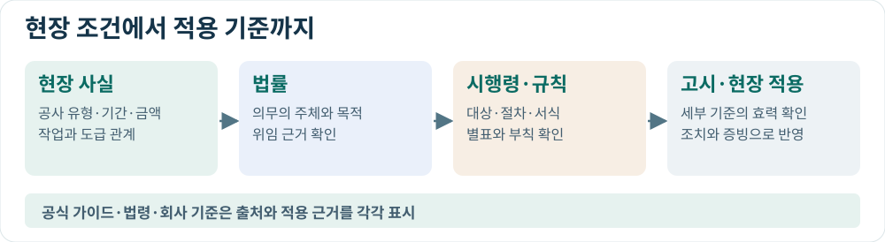

*그림 1. 현장 조건에서 적용 기준까지 · 자체 제작. 법령 제목에서 멈추지 말고 현장 조건에 맞는 조항·별표·부칙까지 찾아갑니다.*

| 구분 | 별내 센터 사례 | 남길 근거 |
| --- | --- | --- |
| 법적 의무 | 추락 위험이 있는 개구부에서 방호 조치를 확인 | 적용 조문, 확인한 날짜, 설치·보완 상태 |
| 공식 가이드 | 작업 전 안전점검회의를 운영하는 방법을 정부 가이드에서 참고 | 기관·가이드명·확인일 |
| 일반 관행 | 매일 아침 진행 중인 여러 작업의 동선을 맞춤 | 현장 일정·일일 조정 기록 |
| 회사·계약 기준 | 특정 화기작업 허가를 해당 회사 절차대로 처리 | 회사 표준 버전·계약 범위·승인 경로 |

법령 원문 페이지의 **시행일**과 개정문 **부칙**을 함께 봅니다. 이미 시작한 공사에 경과조치가 적용되는지, 조항별 시행일이 다른지 확인합니다. 예를 들어 위험성평가 고시의 현행 본문 시행일과 인정심사 개정 별표 적용례의 기준일이 다릅니다. [위험성평가 지침 본문과 부칙](https://www.law.go.kr/LSW/admRulInfoP.do?admRulSeq=2100000288038&chrClsCd=010202&lsId=2052906)

## 2. 산업안전보건법의 목적과 의무 주체

산업안전보건법은 산업재해를 예방하고 작업환경을 개선하기 위한 안전·보건 기준과 책임을 규정합니다. ‘현장에 출입하는 여러 회사 중 누가 조치해야 하는가’는 사업주, 도급인, 관계수급인 및 건설공사발주자의 법적 위치와 사실관계를 확인해야 답할 수 있습니다. [산업안전보건법 제1·2조](https://www.law.go.kr/LSW/lsInfoP.do?ancYnChk=0&chrClsCd=010202&efYd=20261027&lsiSeq=291447&urlMode=lsInfoP)

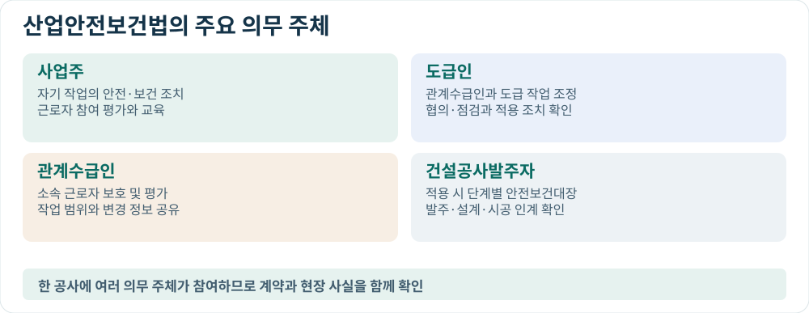

*그림 2. 산업안전보건법의 주요 의무 주체 · 자체 제작. 근로자의 소속과 실제 작업 범위, 도급 구조와 조정 책임을 함께 확인합니다.*

| 대상 | 이 장에서 확인하는 조항과 의무 | 현장·ERP 증빙 예시 |
| --- | --- | --- |
| 사업주 | 제29·31조 교육, 제36조 위험성평가, 제38·39조 안전·보건조치 | 평가·교육, 점검·시정 및 재확인 기록 |
| 도급인 | 제63·64조 도급 과정의 조치와 산업재해 예방 활동. 대상·작업과 행위 범위 확인 | 도급·업체 정보, 협의·순회점검, 작업 조정 및 조치 결과 |
| 관계수급인의 사업주 | 소속 근로자 보호 의무와 현장 도급 운영에 필요한 참여·정보 공유 | 소속 작업조 평가·교육, 접수한 지적사항과 조치 내역 |
| 건설공사발주자 | 제67조 대상 공사의 안전보건대장, 제68조 해당 동시 공사의 조정자 등 | 단계별 대장, 제공·확인 사실, 조정 결과 |
| 사고·급박한 위험의 담당 주체 | 제51·52조 작업중지·대피, 제54조 중대재해 발생 시 조치·보고, 제57조 발생 보고·기록 | 통제·보고·수신 및 재개 판단 자료 |

별내 센터에서 B사 작업조의 운반 통로와 A사 관리 장비 동선이 겹치면, B사는 소속 작업조의 위험을 평가하고 A사는 도급 작업의 조정이 필요한지 확인합니다. 근로자에게 전달한 대책과 교차 지점에 실제 설치한 통제 상태를 함께 남깁니다.

## 3. 산업안전보건법 시행령과 시행규칙

시행령의 인력 기준과 시행규칙의 교육·보고 기준은 업무 성격이 다릅니다. 현장 금액을 확인한 뒤에도 공사의 종류, 관계수급인 포함 여부, 해당 직무와 작업을 각 조문에서 확인합니다.

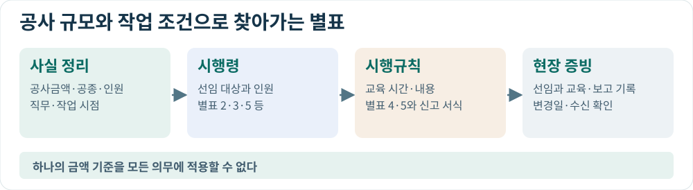

*그림 3. 공사 규모와 작업 조건으로 찾아가는 별표 · 자체 제작. 법률에서 의무를 찾고 시행령과 시행규칙으로 내려가 필요한 별표·서식을 확인합니다.*

| 확인 사항 | 찾을 곳 | 적용 방법과 결과 |
| --- | --- | --- |
| 안전보건관리책임자·안전관리자·보건관리자 | 시행령 제14·16·20조, 별표 2·3·5 | 사업 종류·금액·인원에 맞는 대상과 배치 요건을 확인. 선임·위탁 보고는 시행규칙 제11조와 해당 서식 |
| 안전보건총괄책임자 | 시행령 제52조 | 도급 관련 지정대상 중 건설업은 관계수급인 공사금액을 포함한 해당 공사의 총공사금액 20억 원 이상 기준을 확인 |
| 안전보건교육 | 산업안전보건법 제29·31조, 시행규칙 제26·28조 및 별표 4·5 | 교육 유형별 대상·시간·내용, 해당 면제·특례 여부를 확인 |
| 산업재해조사표 | 시행규칙 제73조제1항 및 별지 제30호서식 | 사망 또는 3일 이상 휴업이 필요한 부상·질병에 해당하는 경우 발생일부터 1개월 이내 관할 지방고용노동관서에 제출. 중대재해 즉시 조치·보고 경로 별도 |

예를 들어 안전관리자 선임 검토에 공사금액을 쓴다고 해서 그 금액을 모든 법정 담당자의 기준으로 복사하면 안 됩니다. 사례별 입력에는 공사금액 산정 범위, 관계수급인 구조, 공종과 공사 기간을 함께 적습니다. [산업안전보건법 시행령과 별표](https://www.law.go.kr/LSW/lsInfoP.do?ancYnChk=0&chrClsCd=010202&efYd=20260801&lsiSeq=288347) · [시행규칙과 별표·서식](https://www.law.go.kr/LSW/lsInfoP.do?ancYnChk=0&chrClsCd=010202&efYd=20260801&lsiSeq=288431) · [산업재해조사표 서식](https://www.law.go.kr/flDownload.do?flSeq=152447827)

## 4. 산업안전보건기준에 관한 규칙

이 규칙은 02장의 위험 감소 대책을 해당 작업의 법정 기준과 잇는 출발점입니다. 일반적인 점검표는 누락을 줄이는 데 쓰며, 구체적인 작업에서 요구하는 조치·성능·확인은 해당 조문과 별표에서 확인합니다.

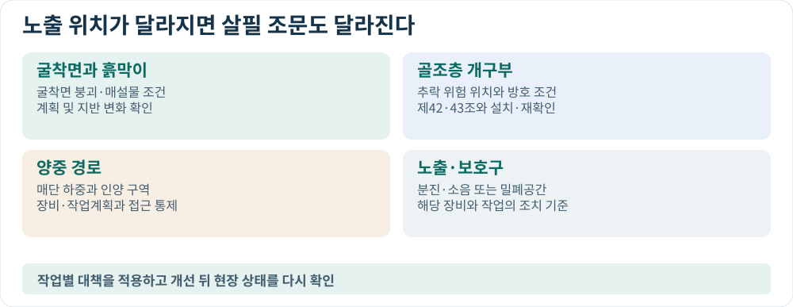

*그림 4. 노출 위치가 달라지면 살필 조문도 달라진다 · 자체 제작. 그림의 작업 조건을 확인하고 필요한 대책과 확인 근거를 하나씩 찾습니다.*

| 작업 상황 | 조항 예시 | 업무와 증빙 |
| --- | --- | --- |
| 개구부·작업발판 끝 | 제13조 난간, 제42·43조 추락·개구부 방호 | 방호 구성과 고정, 접근 통제, 준수 확인 결과 |
| 굴착 또는 차량계 건설기계 등 해당 작업 | 제38조와 별표 4의 사전조사·작업계획서, 작업별 조치 조항 | 계획 적용 여부, 장비·동선·지반 상태, 변경 기록 |
| 양중 | 제38조·별표 4의 해당 중량물 작업과 양중기별 규정 | 계획, 장비·부속·작업구역 및 접근 확인 |
| 작업조건에 맞는 보호구·밀폐공간 | 제32조 및 제619조 등 | 대상 작업, 지급·착용 확인 및 밀폐공간 프로그램과 진입 전 확인 |

예를 들어 B구역 개구부는 덮개를 설치했다는 사진만으로 확인을 끝내지 않습니다. 실제 고정 상태, 적용 기준과 누가 재확인했는지를 기록합니다. [산업안전보건기준에 관한 규칙](https://www.law.go.kr/LSW/lsPdfPrint.do?ancYnChk=0&bylChaChk=N&efGubun=Y&efYd=20260302&joAllCheck=Y&lsiSeq=273603&mokChaChk=N)

## 5. 중대재해처벌법과 안전보건 확보 의무

중대재해 처벌 등에 관한 법률(Serious Accidents Punishment Act)은 사업주·경영책임자등에게 안전·보건 확보 의무를 부과하고 관련 위반에 대한 처벌을 규정합니다. 이 절은 중대산업재해 부분을 다룹니다. 법 제3조는 상시근로자가 5명 미만인 사업 또는 사업장의 사업주와 경영책임자등에게 이 장을 적용하지 않는다고 정합니다. 과거 50억 원 미만 건설공사의 시행 유예와 현행 적용 여부를 구분합니다. [중대재해처벌법 제3~6조 및 부칙](https://www.law.go.kr/LSW/lsInfoP.do?ancYnChk=0&chrClsCd=010202&efYd=20220127&lsiSeq=228817&urlMode=lsInfoP)

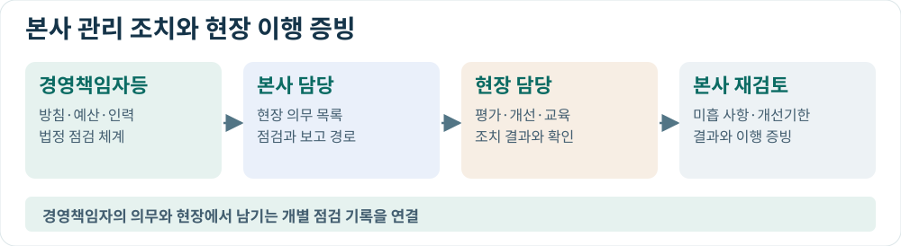

*그림 5. 본사 관리 조치와 현장 이행 증빙 · 자체 제작. 현장의 위험 개선이나 교육 기록은 본사 관리 조치가 실제 이행됐는지 보여 주는 근거입니다.*

- **경영책임자등**은 법 제4조·제5조와 시행령 제4·5조에 따라 인력·예산, 유해·위험요인 개선, 의견 청취, 비상 대응, 도급 기준과 관계 법령 이행 확인을 관리합니다. 제5조의 도급·용역·위탁에는 시설·장비·장소 등에 대한 실질적 지배·운영·관리 책임이라는 적용 조건이 있습니다.
- **현장**은 주기와 확인 항목에 맞춰 근거를 제출합니다. 시행령 제5조는 관계 법령상 의무 이행을 반기 1회 이상 점검하고, 미이행이 확인되면 필요한 조치를 하도록 정합니다. 시행령 제13조의 서면 이행사항 보관 대상은 해당 조문에서 확인합니다.
- **ERP**에서는 의무·기간·담당·근거를 남기고 미흡 사항, 자원 보완, 실제 이행 확인을 연결합니다. 한 번의 결재나 첨부만으로 이행이 입증되는지 판단하지 않습니다. [중대재해처벌법 시행령 제4·5·13조](https://www.law.go.kr/LSW/lsInfoP.do?lsId=014159)

## 6. 건설기술 진흥법상 공사 안전관리

건설기술 진흥법(Construction Technology Promotion Act) 제62조는 해당 건설공사의 안전관리계획과 안전점검을 규정합니다. 시행령 제98조는 해당 시설물, 지하 10 m 이상 굴착 공사, 해당 건설기계 사용 등 적용 요건을 정합니다. 굴착 깊이에는 조문상의 제외 부분이 있으므로 산정 기준을 확인합니다. 시행령 제99·100조 및 시행규칙 제58조는 계획의 내용·서식과 점검 절차를 구체화합니다. [건설기술 진흥법 제62조](https://www.law.go.kr/법령/건설기술진흥법/제62조) · [시행령 제98조](https://law.go.kr/LSW/lsLinkCommonInfo.do?chrClsCd=010202&lsJoLnkSeq=1030331969) · [시행령 제99·100조](https://www.law.go.kr/LSW/lsInfoP.do?ancYnChk=0&chrClsCd=010202&efYd=20260609&lsiSeq=286847) · [시행규칙 제58조](https://www.law.go.kr/법령/건설기술진흥법시행규칙/제58조)

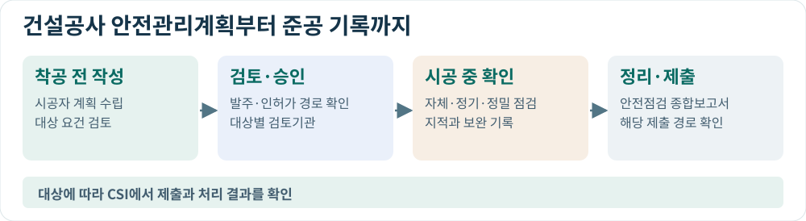

*그림 6. 건설공사 안전관리계획부터 준공 기록까지 · 자체 제작. 대상 공사에서는 착공 전에 계획을 검토·승인받고 시공 중 점검 결과와 후속 조치를 이어서 관리합니다.*

| 단계 | 주체와 시점 | 증빙 |
| --- | --- | --- |
| 계획 수립 | 건설사업자·주택건설등록업자가 대상 공사 여부를 확인하고 착공 전 계획 수립 | 개정본, 공정별 점검 계획, 주변 영향 대책 |
| 검토·승인 | 발주자·인허가기관 등 해당 경로와 검토기관 확인 | 접수·보완 요청, 검토 결과, 승인 또는 확인 기록 |
| 시공 중 점검 | 대상 공사의 시공자는 자체안전점검을 시행하고 정기·정밀 등 기관 점검을 해당 기준에 맞춰 의뢰 | 점검표, 기관 보고서, 지적 개선·재확인 |
| 준공 및 사고 | 해당 안전점검 종합보고서와 사고 통보를 법 제62·67조 및 하위 요건에 따라 관리 | 제출·수신 기록, 종합보고서, 사고 통보 |

ERP에서 내부 검토가 끝난 시점과 건설공사 안전관리 종합정보망(Construction Safety Information System, CSI) 제출 및 수신 시점을 구별합니다. [CSI 안전관리계획서 제출 근거](https://www.csi.go.kr/por/about_smp_002.do)

## 7. 두 가지 안전관리비의 목적과 증빙

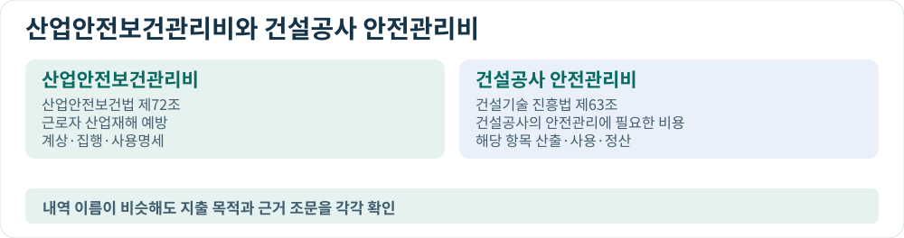

*그림 7. 산업안전보건관리비와 건설공사 안전관리비 · 자체 제작. 같은 현장의 금액이라도 지출 목적과 근거에 따라 확인할 내역과 증빙이 달라집니다.*

| 구분 | 산업안전보건관리비 | 건설공사 안전관리비 |
| --- | --- | --- |
| 근거 | 산업안전보건법 제72조, 시행령 제59·60조, 시행규칙 제89조 및 고용노동부 고시 제2025-11호 | 건설기술 진흥법 제63조, 시행규칙 제60조 등 |
| 목적 | 근로자 산업재해 예방 | 안전관리계획·안전점검, 공사장 주변 안전 등 해당 건설공사의 안전관리 |
| 적용과 계산 | 고시 제3~5조·별표에서 총공사금액 2천만 원 이상을 기본으로 단가계약 적용 방식, 공사 종류·대상액·계상 시기 확인 | 해당 사업·계약에서 정한 법정 항목별 산출 및 반영 |
| 처리와 증빙 | 발주자 등의 계상 자료 인계, 공사도급인 등의 사용, 품목·목적·사용명세·증빙 | 계획·점검 등 해당 항목 산출서, 발주 측 적용·정산 자료 |

예를 들어 B구역에 추락예방시설이 필요할 때, 항목명만 대조하면 어떤 비용에 넣을지 판단하기 어렵습니다. 담당자는 사용 목적·대상·금액과 시행된 고시의 허용·제한·한도, 다른 계약 항목의 처리 여부를 확인합니다. 지출 후 사용명세와 원증빙을 연결해 항목·월·업체별로 대조할 수 있게 합니다. [산업안전보건관리비 고시](https://www.law.go.kr/admRulInfoP.do?admRulSeq=2100000254546) · [고용노동부 해설 및 질의회시집](https://www.moel.go.kr/policy/policydata/view.do?bbs_seq=20250700128) · [건설기술 진흥법 제63조](https://www.law.go.kr/법령/건설기술진흥법/제63조) · [시행규칙 제60조](https://www.law.go.kr/법령/건설기술진흥법시행규칙/제60조)

## 8. 사업장 위험성평가에 관한 지침

제2026-73호는 2026-11-04에 시행됐습니다. 적용 시점, 근로자의 실질적 참여, 평가 결과를 작업 전에 알리는 절차와 도급 사업장의 평가 주체를 확인합니다. 최초·수시·정기·상시 방식 등은 작업 상황에 알맞은 현행 조항으로 판단합니다. 과거 회사 양식의 평가 주기나 항목을 그대로 적용하기 전에 현행 요건과 대조합니다.

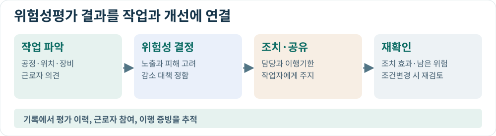

*그림 8. 위험성평가 결과를 작업과 개선에 연결 · 자체 제작. 평가가 끝나면 대책을 작업 전 공유하고 위험이 실제로 줄었는지 확인합니다.*

사업주는 평가 일정을 사전에 알리고, 근로자대표가 참여를 요구하는 경우 법령에 따라 일정·방법·범위를 협의해 참여시킵니다. 신규 채용 또는 작업 대상·내용 변경 시 작업 전에 관련 결과를 공유합니다. 도급인·수급인은 고시 요건에 따라 각각 또는 공동으로 평가할 수 있습니다. 공동 평가에서는 양측의 소속 근로자 참여가 필요합니다. 평가서에 어떤 의견을 수렴했고 어떻게 반영했는지, 개선 후 무엇을 확인했는지 남깁니다. [고용노동부 개편 설명](https://www.moel.go.kr/news/enews/report/enewsView.do?news_seq=20194) · [고시 전문·부칙](https://www.law.go.kr/LSW/admRulLsInfoP.do?admRulSeq=2100000288038)

| 평가 구분 | 고시 제13~16조의 실시 시점 |
| --- | --- |
| 최초평가 | 해당 사업장에서 작업을 시작하기 전에 실시 |
| 정기평가 | 매년 1회 이상 실시 |
| 수시평가 | 새로 발생할 수 있는 위험을 해당 작업 전에 파악·개선. 사고 원인과 법정 중대재해 이후 재검토도 제15조에서 확인 |
| 상시평가 | 최초평가 이후 해당 조건으로 운영. 매월 1회 이상 참여 평가, 매주 결과 논의와 이행 점검, 매 작업일 공유·주지. 새 위험의 우려가 있으면 수시평가 |

시행규칙 제37조의4에 따라 평가 시기·담당, 참여자와 결과 등 해당 자료를 3년간 보존합니다. 고시 제21조는 실시 시기별 개선대책 수립 완료의 다음 날부터 보존 기한을 계산하도록 정합니다. [시행규칙 제37조의4](https://www.law.go.kr/LSW/lsInfoP.do?ancYnChk=0&chrClsCd=010202&efYd=20260801&lsiSeq=288431) · [고시 제13~16·21조 전문](https://www.law.go.kr/LSW/flDownload.do?flSeq=171380057)

## 9. 안전관리계획·유해위험방지계획서·안전보건대장

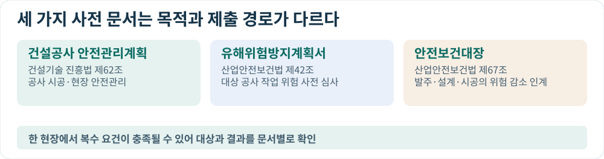

*그림 9. 세 가지 사전 문서는 목적과 제출 경로가 다르다 · 자체 제작. 세 가지 절차는 적용 범위와 책임자가 달라 현장 조건을 문서별로 확인합니다.*

| 문서 | 적용을 판단하는 질문 | 역할과 증빙 |
| --- | --- | --- |
| 안전관리계획 | 건설기술 진흥법 시행령 제98조의 시설·굴착·장비 등 요건에 해당하는가 | 시공자가 계획을 마련하고 발주·인허가 경로에서 검토·승인. 계획과 점검 이행 기록 |
| 유해위험방지계획서 | 산업안전보건법 시행령 제42조제3항의 대상인가. 예를 들어 지상높이 31 m 이상의 해당 건축물·인공구조물인가 | 해당 사업주가 시행규칙 제42조의 착공 전날까지 공단에 제출. 자체심사 대상의 서식은 별도 확인. 접수·심사·이행 확인 기록 |
| 안전보건대장 | 산업안전보건법 제67조와 시행령 제55조의 총공사금액 50억 원 이상 건설공사인가 | 해당 건설공사발주자가 계획 단계의 기본대장을 작성하고 설계·공사대장을 작성하게 하여 확인. 단계별 제공·확인 기록 |

건설기술 진흥법 시행령 제98조제1항에 따라 두 계획을 통합 작성할 수 있는 경우가 있습니다. 통합 문서로 작성하는 경우에도 각각의 적용 기준, 제출·심사와 승인 경로를 확인합니다. [유해위험방지계획서 제출 대상](https://www.law.go.kr/lsLinkCommonInfo.do?chrClsCd=010202&lsJoLnkSeq=1029199425) · [안전보건대장 적용 기준](https://law.go.kr/lsLinkCommonInfo.do?chrClsCd=010202&lspttninfSeq=154203) · [건설공사 안전관리계획 수립 대상](https://law.go.kr/LSW/lsLinkCommonInfo.do?chrClsCd=010202&lsJoLnkSeq=1030331969)

## 10. 위반 시 책임과 제재를 확인하는 법

의무 불이행이 의심되면 먼저 적용 대상, 책임 주체와 누락된 조치를 확인합니다. **행정상 조치**에는 급박한 위험이나 중대재해 상황에서 법령에 따른 작업중지 명령 등이 있습니다. **과태료**는 신고·교육 등 개별 의무의 위반 유형과 시행일을 확인합니다. **형사책임**은 범죄의 구성 요건과 책임을 별도로 판단합니다. 예를 들어 산업안전보건법 제167조의 사망 관련 벌칙은 그 조문이 정한 의무 위반과 결과의 관계를 봅니다. 중대재해처벌법 제6·7조의 사업주·경영책임자등 및 법인 벌칙도 해당 의무·위반과 결과를 법률에 따라 판단합니다. [산업안전보건법 제55·167·175조](https://www.law.go.kr/LSW/lsInfoP.do?ancYnChk=0&chrClsCd=010202&efYd=20261027&lsiSeq=291447&urlMode=lsInfoP) · [중대재해처벌법 제6·7조](https://www.law.go.kr/LSW/lsInfoP.do?ancYnChk=0&chrClsCd=010202&efYd=20220127&lsiSeq=228817&urlMode=lsInfoP)

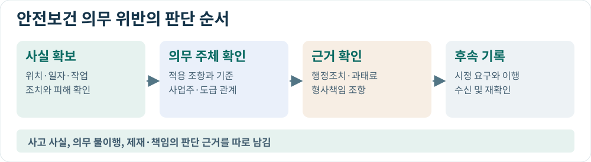

*그림 10. 안전보건 의무 위반의 판단 순서 · 자체 제작. 조치 누락과 사고 사실을 각각 확인하고, 책임을 판단한 조문과 후속 조치 증빙을 남깁니다.*

**시행 시점 사례** — 위험성평가 의무는 현재 적용됩니다. 새 위험성평가 관련 과태료 시행은 고용노동부 안내와 부칙 기준으로 건설업 공사금액 50억 원 이상은 2027-01-01, 50억 원 미만은 2028-01-01부터입니다. ERP의 기준에는 의무 시행, 과태료 시행과 해당 현장 적용을 판단한 근거일을 따로 둡니다. [고용노동부 위험성평가 제도 개편 안내](https://www.moel.go.kr/news/enews/report/enewsView.do?news_seq=20194)

## 11. 공사 조건별 판단과 ERP 증빙

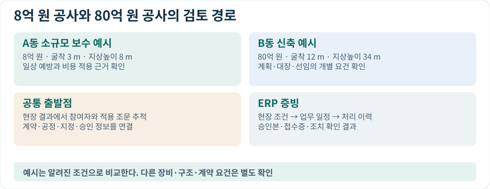

*그림 11. 8억 원 공사와 80억 원 공사의 검토 경로 · 자체 제작. 두 사례의 입력값 차이로 어느 대상 조항을 먼저 확인할지 연습합니다.*

같은 가상 사업의 두 대안입니다. **A**는 총공사금액 8억 원, 지상 8 m, 굴착 3 m의 비토목 소규모 보수 공사로 타워크레인을 사용하지 않습니다. **B**는 총공사금액 80억 원, 지상 34 m, 굴착 12 m의 건축 신축 공사로 타워크레인을 사용합니다. 굴착 깊이와 지상높이는 해당 법령의 산정 기준으로 확인한 값이라고 가정합니다.

| 판단 대상 | A에서 확인할 점 | B에서 확인할 점 | ERP 기록 |
| --- | --- | --- | --- |
| 공사 안전관리계획 | 표의 높이·장비 조건 외에 시설·공법 등 제98조 요건 추가 확인 | 타워크레인 사용이 제98조의 적용 요건. 굴착과 다른 요건도 함께 표시 | 수립 여부·검토 결과·승인본 및 점검 계획 |
| 유해위험방지계획서 | 31 m 높이 조건에는 해당하지 않아 제42조제3항의 다른 요건 확인 | 34 m 건축물로 높이 요건 충족. 시기 및 해당 제출·심사 경로 확인 | 심사 접수·보완 기록과 조치 |
| 안전보건대장 | 확정된 총공사금액은 50억 원 기준 미만 | 확정된 총공사금액은 50억 원 기준 이상 | 기본·설계·공사대장 링크와 발주자 확인 |
| 산업안전보건관리비 | 고시 제3조의 2천만 원 이상 금액 요건을 충족하므로 공사 적용과 계상을 확인 | 금액 요건 충족. 공사 종류·대상액과 시점을 기준으로 계상 검토 | 산정 근거·사용명세·정산 증빙 |
| 도급 예방과 인력 | 계약 관계를 확인하고 사업주·도급인의 적용 조치를 각각 확인 | 제52조와 별표 2·3·5 등 책임자·관리자 요건을 해당 기준대로 각각 확인 | 배치·선임·신고 및 협의·점검 결과 |

사용한 법적 경로는 위 §3·§6·§7·§9의 근거와 같습니다. 현장 정보만으로 적용 전체를 단정하지 않습니다. 공사금액이 바뀌면 변경된 날짜·계약 범위를 기록하고 영향을 받는 기준을 다시 평가합니다. **법령 → 의무 주체 → 착공·작업 등 이행 시점 → ERP의 할 일 → 완료 근거** 순서로 표 한 줄을 만들면 담당자와 증빙을 찾을 수 있습니다. [산업안전보건관리비 고시 전문](https://www.law.go.kr/flDownload.do?flSeq=149050349) · [산업안전보건법 시행령](https://www.law.go.kr/LSW/lsInfoP.do?ancYnChk=0&chrClsCd=010202&efYd=20260801&lsiSeq=288347)

## 핵심 요약

- 의무 주체, 공사 조건, 시행일, 별표와 서식은 한 묶음으로 확인합니다.
- 안전관리계획·유해위험방지계획서·안전보건대장과 두 종류의 안전관리비는 각각의 대상과 근거가 있습니다.
- 시공 전 심사·승인, 시공 중 이행, 대외 제출·수신은 서로 다른 사실입니다. 각 사실을 뒷받침하는 기록을 연결합니다.

## 학습 확인 문제

1. 대상 공사의 안전관리자 선임을 확인할 때 어느 법령의 어느 부분이 필요합니까?
2. B안의 타워크레인과 건축물 높이 34 m는 어느 두 문서의 요건과 연결됩니까?
3. 80억 원 공사의 안전보건대장은 어느 주체가 어느 단계에서 맡습니까?
4. 사업장 위험성평가의 의무가 있는지와 새 과태료가 이미 시행됐는지를 구별해 설명하세요.
5. 발주 측과 내부 ERP에서 안전관리계획 문서가 조회됩니다. 대외 절차 종료를 확인하려면 어떤 증빙이 더 필요합니까?
6. 단순히 안전관리비라는 항목명만 보면 착오가 생기는 이유는 무엇입니까?

## 정답 및 해설

1. 산업안전보건법 제17조와 시행령 제16조·별표 3에서 대상과 인원을 확인합니다. 자격·보고의 절차와 서식은 관련 시행령 및 시행규칙 조문과 별지를 확인합니다.
2. 타워크레인 사용은 건설기술 진흥법 시행령 제98조의 안전관리계획에 연결됩니다. 지상높이 34 m는 산업안전보건법 시행령 제42조제3항의 유해위험방지계획서 높이 요건에 연결됩니다.
3. 해당 건설공사발주자는 계획 단계에서 기본대장을 작성하고 설계 단계에서 설계자가, 시공 단계에서 최초 수급인이 해당 대장을 작성하게 하여 확인합니다. 제공·확인과 이행의 기록을 남깁니다.
4. 제36조 평가 의무는 기준일에 이미 적용됩니다. 개편 과태료의 단계 시행일은 건설업 공사금액을 기준으로 별도 확인합니다.
5. 제출 대상과 경로, 접수 시각·문서 버전, 검토 결과, 보완 여부와 최종 수신 확인이 필요합니다. 문서가 내부 결재됐다는 사실과 대외 접수 여부를 따로 확인합니다.
6. 근로자 산업재해 예방과 건설공사 자체의 안전관리라는 목적 및 인정 항목과 정산 근거가 다르기 때문입니다.

## 법령과 공식 자료

기준일의 현행본입니다. 개별 조항의 적용례와 시행 예정 내용은 원문 부칙을 함께 확인합니다.

| 원문 또는 기관 자료 | 원문 시행·확인 정보 | 확인 범위 |
| --- | --- | --- |
| [산업안전보건법](https://www.law.go.kr/LSW/lsInfoP.do?ancYnChk=0&chrClsCd=010202&efYd=20261027&lsiSeq=291447&urlMode=lsInfoP) | 시행 2026-10-27 | 주체, 평가·조치·교육, 도급, 대장·비용 및 벌칙 |
| [시행령](https://www.law.go.kr/LSW/lsInfoP.do?ancYnChk=0&chrClsCd=010202&efYd=20260801&lsiSeq=288347) · [시행규칙](https://www.law.go.kr/LSW/lsInfoP.do?ancYnChk=0&chrClsCd=010202&efYd=20260801&lsiSeq=288431) | 각 시행 2026-08-01 | 별표·대상·보고서·교육 |
| [산업안전보건기준에 관한 규칙](https://www.law.go.kr/LSW/lsPdfPrint.do?ancYnChk=0&bylChaChk=N&efGubun=Y&efYd=20260302&joAllCheck=Y&joEfOutPutYn=on&lsiSeq=273603&mokChaChk=N) | 시행 2026-03-02 | 작업 안전·보건조치 |
| [중대재해처벌법](https://www.law.go.kr/LSW/lsInfoP.do?ancYnChk=0&chrClsCd=010202&efYd=20220127&lsiSeq=228817&urlMode=lsInfoP) · [시행령](https://www.law.go.kr/LSW/lsInfoP.do?lsId=014159) | 각각 시행 2022-01-27·2025-10-01 | 적용, 경영책임자등, 이행점검과 보관 |
| [건설기술 진흥법](https://www.law.go.kr/법령/건설기술진흥법) · [시행령](https://www.law.go.kr/LSW/lsInfoP.do?ancYnChk=0&chrClsCd=010202&efYd=20260609&lsiSeq=286847) · [시행규칙](https://www.law.go.kr/LSW/lsInfoP.do?ancYnChk=0&chrClsCd=010202&efYd=20260611&lsiSeq=286885) | 각각 시행 2025-10-01·2026-06-09·2026-06-11 | 안전관리계획, 점검, 안전관리비, 사고 통보 |
| [산업안전보건관리비 고시 제2025-11호](https://www.law.go.kr/admRulInfoP.do?admRulSeq=2100000254546) | 시행 2025-02-12. 개정 항목별 시행·적용례 별도 | 공사 적용, 계상·사용·확인 |
| [위험성평가 고시 제2026-73호](https://www.law.go.kr/LSW/admRulLsInfoP.do?admRulSeq=2100000288038) | 시행 2026-11-04. 인정심사 적용례 별도 | 평가 방법과 시기, 참여, 공유 및 기록 |
