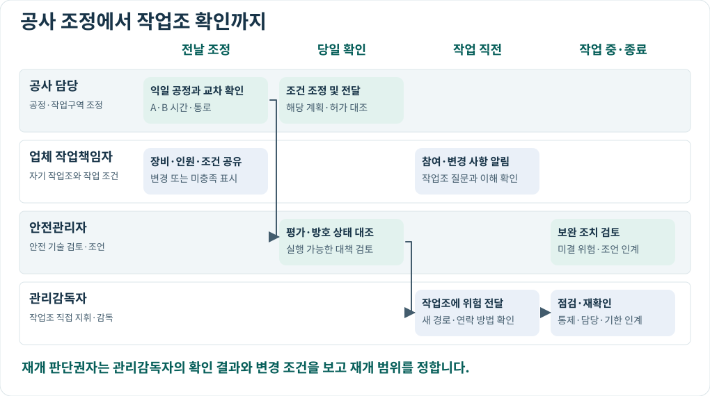
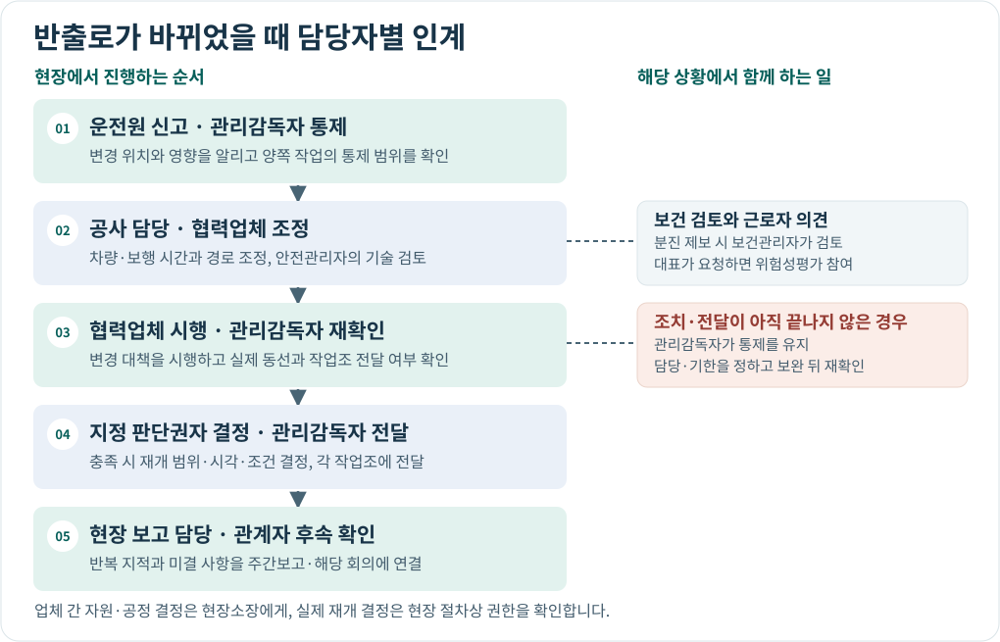

# 04-1. 현업 안전관리 업무 흐름

[교재 안내](./README.md) · [04장 안전관리 업무 프로세스](./04_안전관리_업무_프로세스.md) · [담당자별 업무 순서](#6-담당자별로-하는-일과-처리-순서) · [05장 ERP 모듈 및 기능](./05_건설안전_ERP_모듈_및_기능.md)

이 절은 **현장에서 누가 각 단계를 맡고, 왜 그 역할이 필요하며, 어떻게 판단하고 인계하는지** 설명합니다. 현장·본사 운영 자료에 있는 위험성평가, 일일점검, 작업계획서, 작업허가서, 주간업무보고와 산업안전보건관리비 항목을 한 작업의 흐름에 연결했습니다. 시간과 사건은 04장의 가상 **별내 생활문화센터**를 사용한 학습 예시입니다. 작성·검토·결재 역할은 실제 현장의 업무분장과 지정 권한을 확인합니다. [현업 자료와 공식 근거](#현업-자료와-공식-근거)

## 1. 전날 작업 조정부터 월말까지

A구역에서는 굴착한 흙을 차량으로 반출하고, B구역에서는 철근을 배근합니다. 두 구역의 작업 장소는 떨어져 있어도 작업자가 드나드는 길과 차량 반출로는 공용 진입로에서 만납니다. 이 때문에 각 업체가 자기 작업만 확인하면 놓치는 위험이 생깁니다.

*그림 1. 전날 작업 조정에서 월말까지 · 자체 제작. 당일 조건이 바뀌면 영향받는 작업의 사전 확인으로 돌아갑니다.*

| 언제 | 누가 맡는가 | 왜 하는가 | 현장에서 어떻게 하고 무엇을 남기는가 |
| --- | --- | --- | --- |
| 전날 오후 | 공사 담당이 조정하고 A·B업체 작업책임자가 예정 정보를 냅니다. | 각 업체 일정표를 따로 보면 공용 진입로에서 차량과 사람이 만나는 시간을 놓칠 수 있습니다. | 반출 예정 시간과 B구역 자재 운반 시간을 도면과 일정표에 함께 표시합니다. 겹치는 구간과 시간, 합의한 대책, 당일 확인할 사람을 작업 예정표에 남깁니다. |
| 당일 작업 전 | 각 작업의 관리감독자가 자기 작업과 출입 상태를 확인합니다. 업체 책임자가 실제 투입 정보를 대고, 안전관리자가 대책 검토를 지원합니다. | 밤사이 달라진 인원·장비·통로에도 전날 대책이 적용되는지 판단해야 합니다. | 관리감독자가 업체 책임자와 진입로를 걸으며 실제 투입 장비·작업조와 방호·출입 상태를 확인합니다. 적용할 평가·계획과 해당하는 허가 조건을 대조하고 차이가 있으면 영향받는 작업을 보류해 확인합니다. |
| 작업 직전 | 관리감독자 또는 지정 진행자가 작업 전 안전점검회의(Tool Box Meeting, TBM)를 진행합니다. 운전원과 작업자가 실제 이동 절차를 확인합니다. | 아침에 정한 조건이 안전하려면 운전원과 작업자가 같은 통로·통제 기준을 이해해야 합니다. | 도면에서 차량·보행 구간을 가리키고, 경로가 바뀌면 어디서 멈춰 누구에게 알릴지 각 작업조에 물어봅니다. 질문과 답, 적용한 대책, 추가 확인이 필요한 내용을 남깁니다. |
| 작업 중 | 변경 발견자가 알리고, 관리감독자가 담당 작업을 통제합니다. 공사 담당은 같은 길을 쓰는 업체를 조정합니다. | 첫 작업조만 알고 있으면 다른 작업조가 종전 조건으로 진입할 수 있습니다. | 변경 위치·시각·영향 작업을 알리고 통제 범위를 정합니다. 점검자는 현장의 통제 상태를 확인하고 담당·기한·현재 상태를 점검일지에 남깁니다. |
| 작업 후 | 조치 담당자가 결과를 내고, 지정 확인자가 이행 여부를 확인합니다. 관리감독자가 다음 작업조에 미결 사항을 인계합니다. | 교대 뒤에 미결 사항을 놓치면 다음 작업조가 통제 구간을 그대로 사용할 수 있습니다. | 현장 확인 결과·시각과 미결 항목의 통제 상태를 남깁니다. 다음 담당자는 인계받은 구간·제한 사항·재확인 시점을 확인합니다. |
| 주간·월간 | 현장 보고 담당이 원기록을 모으고, 현장 검토자와 본사 담당이 맡은 항목을 확인합니다. | 반복된 간섭과 미결 조치를 다음 공정에 반영하고 보고 수치의 근거를 찾을 수 있어야 합니다. | 일일 기록을 차주 작업·관리계획에 연결합니다. 월별로 해당 현장·기간의 실적과 실제 집행 증빙을 대조하고, 미결 건을 맡을 사람을 확인합니다. |

## 2. 현장에서 누가 맡고 어디까지 판단하는가

*그림 2. 담당자별 인계 · 자체 제작. 현장 역할을 기준으로 공정 조정, 작업조 확인, 안전 기술 검토, 직접 작업 지휘를 연결했습니다.*

| 역할 | 왜 맡는가 | 별내 사례에서 어떻게 하는가 |
| --- | --- | --- |
| 원청 공사 담당 | 두 업체의 공정과 공용 공간을 함께 조정할 수 있습니다. | A업체 반출 예정과 B업체 자재 운반 일정을 한 도면에 겹쳐 봅니다. 충돌하면 양쪽 책임자와 시간·경로를 다시 정하고 관리감독자에게 변경안을 전달합니다. |
| 협력업체 작업책임자 | 실제 들어오는 운전원·장비·작업조와 당일 변경을 파악합니다. | 전날 예정과 실제 투입이 다르면 공사 담당과 자기 작업의 관리감독자에게 알립니다. 자기 작업조에 적용 조건과 변경 연락처를 전달합니다. |
| 관리감독자 | 맡은 작업과 소속 근로자를 직접 지휘·감독합니다. | 업체 책임자와 현장을 확인하고 TBM에서 운전원·작업자가 조치 내용을 이해했는지 확인합니다. 조건이 맞지 않으면 담당 작업을 보류하거나 통제하고, 바뀐 범위와 재확인 결과를 기록합니다. |
| 선임된 안전관리자 | 안전 기술 사항에서 사업주 또는 안전보건관리책임자를 보좌하고 관리감독자에게 지도·조언합니다. | 교차점의 시야, 차량·보행 분리, 출입 통제의 실효성을 검토합니다. 보완이 필요한 지점을 공사 담당과 관리감독자에게 설명하고 현장 확인을 지원합니다. |
| 운전원·작업자 | 실제로 이동하거나 작업하면서 도면과 현장 상태의 차이를 먼저 발견할 수 있습니다. | 차량 대기 위치, 작업자 이동 경로, 변경 연락 대상을 TBM에서 자기 말로 확인합니다. 정한 조건이 달라지면 해당 작업의 관리감독자에게 알립니다. |
| 현장 절차상 재개 판단권자 | 바뀐 조건에서 어느 작업을 언제부터 할 수 있는지 현장 권한에 따라 결정합니다. | 관리감독자의 현장 재확인 결과, 기술 검토와 해당 문서의 변경·승인 상태를 보고 재개 범위와 조건을 정합니다. 관리감독자가 관계 작업조에 전달합니다. |

이 장에서 ‘공사 담당’과 ‘업체 작업책임자’는 사례의 업무분장을, ‘관리감독자’와 ‘안전관리자’는 법령상의 역할을 가리킵니다. 실제 현장에서는 각 작업의 관리감독자 지정과 내부 판단 권한을 먼저 확인합니다. [산업안전보건법 제16·17조](https://www.law.go.kr/LSW/lsInfoP.do?lsId=001766)

착수 직전에는 **공사 담당이 조정한 작업 범위**, **관리감독자가 확인한 실제 조건**, **작업조가 이해한 이동·연락 방법**이 맞아야 합니다. 적용되는 작업계획서·작업허가서와 필요한 자격·교육을 확인합니다. 예를 들어 운전원이 전달받은 대기 위치가 관리감독자가 확인한 위치와 다르면, 해당 차량의 진입 조건을 정리하고 작업조에 다시 전달한 뒤 확인합니다. 위험성평가의 실시 시점과 근로자 참여·공유는 현행 지침을 확인합니다. [위험성평가 지침](https://www.law.go.kr/LSW/admRulLsInfoP.do?admRulSeq=2100000288038) · [고용노동부 건설현장 TBM 실천 가이드](https://moel.go.kr/local/busanbukbu/news/notice/noticeView.do?bbs_seq=20230302066)

## 3. 작업 중 반출 경로가 바뀌면

**10:20,** A구역 반출차 운전원이 기존 출구를 쓸 수 없어 공용 진입로로 돌아가야 한다고 알립니다. 같은 시간에 B구역 작업자들은 그 진입로를 거쳐 철근을 옮길 예정입니다. 아래 시각은 각 단계의 흐름을 보여 주는 예시입니다.

*그림 3. 공용 진입로 변경 전후 · 자체 제작. 왼쪽의 교차 구간을 통제한 뒤 오른쪽처럼 해당 현장에 맞는 경로·시간·교차점 대책의 이행을 확인합니다.*

| 시각 예시 | 누가 무엇을 하는가 | 왜 이 순서로 하는가 | 어떻게 확인하고 기록하는가 |
| --- | --- | --- | --- |
| 10:20 변경 신고·초기 통제 | A구역 운전원이 자기 관리감독자에게 알립니다. A·B구역 관리감독자가 각각 담당 작업의 영향 범위를 통제하고 공사 담당이 양쪽에 변경을 전파합니다. | 대책을 정하는 동안에도 차량과 작업자가 동시에 들어올 수 있습니다. | 기존 출구와 변경 예정 구간을 알립니다. 예시에서는 반출차를 지정 대기 위치에 대기시키고 B구역 자재 운반조의 해당 통로 진입을 보류합니다. 최초 신고자·시각·통제 구간을 남깁니다. |
| 10:35 대책 재검토·시행 | 공사 담당이 양쪽 업체 책임자를 불러 시간·통로를 조정합니다. 운전원과 작업자가 사각지대와 실제 이동 경로를 알리고, 안전관리자가 조치의 적정성을 검토합니다. 각 업체가 담당 조치를 시행합니다. | 시간표와 도면에서 분리해도 현장에서 진입이 겹치거나 경로가 이어지지 않으면 위험이 남습니다. | 교차점을 함께 확인하고 보행 통로, 반출 시간, 출입 통제 위치를 다시 정합니다. 변경 내용을 위험성평가 개정본(RA-A-014)에 남기고 해당 작업계획과 허가 조건도 확인·반영한 뒤 양쪽 작업조에 전달합니다. |
| 10:50 재확인·재개 판단 | 각 관리감독자가 자기 작업의 현장 상태와 작업조 이해를 재확인합니다. 현장 절차상 판단권자가 확인 결과를 받아 재개 범위·조건을 정합니다. | 설치된 조치가 실제로 작동하고 양쪽 작업조가 새 경로를 알아야 정한 조건으로 재개할 수 있습니다. | 관리감독자가 현장에서 차량·보행 경로의 분리 상태와 출입 통제 상태를 대조합니다. 운전원과 B구역 작업자에게 새 시간·통로를 확인합니다. 조건이 충족되면 판단권자가 시각·범위·조건을 남기고, 양쪽 관리감독자가 각 작업조에 알립니다. |
| 종료 전 인계 | 조치 담당자가 이행 근거를 제출하고 각 관리감독자가 다음 작업조에 남은 통제와 확인 사항을 넘깁니다. | 같은 진입로를 쓰는 다음 작업조도 새 조건을 알아야 이전 경로 사용을 막을 수 있습니다. | 원기록에 확인자·시각, 유지할 통제와 다음 확인 시점을 남깁니다. 관리감독자는 다음 근무조가 맡을 구간과 확인 담당을 지정합니다. |

*그림 4. 변경 후 통제와 재개 판단 · 자체 제작. 조치하는 사람, 현장에서 확인하는 사람, 재개 범위와 조건을 결정하는 사람의 역할을 표시했습니다.*

**재확인에서 막히는 예.** B구역 자재 운반조 일부가 새 경로를 듣지 못했습니다. 관리감독자는 해당 통로의 통제를 유지하고, 전달할 작업조·담당자·재확인 시점을 남깁니다. 작업조가 새 경로를 확인하면 관리감독자가 결과를 기록하고 판단권자에게 다시 올립니다.

**급박한 위험·작업중지 명령이 있는 경우.** 급박한 위험에서는 즉시 작업중지·대피 등 법령에 따른 조치를 하고, 근로자의 중지·대피와 보고도 법령에 따릅니다. 행정기관의 작업중지 명령이 적용되면 법정 해제 절차를 따릅니다. [산업안전보건법 제51·52·55조](https://www.law.go.kr/LSW/lsInfoP.do?lsId=001766) · [03장 법령과 공식 자료](./03_건설안전_관련_법령.md#법령과-공식-자료)

## 4. 일일 기록이 주간보고와 월말까지 이어지는 순서

확인한 현장 주간보고 빈양식에는 공정률·재해건수·주요 진행 공종·계상 안전관리비·교육·안전활동과, 작업별 **업체명·공종·작업 예정일·투입인원·작업 내용·안전 관리계획** 항목이 있습니다. 본사 자료에는 주간업무보고와 분기 안전점검 실적 보고 항목이 있습니다.

*그림 5. 일일·주간·월간 인계 · 자체 제작. 보고에서 발견한 미결·지원 필요 사항을 다음 작업 확인으로 돌려보냅니다.*

| 단계 | 누가 맡는가 | 왜 하는가 | 어떻게 확인하고 보고하는가 |
| --- | --- | --- | --- |
| 당일 기록 정리 | 각 관리감독자가 자기 작업의 변경·통제·재확인 결과를 확인합니다. 점검 담당이 원기록을 정리합니다. | 교대 뒤에도 현재 유효한 작업 조건과 미결 사항을 확인할 수 있어야 합니다. | 최초 신고, 통제, 대책 시행, 현장 재확인, 재개 판단을 실제 시각과 담당자별로 남깁니다. 통제 중인 항목에는 다음 확인 시각을 적습니다. |
| 주간 현장 보고 | 현장 보고 담당이 점검 기록을 모읍니다. 공사 담당은 차주 일정, 관리감독자는 조치가 실제로 끝났는지, 지정 검토자는 지원·이월 사항을 확인합니다. | 같은 진입로를 쓰는 작업이 반복되면 이번 주에 확인한 대책을 차주 일정에 반영해야 합니다. | A구역 반출 날짜·업체·인원과 B구역 자재 운반 일정을 대조합니다. 차주 보고서에 공용 진입로의 통제 계획과 확인 담당을 적고, 미결은 원기록 번호로 연결합니다. |
| 월별 정리 및 본사 확인 | 현장 담당이 기간별 실적과 증빙을 모으고 본사 담당이 해당 업무 기준으로 확인합니다. | 여러 현장의 수치가 같은 기준으로 집계됐는지, 이월 조치를 어느 현장과 담당자가 이어서 할지 확인합니다. | 보고 집계에서 일일·주간의 원기록과 미결 이력을 찾아 대조합니다. 비용이 발생한 건은 적용 산업안전보건관리비의 항목과 거래·사용 증빙을 연결합니다. |

이 사례에서는 기존 차단시설을 재배치해 새 비용이 발생하지 않았다고 가정합니다. 주간보고에는 경로 변경과 조치 이력을 연결하고, 월별 비용 확인에서는 해당 건의 추가 집행 여부를 실제 지출 기록으로 확인합니다.

## 5. 담당자와 기록을 바꿔 가며 한 건을 추적하기

| 기록 예시 | 확인할 사실 | 연결할 다음 기록 |
| --- | --- | --- |
| 당일 작업 예정·조정표 | A구역의 반출 장비와 B구역 작업조가 사용하는 구역·시간 | 최초 및 변경 위험성평가 |
| 위험성평가 RA-A-014 | 교차 지점의 위험, 의견, 대책·담당·기한과 적용한 버전 | 작업계획·해당 허가, 작업 전 전달 |
| TBM·작업 전 전달 | 누구에게 어느 버전의 대책을 언제 알렸는지 | 현장 점검과 조건 변경 통보 |
| 점검·시정·재확인 | 변경을 확인한 시각과 장소, 통제·대책, 지정 확인자의 결과 | 주간보고의 실적·미결과 차주 확인 |
| 주간 업무 및 월별 정리 | 차주 공종·예정일·투입인원과 안전관리계획, 미결 또는 비용 증빙 | 다음 주 공사 일정과 위험 검토 |

**ERP에서 담당자와 판단 근거를 확인하는 순서** — 현장과 작업일·구역·업체로 당일 작업을 찾습니다. 이어서 적용 작업과 위험성평가 개정본, TBM 기록, 점검·시정·재확인을 각각 찾습니다. 변경 신고자, 조치 담당자, 현장 확인자, 재개 판단자를 찾고 각각의 시각과 근거를 대조합니다. 예를 들어 RA-A-014가 개정된 시각과 양쪽 작업조에 새 경로를 알린 시각, 현장 재확인 및 재개 판단 시각을 각각 확인합니다. 요약 보고에서 해당 원기록을 찾을 수 있게 연결합니다. 메뉴·상태 이름은 적용 화면과 역할에 따라 확인합니다. [05장 ERP 모듈 및 기능](./05_건설안전_ERP_모듈_및_기능.md)

## 6. 담당자별로 하는 일과 처리 순서

현장 업무분장표의 건축·토목·기계·전기 등 공종별 관리감독자, 협력업체 소장, 안전·보건 인력을 기준으로 업무를 풀었습니다. 아래 순서는 별내 생활문화센터 사례에 적용한 예입니다. 현장에 적용할 때는 각 역할의 **소속, 담당 작업, 법정 선임·지정 여부, 내부 권한**을 확인합니다. 한 사람이 현장소장과 안전보건관리책임자 등 여러 역할을 맡으면 기록에 어느 권한으로 판단했는지 표시합니다. [현업 자료와 공식 근거](#현업-자료와-공식-근거)

### 6.1 현장소장, 안전보건관리책임자, 안전보건총괄책임자

**현장소장**은 현장 전체 공정과 인원·장비·예산을 움직여 결정된 대책을 실행할 수 있게 합니다. 업무분장표 예시에는 현장소장이 안전보건총괄책임자로 표시되어 있습니다. 실제 현장에서는 선임·지정 근거와 직무를 확인합니다.

1. 공사 담당에게서 다음 공정과 공용 공간 사용 계획을, 안전·보건관리자에게서 주요 위험과 필요한 지원을 받습니다.
2. 현장 부서가 조정할 수 있는 범위를 정합니다. 반출 시간 변경처럼 여러 공정과 자원이 걸린 건은 현장소장이 공사·장비·통제 인력 배치를 결정하고, 큰 추가 비용이나 공기 영향은 본사와 협의합니다.
3. 공사 담당에게 변경 일정을, 각 관리감독자에게 적용 범위와 현장 확인 담당을 전달합니다. 현장소장이 재개 판단권자로 정해져 있으면 확인 결과를 받은 뒤 재개 범위·조건을 기록합니다.
4. 주간회의에서 반복 지적과 기한을 넘긴 조치를 보고받아 지원 담당과 처리 시점을 정합니다. **남기는 기록**은 공정·자원 결정, 지시 대상, 이행 기한과 확인 결과입니다.

**안전보건관리책임자**는 적용 사업장에서 재해예방계획과 현장의 안전보건관리 업무를 총괄하고 안전관리자·보건관리자를 지휘·감독합니다.

1. 공정 계획을 받아 위험성평가, 교육, 점검, 작업환경·건강관리에 관한 계획과 담당을 정리합니다.
2. 안전·보건관리자의 기술 의견과 관리감독자의 현장 결과를 받아 필요한 조치와 지원을 정합니다.
3. 조치 담당에게 결과를 받고 미결 사유를 확인합니다. 반복 위험은 다음 예방계획·교육에 반영합니다. **남기는 기록**은 담당별 계획, 조치 지시, 이행·미결 검토 결과입니다.

**안전보건총괄책임자**는 도급인이 지정해야 하는 현장에서 도급인과 관계수급인 근로자의 재해예방 업무를 함께 관리합니다.

1. 공용 진입로와 같은 혼재 구간, 관계수급인별 작업 범위, 보고·연락 담당을 파악합니다.
2. 양쪽 업체가 함께 지켜야 할 통제 조건을 정리하고, 위험성평가와 도급인 예방조치가 조정된 범위에 반영됐는지 확인합니다. 법령상 작업중지 직무 및 관계수급인 간 산업안전보건관리비 사용 협의·집행 감독도 해당 범위에서 수행합니다.
3. 각 업체의 조치와 미결을 받고 공통 조건이 현장에 적용됐는지 확인합니다. **남기는 기록**은 업체 간 조정, 협의 사항, 이행·통보 이력입니다. [산업안전보건법 제15·51·62·64조](https://www.law.go.kr/LSW/lsInfoP.do?lsId=001766) · [산업안전보건법 시행령 제14·52·53조](https://www.law.go.kr/LSW/lsInfoP.do?lsiSeq=288347&efYd=20260801)

### 6.2 안전관리자

안전에 관한 기술 사항을 사업주 또는 안전보건관리책임자에게 보좌하고 관리감독자에게 지도·조언합니다. 작업 현장과 평가 내용을 대조해 **어떤 위험이 남아 있고 대책이 어떻게 작동해야 하는지** 설명합니다.

1. 공사 담당에게서 공정·장비·작업구역 정보를 받고, 관리감독자와 업체 책임자에게 실제 작업방법과 변경 정보를 확인합니다.
2. 위험성평가를 지원합니다. 반출 경로·교차 지점·사각지대를 보고 필요한 출입 통제, 동선 분리, 작업계획 관련 보완을 제안합니다.
3. 순회점검으로 조치 적용 상태를 확인합니다. 언제 어디에서 어떤 위험이 남았는지 기록해 관리감독자와 조치 담당에게 전달하고, 현장 지원이 필요하면 책임자에게 보고합니다.
4. 변경 뒤에는 관리감독자와 현장을 확인하고 남은 위험을 알려 줍니다. 비슷한 지적이 반복되면 평가표·교육 자료·다음 점검 항목에 반영하도록 지원합니다. **남기는 기록**은 기술 검토 의견, 지적·개선 건의, 이행 확인 근거입니다. [산업안전보건법 제17·20조](https://www.law.go.kr/LSW/lsInfoP.do?lsId=001766) · [산업안전보건법 시행령 제18조](https://www.law.go.kr/lsLinkCommonInfo.do?lsJoLnkSeq=1034168707)

### 6.3 관리감독자

맡은 작업과 소속 근로자를 직접 지휘·감독합니다. 예시에서는 A구역과 B구역의 관리감독자가 각자의 작업을 확인하고 공용 진입로 문제를 공사 담당에게 함께 알립니다.

1. **작업 전** 실제 인원·장비·기구, 보호구, 작업구역과 통제 상태를 확인합니다. 위험성평가에서 해당 작업의 위험요인 파악과 개선대책 시행에 참여합니다.
2. **착수 직전** 작업조에게 작업 범위, 이동 경로, 변경 때의 연락 방법을 전달합니다. 작업자가 자기 이동 경로와 대기 위치를 설명할 수 있는지 확인합니다.
3. **작업 중** 설비 이상, 동선 변경, 위험 신고를 받으면 담당 작업을 확인합니다. 상황에 따라 통제하거나 대피·보고 절차를 진행하고, 공용 구역에 영향이 있으면 공사 담당과 상대 구역 관리감독자에게 알립니다.
4. **변경·종료 후** 시설 배치와 작업조 전달 상태를 현장에서 다시 확인합니다. 지정 판단권자에게 결과를 넘기고 시정 미결과 통제 상태를 다음 작업조에 인계합니다. **남기는 기록**은 작업 전 확인, TBM, 변경·통제 시각 및 현장 재확인 결과입니다. [산업안전보건법 제16·51·52조](https://www.law.go.kr/LSW/lsInfoP.do?lsId=001766) · [산업안전보건법 시행령 제15조](https://www.law.go.kr/LSW/lsSideInfoP.do?docCls=jo&joBrNo=00&joNo=0015&lsiSeq=288347&urlMode=lsScJoRltInfoR)

### 6.4 보건관리자

소음·분진·화학물질·온열 등 건강 유해요인을 파악하고 관리감독자에게 작업환경 개선을 지도·조언합니다. 반출로 변경으로 분진이 배근조 휴게·이동 구간에 닿을 우려가 생겼다면 차량 접촉 위험과 함께 검토합니다.

1. 공정표, 취급 물질과 물질안전보건자료(MSDS), 작업자 의견, 과거 작업환경측정 결과를 모아 노출이 달라지는 작업과 인원을 찾습니다.
2. 현장 확인 결과를 토대로 발생원 관리, 작업 위치·시간 조정 등 대책을 검토합니다. 작업환경측정이나 건강진단은 해당 요건을 확인해 사업주의 실시 계획을 지원하고, 필요한 자격을 갖춘 수행자나 지정 기관과 일정을 조정합니다.
3. 관리감독자와 업체 책임자에게 개선할 위치·작업 조건과 전달 내용을 알립니다. 예를 들어 분진이 늘어난 보행 구간의 작업 위치 조정이나 발생원 관리를 제안하고 현장 개선 여부를 확인합니다.
4. 관리 조치 뒤 작업환경과 필요 시 측정 결과를 확인하고 후속 조치를 추적합니다. 회의·주간보고에는 공종·유해인자·개선 상태를 올리고, 개인 건강진단 결과에는 법령상 공개·사용 제한을 적용합니다. **남기는 기록**은 유해인자 목록, 측정 실시 현황, 개선·후속 확인 결과입니다. [산업안전보건법 제18·125·132·135조](https://www.law.go.kr/LSW/lsInfoP.do?lsId=001766) · [산업안전보건법 시행령 제22조](https://www.law.go.kr/lsLawLinkInfo.do?chrClsCd=010202&lsJoLnkSeq=900384121)

### 6.5 근로자대표

산업안전보건법상 근로자대표는 과반수 노동조합이 있으면 그 노동조합, 없으면 근로자 과반수를 대표하는 자입니다. 예시의 작업조 책임자와는 별개의 역할로, 대표하는 근로자의 의견을 평가와 회의에 전달하고 처리 결과를 확인합니다.

1. 작업자에게서 반복되는 통행 문제, 실제 보호조치의 불편, 보건 유해요인과 같은 의견을 모읍니다. 장소·작업·발생 시점과 영향을 정리합니다.
2. 위험성평가에 참여하려는 경우 사업주에게 요청합니다. 사업주는 요청이 있으면 근로자대표를 참여시키고, 작업을 수행하는 근로자의 평가 참여도 적용 법령에 따라 진행합니다.
3. 평가나 해당 회의에서 현장 사례와 개선안을 제시합니다. 예를 들어 우회 통로가 자재 운반 동선과 다시 겹친다는 제보를 전달하고 처리 결과와 확인 기한을 확인합니다.
4. 해당 위원회·협의체 회의 결과와 조치 진행 상황을 대표하는 근로자와 공유합니다. 작업환경측정·건강진단에서 법령에 따른 참석이나 설명을 요청할 수 있습니다. **남기는 기록**은 의견, 참여 요청, 회의 조치, 회신·후속 확인입니다. [산업안전보건법 제2·24·36·75·125·132조](https://www.law.go.kr/LSW/lsInfoP.do?lsId=001766) · [사업장 위험성평가에 관한 지침](https://www.law.go.kr/LSW/admRulLsInfoP.do?admRulSeq=2100000288038)

공통 문제가 반복되면 적용되는 회의체의 안건으로 올립니다. 산업안전보건위원회는 대상 사업장의 중요 안전보건 사항을 근로자위원과 사용자위원이 심의·의결합니다. 도급인의 안전 및 보건에 관한 협의체는 도급인과 수급인 사이의 예방조치와 작업 조정을 다룹니다. 해당 건설공사가 법 제75조의 노사협의체를 구성·운영하면 두 회의체를 각각 구성·운영하는 것으로 봅니다. 회의록에는 의견, 결정, 시행 담당과 후속 확인을 연결합니다. [산업안전보건법 제24·64·75조](https://www.law.go.kr/LSW/lsInfoP.do?lsId=001766)

### 6.6 공사 담당과 협력업체 작업책임자

| 담당 | 실제 업무 순서 | 전달·기록 |
| --- | --- | --- |
| 원청 공사 담당 | ① 각 업체의 다음 날 시간·인력·장비·구역을 받습니다. ② 도면과 작업 예정표에 겹치는 구간을 표시합니다. ③ 충돌하면 양쪽 책임자와 시간·경로를 조정합니다. ④ 변경안을 관리감독자와 안전·보건 검토자에게 전달합니다. ⑤ 위험이나 공기·자원 문제가 팀 범위를 넘으면 현장소장에게 올립니다. | 조정표, 변경 도면, 영향 작업 목록, 양쪽 업체 통보 이력 |
| 협력업체 작업책임자·협력업체 소장 | ① 자기 업체의 실제 작업 범위, 장비, 운전원과 작업조를 확인해 원청 공사 담당에게 보냅니다. ② 업체 내부 관리감독자와 적용 조건을 확인합니다. ③ 자기 업체가 맡은 방호·안내·통제 실행을 준비합니다. ④ 당일 투입이나 경로가 달라지면 관련 담당에게 즉시 알립니다. ⑤ 조치 결과와 남은 사항을 제출합니다. | 장비·인원 예정과 실제, 변경 신고, 조치 실행 증빙과 미결 |

### 6.7 작업지휘자·유도자와 근로자·운전원

| 담당 | 실제 업무 순서 | 전달·기록 |
| --- | --- | --- |
| 작업지휘자 | ① 해당 작업의 지정 여부와 적용 작업계획서를 확인합니다. ② 작업구역·순서·관계자 역할을 확인합니다. ③ 계획에 따라 지정받은 작업을 지휘합니다. ④ 계획과 현장이 달라지면 관리감독자에게 알려 필요한 재확인을 받습니다. | 적용 작업계획서, 지정 기록, 계획 변경 통보 |
| 유도자 | ① 해당 작업에 배치되는 경우 담당 차량·구간과 유도 방법을 운전원과 확인합니다. ② 작업 중 지정된 구간에서 유도합니다. ③ 통제 조건이 바뀌거나 위험이 생기면 작업을 안전하게 멈추도록 알리고 관리감독자에게 보고합니다. | 배치 구간과 시간, 교대·변경 연락 |
| 근로자·운전원 | ① TBM에서 자기 작업과 통행·대기 위치를 확인합니다. ② 합의한 작업 조건을 따릅니다. ③ 이상이나 변경을 발견하면 작업 위치·시각·위험을 관리감독자에게 알립니다. ④ 급박한 위험에서 작업을 중지하고 대피했다면 지체 없이 관리감독자 등에게 보고합니다. ⑤ 재개 전달을 받은 뒤 자기 작업에 적용할 조건을 확인합니다. | 현장 제보, 작업조 전달·확인, 미해결 사항 |

작업지휘자와 유도자 배치 여부는 장비·작업 유형과 적용 조항에 따라 확인합니다. 법정 작업계획서가 적용되는지와 현장의 작업허가 절차도 각각 확인합니다. [산업안전보건기준에 관한 규칙 제38·39조](https://www.law.go.kr/LSW/lsInfoP.do?lsId=007363) · [산업안전보건법 제52조](https://www.law.go.kr/LSW/lsInfoP.do?lsId=001766)

### 6.8 현장 공무·자재·보고 담당과 본사 안전보건 담당

| 담당 | 실제 업무 순서 | 전달·기록 |
| --- | --- | --- |
| 공무·자재 담당 | ① 현장 조치에 필요한 자재·장비·외주 요청을 받습니다. ② 구매·사용 기준과 내부 승인 절차에 맞춰 공급을 진행합니다. ③ 설치·사용 후 거래·사용 증빙을 대조합니다. ④ 적용되는 산업안전보건관리비 항목이면 현장 월별 자료에 연결합니다. | 요청·승인·거래·설치 또는 사용 증빙 |
| 현장 보고 담당 | ① 일일 점검, 시정·재확인, 업체 조정 이력을 모읍니다. ② 공사 담당에게 차주 작업일과 인원을, 관리감독자에게 조치 상태를 확인합니다. ③ 주간보고에 차주 관리계획과 원기록 번호를 넣고 미결·지원 건을 올립니다. | 주간보고, 원기록 연결, 미결과 지원 요청 |
| 본사 안전보건 담당 | ① 보고의 현장·대상 기간과 원기록을 확인합니다. ② 반복 위험과 현장에서 해결하기 어려운 지원 요청을 검토합니다. ③ 현장별 지원 결과와 후속 확인 일정을 공유합니다. ④ 다른 현장에도 적용할 조치가 있으면 점검 항목이나 업무 기준에 반영합니다. | 검토 의견, 지원 회신, 후속 확인 또는 개정 이력 |

### 6.9 발주자 측 안전보건조정자

건설공사발주자가 같은 장소에서 진행하는 둘 이상의 건설공사를 도급하고 법령의 적용 요건을 충족할 때 선임되는 역할입니다. 한 원청 아래 두 협력업체의 작업을 조정하는 이 장의 기본 사례는 원청 측 조정으로 다뤘습니다.

1. 각 공사의 도급인에게 공정표, 공용 공간 계획과 작업 내용을 받습니다.
2. 두 공사 사이의 혼재 작업과 위험을 파악하고 작업 시기·내용을 조정합니다.
3. 각 도급인의 안전보건관리책임자 사이에 작업 정보가 공유됐는지 확인합니다. **남기는 기록**은 혼재 작업, 조정 결과와 전달·확인 내역입니다. [산업안전보건법 제68조](https://www.law.go.kr/LSW/lsLinkCommonInfo.do?chrClsCd=010202&lsJoLnkSeq=1032637273) · [산업안전보건법 시행령 제56·57조](https://www.law.go.kr/LSW/lsInfoP.do?lsiSeq=288347&efYd=20260801)

### 6.10 반출 경로 변경 때 담당자들이 서로 넘기는 것

*그림 6. 반출로 변경 시 담당자별 인계 · 자체 제작. 근로자대표의 참여와 보건 검토는 해당 상황에서 연결되고, 통제가 필요한 경우 초기 조치를 먼저 합니다.*

별내 사례에서 운전원은 A구역 관리감독자에게 바뀐 경로를 알립니다. 공사 담당이 B구역에도 알리고, 양쪽 관리감독자가 영향 작업을 통제합니다. 공사 담당은 업체와 변경안을 만들고 안전관리자에게 충돌·출입 위험의 기술 검토를 받습니다. 보행 쪽 분진 제보가 함께 들어오면 보건관리자가 노출과 개선안을 확인합니다. 근로자대표가 위험성평가 참여를 요청하면 참여 절차를 진행하고, 해당 작업을 맡은 근로자에게도 실제 이동 조건을 확인합니다.

각 업체가 대책을 시행하면 관리감독자가 실제 경로·출입 통제와 양쪽 작업조에 전달됐는지 확인합니다. 작업조 일부에 전달되지 않았다면 통제를 유지하고 다시 전달·확인합니다. 확인 결과는 현장 절차상 판단권자에게 올라가며, 판단권자는 재개 범위·시각·조건을 남깁니다. 관리감독자는 각 작업조에 결정을 전달합니다. 반복 지적이나 지원 요청은 원기록 번호와 다음 확인 담당을 붙여 주간보고와 해당 회의 안건에 연결합니다.

## 현업 자료와 공식 근거

| 자료 | 이 절에서 확인한 부분 |
| --- | --- |
| `ref/현업자료/본사 운영 부문/vPLUS(ERP) 안전관리 현장 운영 부문(수정본).xlsx` | ‘본사 서류 전산화 목록(취합)’ 시트 10~17행의 일일점검·위험성평가·주간업무보고·관리비 및 33~38행의 작업계획서·작업지휘자 지정·작업허가서. 작성 주체·결재 관련 열을 확인 |
| `ref/현업자료/본사 운영 부문/vPLUS(ERP) 안전관리 본사 운영 부문.xlsx` | ‘본사 서류 전산화 목록’ 시트 3·7행의 주간업무보고와 분기안전점검 실적 보고 항목 |
| `ref/현업자료/현장주간보고/주간업무보고(빈양식).xlsx` | ‘주간업무보고’ 시트 5·16행의 공정·안전활동 및 작업별 예정·투입·관리계획 작성 항목 |
| `ref/2.현장 안전보건경영매뉴얼/5.안전보건 조직도 및 개인별 업무분장표.hwp` | ‘안전보건 조직도’의 현장소장·안전보건총괄책임자 표기, 안전·보건관리자, 공종별 관리감독자, 협력업체 소장의 배치 |
| `ref/10차개정 문서표준안/2.안전교육,회의/2.회의/4.노사협의체 회의록/노사협의체 회의록.hwp` | 근로자위원·사용자위원 구성란, 안건 중 위험성평가와 연락 방법·작업공정 조정 |
| `ref/10차개정 문서표준안/6.보건/3.작업환경/1.작업환경측정 실시 현황/작업환경 측정 실시 현황 목록표.hwp` | 측정 회차·실시일, 관계협력사·참여 인원, 유해인자와 공정별 결과의 구성 |

위 자료는 저장소와 같은 상위 폴더의 `ref/`에 있습니다. 회사의 서류 목록과 보고 양식을 참고해 **업무가 이어지는 순서**를 가상 현장에 맞춰 재구성했습니다. 법령과 공식 안내는 근거 확인일 2026-11-27 기준으로 확인했습니다. [현행 위험성평가 지침](https://www.law.go.kr/LSW/admRulLsInfoP.do?admRulSeq=2100000288038) · [고용노동부 개정 안내](https://www.moel.go.kr/news/enews/report/enewsView.do?news_seq=20194) · [건설현장 TBM 실천 가이드](https://moel.go.kr/local/busanbukbu/news/notice/noticeView.do?bbs_seq=20230302066)
