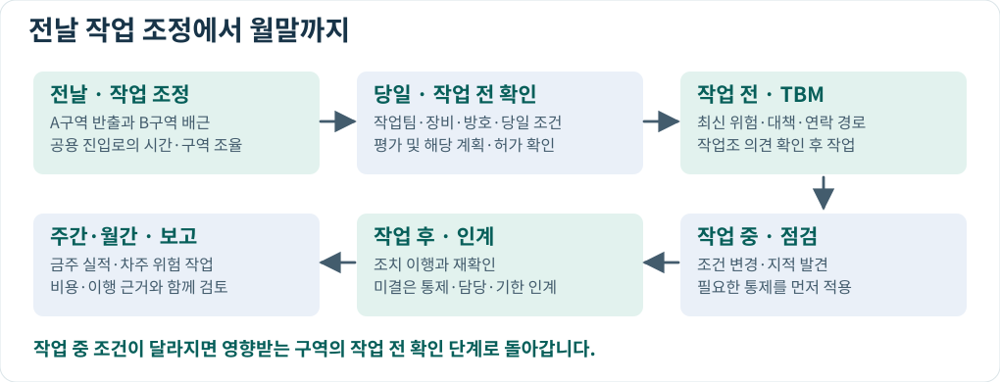
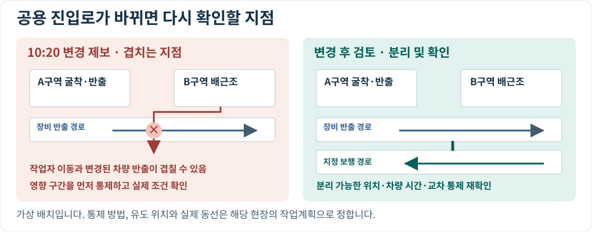
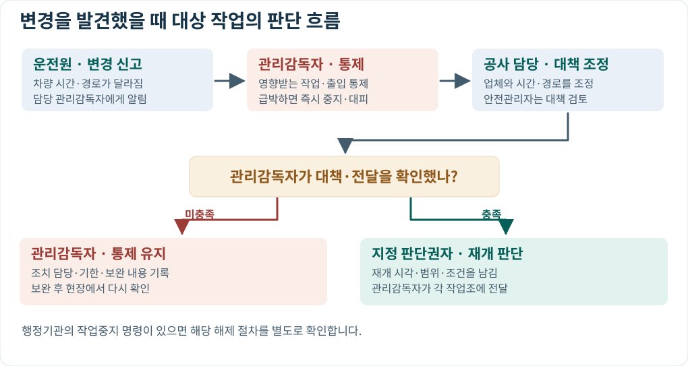
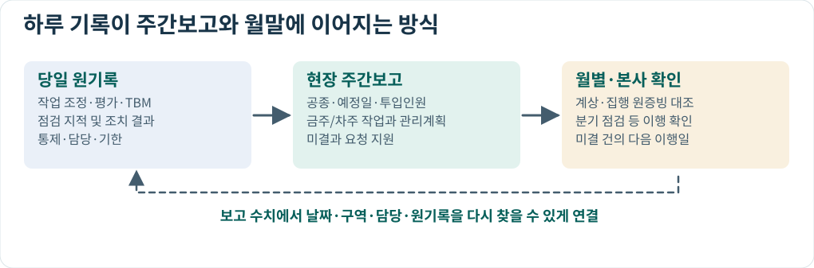

# 04-1. 현업 안전관리 업무 흐름

[교재 안내](./README.md) · [04장 안전관리 업무 프로세스](./04_안전관리_업무_프로세스.md) · [05장 ERP 모듈 및 기능](./05_건설안전_ERP_모듈_및_기능.md)

이 절은 **현장에서 누가 먼저 무엇을 확인하고, 무엇을 다음 담당자에게 넘기는지** 설명합니다. 현장·본사 운영 자료에 있는 위험성평가, 일일점검, 작업계획서, 작업허가서, 주간업무보고와 산업안전보건관리비 항목을 한 작업의 흐름에 연결했습니다. 시간과 사건은 04장의 가상 **별내 생활문화센터**를 사용한 학습 예시입니다. 작성·검토·결재 역할은 실제 현장의 업무분장과 지정 권한을 확인합니다. [현업 자료와 공식 근거](#현업-자료와-공식-근거)

## 1. 전날 작업 조정부터 월말까지

A구역에서는 굴착한 흙을 차량으로 반출하고, B구역에서는 철근을 배근합니다. 두 구역은 떨어져 있어도 작업자가 드나드는 길과 반출 차량이 같은 진입로를 사용할 수 있습니다. 공사 담당은 전날 작업 예정표를 대조하고, 협력업체 작업책임자는 장비·인력·작업 조건을 알립니다. 안전팀은 작업 계획과 위험성평가가 실제 구역과 맞는지 확인을 지원합니다. 관리감독자와 작업책임자는 당일 조건을 다시 확인하고 작업조에 전달합니다.

*그림 1. 전날 작업 조정에서 월말까지 · 자체 제작. 당일 조건이 바뀌면 영향받는 작업의 사전 확인으로 돌아갑니다.*

| 언제 | 누가 무엇을 하는가 | 다음 단계에 넘기는 기록 |
| --- | --- | --- |
| 전날 오후 | 공사 담당이 다음 날 공정과 장비 반입·반출을 모아 봅니다. 양쪽 업체 책임자와 공용 진입로 사용 시간·구역을 조정합니다. | 작업 예정표, 동시 작업과 교차 구간, 조정한 조건 |
| 당일 작업 준비 | 관리감독자·업체 책임자가 실제 사람과 장비, 방호·출입 상태를 확인합니다. 안전팀은 해당 평가, 작업계획서와 허가 조건을 확인하는 데 참여합니다. | 작업 전 확인 결과, 누락·변경 사항, 필요한 보완 담당 |
| 작업 직전 | 관리감독자 또는 지정 진행자가 작업 전 안전점검회의(Tool Box Meeting, TBM)에서 위험·대책·변경 연락 경로를 알립니다. 작업조의 질문을 듣고 시작 전 조건을 확인합니다. | 당일 작업 범위, 공유한 평가 버전과 조치, 의견·보류 사항 |
| 작업 중 | 작업조는 바뀐 조건과 이상을 알립니다. 점검 담당은 위치·위험·통제 상태를 확인하고 미흡 사항을 담당자에게 넘깁니다. | 점검일지, 지적과 통제, 조치 담당·기한 |
| 작업 후 | 조치 담당자가 실행 결과를 제출하고 지정 확인자가 현장 상태를 확인합니다. 미결은 현재 통제 상태와 다음 담당에게 넘깁니다. | 이행 증빙, 재확인 결과와 시각, 미결·다음 확인 시점 |
| 주간·월간 | 현장 담당이 일일 기록을 주간 업무와 다음 주 작업 계획에 반영합니다. 현장·본사는 해당 월의 집행 증빙과 계획·실적을 대조합니다. | 주간보고, 차주 관리계획, 월간 증빙·미결 이력 |

## 2. 작업 전에는 어떤 정보가 오가는가

*그림 2. 담당자별 인계 · 자체 제작. 공사·협력업체가 예정 정보를 전달하고, 안전팀·관리감독자가 실제 상태와 작업 직전 공유를 확인하는 예입니다.*

1. **공정과 간섭을 먼저 확인합니다.** 공사 담당은 구역, 작업 내용, 시작·종료 예정, 장비 이동과 교차 지점을 정리합니다. 협력업체 책임자는 실제로 들어오는 장비·운전원·작업조와 예상 변경을 알립니다. 장소가 같거나 길을 함께 쓴다면 어느 시간에 어떤 작업이 겹치는지 표시합니다.
2. **작업에 필요한 조건을 확인합니다.** 관리감독자가 작업조·도구·통제 상태를 확인하고, 공사 담당자와 안전팀이 최신 평가, 해당 작업계획·작업허가의 범위와 일치 여부를 확인합니다. 교육·자격·검사·작업지휘자 지정 등이 해당하면 근거와 확인자를 남깁니다. 업체가 작업에 참여하는 경우 작업조가 실제로 적용할 대책을 함께 확인합니다.
3. **작업조에 전달하고 조건을 점검합니다.** TBM에서는 해당 구역과 작업의 위험, 지정된 이동 경로, 작업 중 변경을 알릴 사람을 확인합니다. 작업자가 “차량 시간이 달라지면 어떻게 하나요?”라고 묻는다면, 담당자가 답과 후속 조치를 남깁니다. 보완이 필요한 범위는 정해진 절차에 따라 확인한 뒤 착수합니다.

현장 조치를 정할 때 위험성평가의 대상·시점, 근로자 참여와 공유는 현행 고시를 확인합니다. 내부 양식의 작성·결재 주기는 해당 회사 자료에서 확인합니다. [위험성평가 지침](https://www.law.go.kr/LSW/admRulLsInfoP.do?admRulSeq=2100000288038) · [고용노동부 건설현장 TBM 실천 가이드](https://moel.go.kr/local/busanbukbu/news/notice/noticeView.do?bbs_seq=20230302066)

## 3. 작업 중 반출 경로가 바뀌면

**10:20,** A구역 반출 차량의 이동 경로가 달라져 B구역 배근조가 자재를 운반할 때 공용 진입로를 함께 사용할 수 있다는 연락이 들어옵니다. 해당 구간의 통제, 영향받는 작업과 기존 대책을 확인할 필요가 생깁니다.

*그림 3. 공용 진입로 변경 전후 · 자체 제작. 왼쪽의 교차 구간을 통제한 뒤 오른쪽처럼 해당 현장에 맞는 경로·시간·교차점 대책의 이행을 확인합니다.*

| 시각 예시 | 현장 행동 | 남기는 근거 |
| --- | --- | --- |
| 10:20 | 발견자가 변경 위치·시각과 영향 작업을 공사 담당·관리감독자에게 알립니다. 해당 구간은 상황에 맞게 통제하고 급박한 위험이 있으면 법정 절차에 따라 즉시 대응합니다. | 변경 신고와 최초 통제 내용, 작업조·구역 |
| 10:35 | 공사 담당, 관계 업체와 근로자가 경로·시간·교차점을 다시 확인합니다. 안전팀은 기존 대책으로 보호되는지 검토를 지원합니다. 영향을 받는 위험성평가와 해당 작업계획·허가 조건을 갱신하고 새 조건을 관계 작업조에 알립니다. | RA-A-014 개정본, 조정한 구역·시간, 공유와 참석 기록 |
| 10:50 | 지정 확인자가 통제·방호 상태와 실제 경로를 확인합니다. 필요한 조건이 충족되면 지정 절차에 따른 재개 판단과 결과를 작업조에 전달합니다. | 현장 확인자, 시각과 확인 결과, 해당 승인·통보 기록 |
| 종료 전 | 점검·조치 이력을 정리하고 남은 문제의 통제·담당·기한을 인계합니다. 같은 진입로의 이후 작업도 변경된 조건을 확인합니다. | 점검일지, 시정·재확인 결과, 다음 작업 전 확인 목록 |

*그림 4. 변경 후 통제와 재개 판단 · 자체 제작. 사진·조치 등록과 현장에서 확인한 결과를 구별해 판단합니다.*

대책 확인이 끝나지 않으면 영향 구역을 통제한 상태로 보완 담당·기한·재확인 시점을 기록합니다. 실제 조치가 완료된 경우에도 현장 확인 결과와 재개 판단을 따로 남깁니다. 행정기관의 작업중지 명령이 해당하면 법정 해제 절차를 확인합니다. [산업안전보건법 제51·52·55조와 위험성평가 근거](./03_건설안전_관련_법령.md#법령과-공식-자료)

## 4. 일일 기록이 주간보고와 월말까지 이어지는 순서

현장 주간보고는 보고 대상 주간에 어떤 작업이 있었고 차주에 무엇을 관리해야 하는지 설명합니다. 확인한 회사의 빈양식에는 공정률·재해건수·주요 진행 공종·계상 안전관리비·교육/안전활동과, 작업별 **업체명·공종·작업 예정일·투입인원·작업 내용·안전 관리계획** 항목이 있습니다. 현장 담당자는 점검자의 원기록과 다음 주 계획에서 이 항목을 채우고, 지정 검토자에게 공유합니다. 본사 자료에는 별도로 주간업무보고와 분기 안전점검 실적 보고 항목이 있습니다.

*그림 5. 일일·주간·월간 인계 · 자체 제작. 보고에서 발견한 미결·지원 필요 사항을 다음 작업 확인으로 돌려보냅니다.*

| 단계 | 이번 사례에서 옮겨 적을 내용 | 검토자에게 남기는 질문 |
| --- | --- | --- |
| 당일 기록 정리 | 공용 진입로가 바뀐 시점, 영향받은 작업조, 임시 통제와 새 경로, 재확인 결과 | 현재 어떤 조건에서 작업할 수 있는가? 확인자와 시각이 있는가? |
| 주간 현장 보고 | A구역 토공·반출, B구역 자재 운반과의 간섭, 조치 결과, 차주 반출 예정일과 교차 지점 관리계획 | 다음 주 작업이 바뀌면 누가 다시 조정하는가? 지원·이월 건은 무엇인가? |
| 월별 정리 및 본사 확인 | 주간·일일 근거와 미결 이력, 사용한 경우 적용 산업안전보건관리비의 항목·거래·사용 증빙 | 어느 기간·현장·업체 기준인가? 보고 수치에서 원기록과 이월 담당을 찾을 수 있는가? |

이 사례에서는 기존 차단시설을 재배치하고 새 비용이 발생하지 않았다고 가정합니다. 자재 구입이나 외주비가 발생하는 실제 건은 비용의 적용 근거, 거래와 사용 증빙을 해당 월 집행 자료에 연결합니다. 미결 건을 보고서에 올린 시점과 실제 현장에서 조치를 재확인한 시점을 각각 남깁니다.

## 5. 담당자와 기록을 바꿔 가며 한 건을 추적하기

| 기록 예시 | 확인할 사실 | 연결할 다음 기록 |
| --- | --- | --- |
| 당일 작업 예정·조정표 | A구역의 반출 장비와 B구역 작업조가 사용하는 구역·시간 | 최초 및 변경 위험성평가 |
| 위험성평가 RA-A-014 | 교차 지점의 위험, 의견, 대책·담당·기한과 적용한 버전 | 작업계획·해당 허가, 작업 전 전달 |
| TBM·작업 전 전달 | 누구에게 어느 버전의 대책을 언제 알렸는지 | 현장 점검과 조건 변경 통보 |
| 점검·시정·재확인 | 변경을 확인한 시각과 장소, 통제·대책, 지정 확인자의 결과 | 주간보고의 실적·미결과 차주 확인 |
| 주간 업무 및 월별 정리 | 차주 공종·예정일·투입인원과 안전관리계획, 미결 또는 비용 증빙 | 다음 주 공사 일정과 위험 검토 |

**ERP에서 추적하는 순서** — 현장과 작업일·구역·업체로 당일 작업을 찾습니다. 이어서 적용 작업과 위험성평가 개정본, TBM 기록, 점검·시정·재확인을 각각 찾습니다. 정상 처리와 변경 뒤 새로 확인한 조건을 구별하고, 요약 보고와 원자료를 오갈 수 있게 연결합니다. 메뉴·상태 이름은 적용 화면과 역할에 따라 확인합니다. [05장 ERP 모듈 및 기능](./05_건설안전_ERP_모듈_및_기능.md)

## 현업 자료와 공식 근거

| 자료 | 이 절에서 확인한 부분 |
| --- | --- |
| `ref/현업자료/본사 운영 부문/vPLUS(ERP) 안전관리 현장 운영 부문(수정본).xlsx` | ‘본사 서류 전산화 목록(취합)’ 시트 10~17행의 일일점검·위험성평가·주간업무보고·관리비 및 33~38행의 작업계획서·작업지휘자 지정·작업허가서. 작성 주체·결재 관련 열을 확인 |
| `ref/현업자료/본사 운영 부문/vPLUS(ERP) 안전관리 본사 운영 부문.xlsx` | ‘본사 서류 전산화 목록’ 시트 3·7행의 주간업무보고와 분기안전점검 실적 보고 항목 |
| `ref/현업자료/현장주간보고/주간업무보고(빈양식).xlsx` | ‘주간업무보고’ 시트 5·16행의 공정·안전활동 및 작업별 예정·투입·관리계획 작성 항목 |

위 자료는 저장소와 같은 상위 폴더의 `ref/`에 있습니다. 회사의 서류 목록과 보고 양식을 참고해 **업무가 이어지는 순서**를 가상 현장에 맞춰 재구성했습니다. 법령과 공식 안내는 근거 확인일 2026-11-27 기준으로 확인했습니다. [현행 위험성평가 지침](https://www.law.go.kr/LSW/admRulLsInfoP.do?admRulSeq=2100000288038) · [고용노동부 개정 안내](https://www.moel.go.kr/news/enews/report/enewsView.do?news_seq=20194) · [건설현장 TBM 실천 가이드](https://moel.go.kr/local/busanbukbu/news/notice/noticeView.do?bbs_seq=20230302066)
