# 04 안전관리 업무 프로세스

[교재 안내](./README.md) · [03장 건설안전 관련 법령](./03_건설안전_관련_법령.md) · [학습 로드맵](./ROADMAP.md#04-안전관리-업무-프로세스) · [현업 사례](#18-현업-사례로-보는-안전관리-업무-흐름) · [담당자별 업무 순서](#19-담당자별로-하는-일과-처리-순서)

## 학습 목표

- 현장의 계획, 작업 전 준비, 작업 중 확인, 조치·경영 검토를 한 흐름으로 설명합니다.
- 업무별 수행자·검토자·승인자, 시점, 입력, 결과 및 예외를 찾습니다.
- 같은 현장·구역·작업의 평가, 교육, 허가, 점검 기록을 연결해 봅니다.
- 반출 경로 변경 때 신고·조정·통제·재확인·재개 판단을 누가 맡고 어떤 기록을 넘기는지 설명합니다.

**사례의 기준** — 가상 별내 생활문화센터에서 A구역은 굴착, B구역은 골조 작업을 합니다. 회사별 조직, 양식, 결재·허가 권한과 주기는 실제 업무에 따라 정해집니다. 아래 표와 번호는 학습용입니다. 적용 법령과 법정 서식은 [03장](./03_건설안전_관련_법령.md) 및 말미의 공식 자료에 연결했습니다.

## 1. 안전보건 목표와 계획

목표는 예방 활동에 필요한 인력과 예산을 준비하고 이행 여부를 확인할 기준을 마련합니다. 본사는 방침과 적용 기준을 제시하고, 현장소장과 안전보건 담당은 착공 준비나 운영 계획 수립 시 공정·위험·자원을 검토합니다. 해당 승인권자가 계획을 검토하고, 실행 담당자가 결과와 미흡 사유를 기록합니다. 목표 추진계획서와 측정표는 회사 문서의 예입니다.

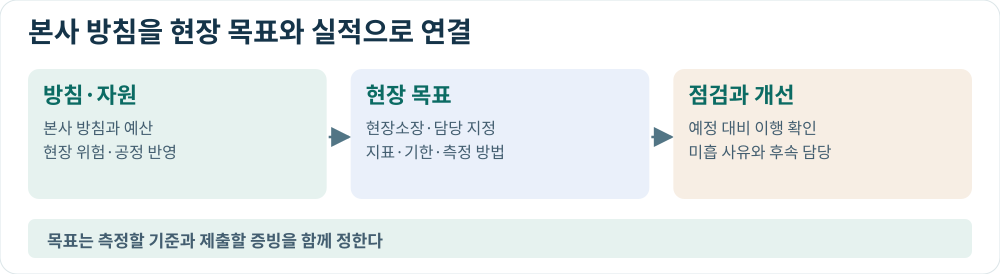

*그림 1. 본사 방침을 현장 목표와 실적으로 연결 · 자체 제작. 목표와 실행 담당, 실적을 측정할 근거를 한 줄에서 이어 봅니다.*

| 목표 추진계획 예시 | 내용 |
| --- | --- |
| 목표와 기준 | B구역의 개구부 방호 변경 건마다 작업 재개 판단 전에 상태 재확인 |
| 입력·담당 | 변경 건 목록과 작업 일정 · 공사 담당과 지정 확인자 |
| 측정·검토 | 완료 확인 건과 대상 건을 월말 대조 · 현장소장 검토 |
| 증빙 | 점검 번호, 조치 사진, 재확인 결과와 미이행 사유 |

**ERP 연결** — 현장·기간·차수별 계획과 실적을 연결합니다. 목표율의 분모와 미완료 건을 함께 확인해 집계가 누락을 가리지 않도록 합니다.

## 2. 현장과 협력업체 관리

현장이 개설되면 현장 담당은 공사 기간, 작업 구역, 담당 조직과 관계 업체를 정리합니다. 협력업체 선정·계약 단계에서는 작업 수행 범위와 필요한 안전보건 역량·역할을 확인합니다. 업체는 현장 투입 전 해당 담당자와 작업·인원·장비 자료를 제출하고, 시공 측은 업무 범위와 공용 동선·보고 경로를 안내합니다. 공정·계약 변경이나 현장 종료 시 업체의 활동 범위·권한·미해결 과제와 인수인계를 확인합니다.

*그림 2. 현장과 협력업체의 투입·변경·종료 · 자체 제작. 계약 기간과 실제 투입 기간을 구별하고, 범위를 바꾸면 관련 기록을 재확인합니다.*

**투입 확인 예시** — B사, 토공, A구역, 11월 4~28일, 책임자 B-01, 장비·근로자 확인 목록, 반입 경로 안내, 계약에 따른 검토자. 작업 후 업체 평가에는 점검·시정 결과와 후속 관리 내역을 근거로 남깁니다. ERP에서는 업체 전체 정보와 현장별 배치·계약을 연결해 조회합니다.

## 3. 근로자 투입·변경·종료

협력업체 작업책임자가 작업 전에 소속·작업·예정 기간과 필요한 자격·교육 자료를 제출합니다. 현장 담당이 작업과 자격·교육의 해당 여부를 보고, 관리감독자와 보호구·역할·변경 내용을 확인합니다. 혼합 작업조의 경우 소속과 실제 담당 업무를 구분합니다. 누락이 있으면 영향받는 작업의 투입 조건을 다시 확인합니다.

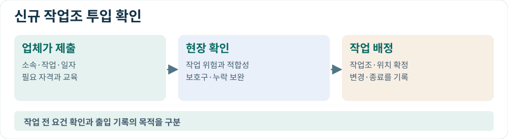

*그림 3. 신규 작업조 투입 확인 · 자체 제작. 작업조 편성 전에 확인한 자료와 실제 작업 배정을 연결합니다.*

| 가상 투입 확인표 | 예시 값 |
| --- | --- |
| 근로자·소속·배치 | 근로자 B-07 · B사 · A구역 토공조 |
| 예정 작업 | 굴착 구간 작업 보조 · 지정된 작업과 이동 경로 확인 |
| 확인 | 해당 교육·자격 여부 확인, 보호구 지급, 작업 변경 시 재확인 |
| 결과·증빙 | 투입 여부, 확인자·일자, 교육 이수와 지급 기록 |

**ERP 연결** — 소속·투입 기간·당일 역할과 종료를 기록합니다. 다음 현장에 배치할 때는 새 작업 조건에 필요한 교육·자격을 다시 확인합니다.

## 4. 위험성평가의 실시와 변경

사업주는 해당 작업의 위험을 실제 근로자와 함께 확인하고 감소대책을 수립·이행합니다. 평가시점과 참여·결과 공유는 산업안전보건법 제36조 및 현행 고시를 따릅니다. 현장에서는 공정·장비·작업 위주로 대상 범위를 정하고, 작업자 의견을 반영한 뒤 담당·기한과 재확인 조건을 남깁니다. 작업 조건이 달라지면 고시의 수시 등 해당 평가 절차를 확인합니다. [산업안전보건법 제36조](https://law.go.kr/LSW/lsLinkCommonInfo.do?chrClsCd=010202&lsJoLnkSeq=1032635443) · [현행 평가 고시](https://www.law.go.kr/LSW/admRulLsInfoP.do?admRulSeq=2100000288038)

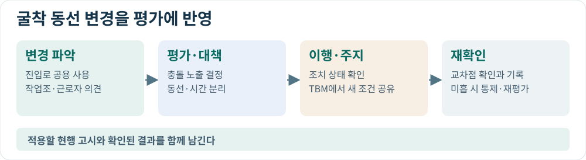

*그림 4. 굴착 동선 변경을 평가에 반영 · 자체 제작. A구역 굴착 장비와 B구역 작업조의 동선이 겹친다는 제보를 평가·조치·전달과 연결합니다.*

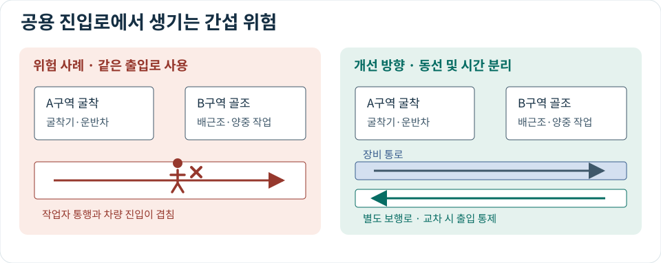

*보충 그림. 공용 진입로 평면의 위험과 개선 방향 · 02장 자체 도해를 재사용했습니다.*

| 평가표 항목 | 조치 전 | 조치 후 확인 예시 |
| --- | --- | --- |
| RA-A-014 | 공용 진입로에서 장비 진입과 B구역 작업자 통행이 겹침. 작업자가 교차 위치를 제보 | 동선 분리와 교차 구간 통제 확인. 남은 차량 진출입 조건을 작업 전 알림 |
| 이행 | 굴착·골조 작업 책임자와 조치 담당 지정 | 담당과 일자, 설치·확인 기록 및 작업자 공유 |
| 재평가 조건 | 차량 경로나 반입 시간이 바뀔 수 있음 | 조건 변경 시 영향받는 작업을 다시 검토 |

## 5. 작업 전 안전점검회의

작업 전 안전점검회의(Tool Box Meeting, TBM)는 작업 직전 관계 작업자와 위험요인·대책을 공유하고 질문과 변화를 확인하는 활동입니다. 진행자는 오늘의 작업에 필요한 평가 결과를 먼저 정리하고, 작업자는 작업·장비·환경 변화를 알려 줍니다. 즉시 해결할 수 없는 사항은 담당자를 정하고 작업을 보류하거나 해당 조건을 재검토합니다. 산업안전보건법 제36조와 고시는 평가 결과 공유를 규정하고, 중대재해로 이어질 수 있는 요인의 상시 주지에 관한 법의 노력 규정을 확인합니다. [고용노동부 건설현장 TBM 실천 가이드](https://moel.go.kr/local/busanbukbu/news/notice/noticeView.do?bbs_seq=20230302066) · [산업안전보건법 제36조](https://law.go.kr/LSW/lsLinkCommonInfo.do?chrClsCd=010202&lsJoLnkSeq=1032635443)

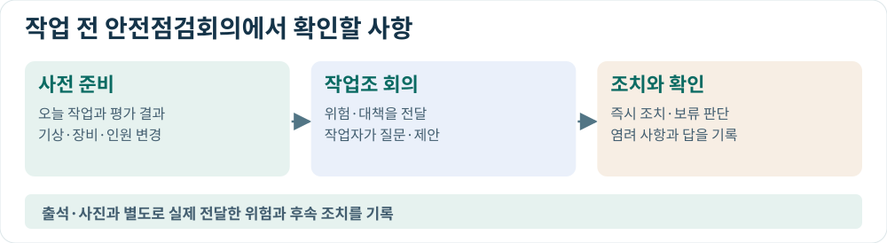

*그림 5. 작업 전 안전점검회의에서 확인할 사항 · 자체 제작. 당일 조건과 작업자 의견을 확인해 안전조치를 작업 시작 전에 반영합니다.*

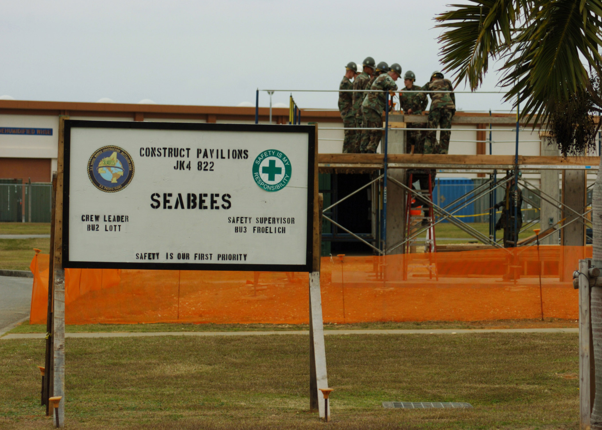

*사진 1. 건설 작업 전 현장 브리핑 · 실제 사진. 일본 오키나와에서 정자를 시공하는 작업조가 사진 오른쪽 위의 작업발판에 모여 착수 전 브리핑을 하고 있습니다. 한국의 법정 교육 이수 요건을 보여 주는 사진과 구별합니다. [사진 출처와 이용조건](#사진-출처와-이용조건)*

**회의 기록 예시** — A/B구역 관계 작업조, 당일 반입 일정, 평가 RA-A-014, 교차지점 통제 위치, 근로자 질의 ‘차량 진입 시간이 달라지면 누구에게 알리는가’, 작업 책임자의 답과 담당·보완 결과. ERP에는 회의 기록을 해당 평가 개정본과 그 날짜 작업에 연결합니다.

## 6. 안전보건교육

교육 담당자는 근로자 소속·업무·숙련·작업 변경과 유해·위험작업을 확인해 대상과 유형을 정합니다. 사업주는 적용되는 교육을 실시하거나 법이 정한 기초교육 이수를 확인합니다. 시행규칙의 교육시간·내용, 면제·특례, 강사 기준을 확인한 뒤 이수 자료를 작업조 배치와 연결합니다. [산업안전보건법 제29·31조 및 시행규칙 제26~28조·별표 4·5](./03_건설안전_관련_법령.md#법령과-공식-자료)

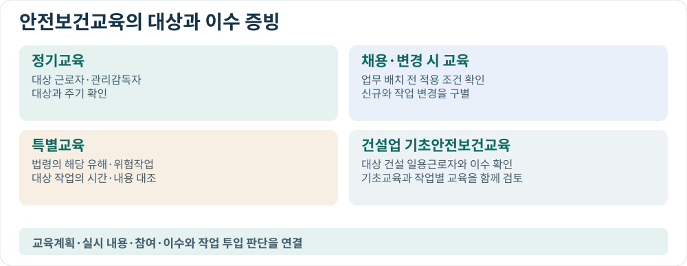

*그림 6. 안전보건교육의 대상과 이수 증빙 · 자체 제작. 교육의 목적과 대상·실시 시점을 먼저 결정합니다.*

| 교육 유형 | 대상과 시점 확인 예시 | 증빙 |
| --- | --- | --- |
| 정기교육 | 대상 근로자와 관리감독자 등 해당 기간·직무 기준 확인 | 기간, 과정, 참석과 이수 기록 |
| 채용 시·작업내용 변경 시 | 신규 배치나 작업내용 변경의 조건과 교육 필요 여부 확인 | 대상, 배치 전 교육 또는 근거, 변경 이력 |
| 특별교육 | 해당 유해·위험작업인지 별표의 대상·시간·내용 확인 | 대상 작업, 실시 시간·내용과 이수 |
| 건설업 기초안전보건교육 | 건설 일용근로자 채용 시 해당 이수 의무·이미 이수한 경우 등 확인 | 교육기관과 이수 확인, 작업 배치 |

**교육일지 예시** — ED-B-011, B사 B-07, 작업 변경 교육, 굴착 경로·접근통제·비상연락, 교육자·실시 일시·대상 기준, 이수 확인, 적용 작업. ERP는 교육 계획, 교육 실적과 실제 투입 조건을 연결합니다. 당일 TBM 참석도 별도 기록으로 확인합니다.

## 7. 작업허가서

작업허가(Permit to Work, PTW)는 회사나 현장이 지정한 작업에서 범위와 선행 안전 조건을 확인하는 절차입니다. 예시 화기작업의 신청자는 위치·작업·시간과 위험·대책을 제출합니다. 현장 검토자는 적합한 방호·감시·초기 대응 수단과 관계 작업을 살피고, 지정 승인자는 허가 조건과 유효기간을 확인합니다. 실제 위험작업별 법정 조치·계획은 별도로 확인합니다.

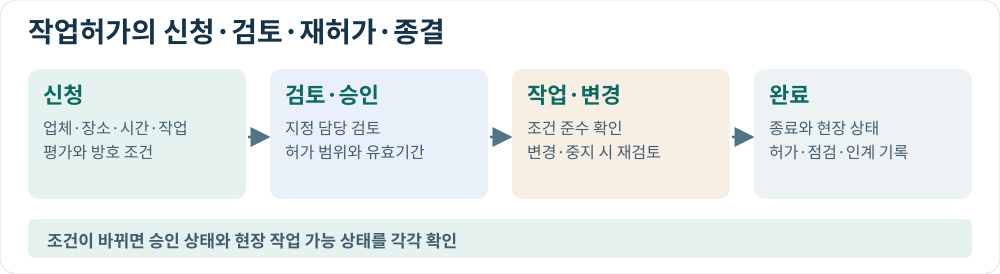

*그림 7. 작업허가의 신청·검토·재허가·종결 · 자체 제작. 승인 후에도 현장 조건이 바뀌거나 시간이 지나면 재검토와 해당 재허가가 필요할 수 있습니다.*

| 화기작업 허가 양식 예시 | 예시 값 |
| --- | --- |
| 신청 | PW-B-003 · B구역 지정 작업 위치 · 신청 업체·책임자·예정 시간 |
| 검토 및 승인 | 적용한 작업계획, 가연물·불티 통제, 감시·임시소방시설 확인 · 승인자와 허가 범위 |
| 작업 및 변경 | 작업 시작 시 조건 확인. 위치·시간·주변 작업이 바뀌면 중지 또는 보류하고 재검토 |
| 종료 | 현장 상태와 해당 작업 후 확인 사항 기록 · 종료 확인자 및 일시 |

**ERP 연결** — 신청, 검토, 승인, 보류·반려, 작업 종료와 재확인의 시점·담당자를 구별합니다. 회사 화기작업 양식은 내부 사례이며, 적용 법령과 관련 소방시설 기준은 해당 현장의 요건으로 확인합니다. [소방시설 설치 및 관리에 관한 법률 제15조](https://www.law.go.kr/법령/소방시설설치및관리에관한법률/제15조)

## 8. 안전점검

일상 안전점검(Inspection)은 작업 일정과 위험에 따라 대상·구역·시간을 잡고 현장 상태를 확인하는 활동입니다. 지정 점검자가 위치·적용 기준·적합 여부·확인 방법을 기록하고, 미흡 사항과 즉시 통제 여부를 해당 책임자에게 알립니다. 일상 순회와 건설기술 진흥법상 대상 공사의 자체·정기·정밀안전점검은 근거·시점·수행자가 다를 수 있습니다. [건설기술 진흥법 시행령 제100조](https://www.law.go.kr/LSW/lsLinkCommonInfo.do?lsJoLnkSeq=1033553135)

*그림 8. 안전점검의 계획과 결과 확인 · 자체 제작. 점검 항목 번호만으로는 부족하므로 위치와 기준, 결과와 이어지는 조치를 기록합니다.*

*보충 그림. 순회점검의 위치 기록 예 · 01장 자체 도해를 재사용했습니다.*

**점검표 예시** — CK-B-022, B구역 골조층 개구부, 고정·식별 확인, 결과 ‘고정 상태 재확인 필요’, 발견일·점검자, 접근 통제, 조치 CA-B-009 연결. 다음 점검자는 변경된 공정과 앞선 미완료 항목을 같이 확인합니다.

## 9. 지적사항과 시정조치

시정조치(Corrective Action)는 지적 등록, 필요한 통제, 담당·기한, 조치 등록, 재확인을 거쳐 종결합니다. 점검에서 발견한 위험에 즉시 통제가 필요하면 담당 배정이나 전자결재를 기다리기 전에 해당 절차에 따라 대응합니다. 담당자가 작업을 마쳤다고 알리면 지정 확인자가 기준·현장 상태를 보고 기록을 남깁니다.

*그림 9. 개구부 지적에서 시정·재확인까지 · 자체 제작. 같은 지적을 여러 작업조가 조회할 수 있게 하고, 보완과 재확인 이력을 연결합니다.*

*보충 그림. 개구부 시정 전·후 · 자체 제작. 위험 구역의 통제와 개선 상태 재확인을 보여 주는 개념도입니다.*

| 지적·시정 기록 예시 | 예시 값 |
| --- | --- |
| 지적 | CA-B-009 · CK-B-022 · 덮개 고정 상태 불명확 |
| 초기 통제·담당 | 접근 통제 · 공사 담당, 방호 작업조 · 재확인 전 재개 보류 |
| 조치 | 기준에 맞는 방호 구성·고정·표시 적용 · 조치 완료 사진과 기록 |
| 재확인 | 지정 확인자의 확인 내용과 결과 · 기준 미충족이면 보완 진행 |

**ERP 연결** — 완료 보고일, 확인일·확인자, 종결일을 별도로 확인합니다. 같은 위험이 재발하면 이전 기록과 작업조건 변경 여부를 찾아봅니다.

## 10. 건설기계·장비 안전관리

장비 담당자는 반입 전에 해당 장비의 식별 정보·제원·적용 등록·검사 상태와 운전원 자격, 작업계획 적용을 확인합니다. 작업일에는 운전원·관리감독자가 장비 상태와 당일 위치·반경·통제 조건을 확인합니다. 결함이 발견되면 사용 제한과 수리·교체를 기록하고, 적합 확인 후 허용 범위에서 사용합니다. 반출 때는 현장 배치 상태를 종료합니다. [건설기계관리법 시행령과 별표 1](https://www.law.go.kr/법령/건설기계관리법시행령) · [산업안전보건기준에 관한 규칙](./03_건설안전_관련_법령.md#법령과-공식-자료)

*그림 10. 굴착기 반입·사용·반출 확인 지점 · 자체 제작. 굴착기와 실제 운전원, 장비가 들어가는 현장의 확인 자료를 연결합니다.*

*보충 그림. 장비 종류 및 주요 부위 · 01장 자체 도해를 재사용했습니다. 굴착기의 붐·암·버킷과 작업 영역을 확인합니다.*

**반입·점검표 예시** — EQ-EX-02, A구역, 장비 모델·식별정보, 운전원과 자격 확인, 적용 장비 검사 자료, 버킷·주행부 및 작업계획 확인, 반입 확인자·일시, 결함과 조치 기록. 같은 구역에 대체 장비가 들어오면 배치와 당일 점검을 갱신합니다.

## 11. 보건 및 건강관리

보건 담당자는 절단 분진·소음, 화학물질 등 작업별 유해인자와 노출 상황을 확인합니다. 사업주는 적용 요건에 따라 작업환경측정(Work Environment Measurement) 및 일반·특수·배치전·수시 건강진단 등 해당 건강진단을 실시·관리합니다. 후속조치는 노출 저감과 작업환경 개선에 연결합니다. 건강진단 결과는 산업안전보건법상 다른 목적으로 사용하지 않으며, 건강 관련 개인정보의 처리 근거와 접근·공유 범위를 검토합니다. [산업안전보건법 제125·129~132조](https://www.law.go.kr/LSW/lsInfoP.do?ancYnChk=0&chrClsCd=010202&efYd=20261027&lsiSeq=291447&urlMode=lsInfoP) · [개인정보 보호법 제23조](https://www.law.go.kr/법령/개인정보보호법/제23조)

*그림 11. 유해인자부터 사후관리까지 · 자체 제작. 작업의 노출 확인과 개인별 건강정보 열람 범위를 각각 검토합니다.*

*보충 그림. 작업 유해인자 저감 예 · 02장 자체 도해를 재사용했습니다. 절단 분진과 소음은 각각 노출과 대책을 확인합니다.*

**학습용 보건 기록** — H-B-004, B구역 절단작업, 유해인자 분진·소음, 측정·건강진단 적용 확인 담당, 집진 및 구역 통제 적용, 작업환경 재확인 일정. 일반 현장 조회에는 작업 개선 상태만 표시하고 개인의 진단 자료는 업무상 필요한 담당이 처리하는 예입니다.

## 12. 산업안전보건관리비 관리

공사비 담당자는 계상 근거를 인계받고 사용 목적·편성액과 현행 고시의 허용·제한을 미리 대조합니다. 사용 담당은 품목과 사용 현장·대상 및 원증빙을 남기며, 검토자는 같은 지출이 여러 곳에 중복 반영됐는지, 항목과 시기에 맞는지 확인합니다. 월말에는 당사·협력업체 실적을 대조해 정정·정산 자료와 사용명세를 보관합니다. [산업안전보건관리비 고시와 해설](./03_건설안전_관련_법령.md#법령과-공식-자료)

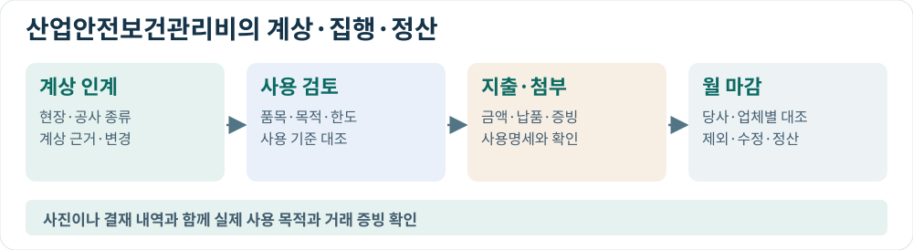

*그림 12. 산업안전보건관리비의 계상·집행·정산 · 자체 제작. 계상액, 사용 목적, 거래·사용 증빙과 확인 결과를 월별로 추적합니다.*

| 가상 사용명세 | 내용 |
| --- | --- |
| 지출 요청 | SC-11-021 · B구역 추락 예방 시설 · 80만 원(가상 금액) |
| 사전 검토 | 해당 공사, 사용 목적, 적용 고시 항목과 인정 요건 검토 |
| 첨부 | 납품·거래 증빙, 실제 사용 위치 및 확인 기록 |
| 월말 결과 | 검토 상태, 수정 사항, 승인·제외 근거 및 월별 사용명세 |

**ERP 연결** — 현장·월·업체·항목으로 조회하되, 계약변경으로 계상액을 바꾼 날짜와 지출 발생일은 구별합니다. 결재나 사진 한 장에만 의존하지 않고 원증빙과 이력을 연결합니다.

## 13. 재해와 아차사고

사고를 발견하면 구조·대피, 2차 재해 예방과 보고를 우선합니다. 현장 담당은 작업·시간·위치, 피해와 확인된 사실을 기록하고, 해당 법령의 보고·통보 의무를 사업주·관계 주체가 판단할 수 있게 전달합니다. 조사 담당은 원인, 재발방지대책, 담당·기한을 정리하고 결과를 해당 작업에 다시 반영합니다. 아차사고도 위험요인 개선을 위한 입력으로 관리합니다. [산업안전보건법 제54·57조 및 시행규칙 제73조](./03_건설안전_관련_법령.md#법령과-공식-자료) · [CSI 건설사고 안내](https://www.csi.go.kr/por/about_acd_002.do)

*그림 13. 재해 또는 아차사고 후 처리 순서 · 자체 제작. 초기 대응과 법령별 보고, 조사와 후속 조치 기간을 서로 구별합니다.*

**가상 아차사고 기록** — NM-A-002, 공용 진입로에서 굴착 운반차와 보행자가 예상보다 가까워졌으나 피해 없음, 해당 구역 통제와 작업조 확인, 원인 ‘반입 시간이 바뀌었으나 보행 담당에게 미전달’, 대책 ‘교차점 통제·변경 전달·재확인 담당 지정’, 관련 평가 RA-A-014. 재해인 경우 조사보고서에는 피해, 보고 판단, 제출·수신과 예방조치를 각각 기록합니다. 법정 기준에 해당하는 경우 공식 서식·기한을 적용합니다. [산업재해조사표 공식 서식](https://www.law.go.kr/flDownload.do?flSeq=152447827)

## 14. 안전보건 관련 회의체

회의체마다 목적과 구성·주기가 다릅니다. 현장 담당은 법 제24·64·75조와 해당 시행령·시행규칙에 따라 적용 요건을 확인합니다. 예를 들어 시행령 제63조의 노사협의체 기준은 공사금액 120억 원 이상이며 해당 토목공사업은 150억 원 이상입니다. 법 제75조 요건을 충족해 노사협의체를 구성·운영하면 적용되는 위원회·도급 협의체 관련 간주 규정을 확인합니다. [산업안전보건법](./03_건설안전_관련_법령.md#법령과-공식-자료) · [시행령 제63~65조 및 별표](https://www.law.go.kr/LSW/lsInfoP.do?ancYnChk=0&efYd=20260801&lsiSeq=288347)

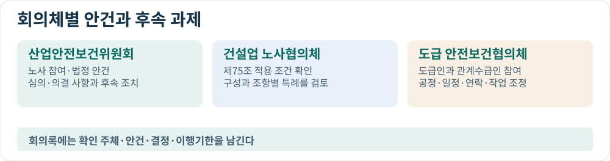

*그림 14. 회의체별 안건과 후속 과제 · 자체 제작. 회의 계획에 참여자, 적용 근거, 후속 조치 확인 담당을 함께 둡니다.*

| 회의록 항목 | 가상 예 |
| --- | --- |
| 회의·참석 | 적용 회의체와 일자 · 시공사·협력업체 등 해당 참여자 및 역할 |
| 안건 | 11월 B구역 물류와 A구역 반출 시간 겹침 |
| 결정 | 담당자가 일일 작업계획을 조정하고 현장 통제 위치 확인 |
| 후속 | 기한, 작업 전 반영·전달 기록, 다음 회의에서 이행 확인 |

**ERP 연결** — 회의록에서 결정된 과제에 담당자와 기한을 부여하고 평가·중점 점검·조치 기록에 연결합니다. 회의록 승인과 과제 이행을 구별합니다.

## 15. 중대재해 예방과 의무이행 점검

본사 담당은 적용 의무와 점검 주기, 책임 및 현장이 제출할 근거를 정리합니다. 현장은 작업계획, 평가·교육·비상훈련 등 해당 자료를 연결합니다. 이행 점검자는 누락·미흡과 실제 조치 여부를 확인하고, 필요한 인력·예산 지원과 완료 기한을 정해 재확인합니다. 중대재해처벌법 시행령 제4·5조에 따른 반기 점검 등은 적용 조문과 대상에 맞춰 관리합니다. [중대재해처벌법 시행령 제4·5조](https://www.law.go.kr/LSW/lsInfoP.do?lsId=014159)

*그림 15. 본사 점검과 현장 이행 근거 · 자체 제작. 본사의 확인 결과를 현장의 보완과 다시 연결합니다.*

**의무 이행 점검 예시** — 하반기 의무 이행 검토, 별내 센터, 근거 위험성평가와 근로자 참여·개선 기록, 미흡 ‘변경 후 재확인 증빙 누락’, 담당·기한·본사 지원 여부, 개선 후 확인일. ERP에서는 여러 현장을 집계하면서 각 결과의 근거 번호로 내려갈 수 있게 합니다.

## 16. 비상대응·작업중지·재개

급박한 위험이 발견되면 현장 역할에 따라 작업중지·대피와 접근 제한, 보고와 필요한 비상 대응을 합니다. 산업안전보건법 제51조는 사업주의 작업중지를, 제52조는 근로자의 작업중지·대피·보고를 규정합니다. 보고받은 담당자는 위험이 제거됐는지 확인하고 작업계획, 평가와 필요한 재검토·재개 권한을 확인합니다. 행정기관이 작업을 중지시킨 경우에는 해당 법정 해제 절차를 적용합니다. [산업안전보건법 제51·52·54·55조](./03_건설안전_관련_법령.md#법령과-공식-자료)

*그림 16. 위험 발견에서 재개 판단까지 · 자체 제작. 위험 발견·통제, 보완 완료, 재개 판단은 각기 다른 기록을 남깁니다.*

**비상 훈련·조치 기록 예시** — EM-B-001, B구역, 방호 훼손·위험 발견 시각, 통제 범위와 대피·연락 대상, 현장 확인과 보완, 재개 검토 담당·근거, 작업조에 다시 알린 내용. 훈련과 실제 사건을 해당 유형으로 표시하고, 훈련에서 확인된 누락 연락망을 보완합니다.

## 17. 하루에서 월말까지의 업무 인계

현장마다 작업·회의 주기는 다릅니다. 다음은 별내 센터에서 작업 전 준비가 주간 조정과 월간 관리로 이어지는 예입니다. 해당 법정 점검·회의·보고에 정해진 기한이 있으면 이를 일정에 반영합니다.

*그림 17. 일간·주간·월간 업무와 이월 기록 · 자체 제작. 일간 기록을 주간 작업 일정과 월간 증빙에서 다시 확인합니다.*

| 시점 | 주된 업무와 참여자 | 다음에 넘길 정보 |
| --- | --- | --- |
| 일간 작업 전 | 작업책임자·관리감독자·관계 작업조가 인원·교육·장비·계획·허가 조건과 위험성평가 및 TBM 결과를 확인 | 당일 작업 범위, 시행할 조치, 확인·보류 |
| 일간 작업 중·후 | 현장 담당자가 순회점검, 변경 통제, 지적·시정 등록과 작업·허가 종료 확인 | 조치 담당·기한, 완료·재확인, 보고 대상 사건 |
| 주간 | 공사·안전보건 담당과 관계 업체가 다음 공정과 동시 작업을 조정하고 회의·점검 현황을 검토 | 다음 주 위험, 예정 조치와 미해결 건, 주간보고 |
| 월간 | 현장소장과 본사 담당이 계획·실적, 교육·재해·비용·보건 및 개선 현황을 대조 | 월말 기준, 원증빙, 이월 조치와 후속 일정 |

예를 들어 A구역 진입로 변경은 **RA-A-014 위험성평가 → 당일 TBM → 실제 동선 점검 → A구역 동선의 후속 조치 → 주간 인계**로 추적합니다. B구역의 개구부 조치와 A구역 동선 조치는 서로 다른 위험 건으로 유지하되, 같은 작업일의 공용 구역 영향은 작업계획에서 함께 확인할 수 있습니다. 월 마감을 넘긴 항목은 미종결 사유와 새 기한까지 인계합니다. [반출 경로 변경 사례에서 따라가기](#18-현업-사례로-보는-안전관리-업무-흐름)

## 18. 현업 사례로 보는 안전관리 업무 흐름

별내 생활문화센터에서 굴착토 반출 경로가 바뀌어 철근 작업조의 통로와 겹치는 하루를 따라갑니다. 전날 공정 조정에서 시작해 작업 전 확인·TBM, 통제와 재개, 주간보고·월말 인계까지 **누가 맡고, 왜 확인하며, 무엇을 다음 담당자에게 넘기는지** 확인합니다. 작업계획서·작업허가서, 일일점검과 주간업무보고의 작성 항목을 바탕으로 재구성한 사례입니다. 시간과 사건은 학습용입니다. [현업 자료와 공식 근거](#현업-자료와-공식-근거)

### 18.1 전날 작업 조정부터 월말까지

A구역에서는 굴착한 흙을 차량으로 반출하고, B구역에서는 철근을 배근합니다. 두 구역의 작업 장소는 떨어져 있어도 작업자가 드나드는 길과 차량 반출로는 공용 진입로에서 만납니다. 이 때문에 각 업체가 자기 작업만 확인하면 놓치는 위험이 생깁니다.

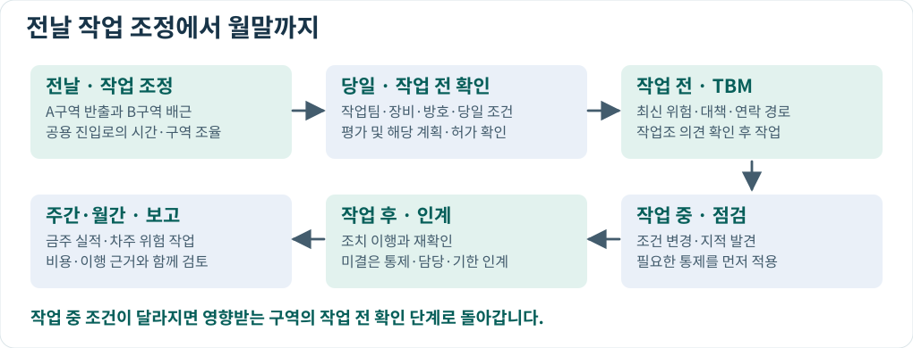

*그림 18. 전날 작업 조정에서 월말까지 · 자체 제작. 당일 조건이 바뀌면 영향받는 작업의 사전 확인으로 돌아갑니다.*

| 언제 | 누가 맡는가 | 왜 하는가 | 현장에서 어떻게 하고 무엇을 남기는가 |
| --- | --- | --- | --- |
| 전날 오후 | 공사 담당이 조정하고 A·B업체 작업책임자가 예정 정보를 냅니다. | 각 업체 일정표를 따로 보면 공용 진입로에서 차량과 사람이 만나는 시간을 놓칠 수 있습니다. | 반출 예정 시간과 B구역 자재 운반 시간을 도면과 일정표에 함께 표시합니다. 겹치는 구간과 시간, 합의한 대책, 당일 확인할 사람을 작업 예정표에 남깁니다. |
| 당일 작업 전 | 각 작업의 관리감독자가 자기 작업과 출입 상태를 확인합니다. 업체 책임자가 실제 투입 정보를 대고, 안전관리자가 대책 검토를 지원합니다. | 밤사이 달라진 인원·장비·통로에도 전날 대책이 적용되는지 판단해야 합니다. | 관리감독자가 업체 책임자와 진입로를 걸으며 실제 투입 장비·작업조와 방호·출입 상태를 확인합니다. 적용할 평가·계획과 해당하는 허가 조건을 대조하고 차이가 있으면 영향받는 작업을 보류해 확인합니다. |
| 작업 직전 | 관리감독자 또는 지정 진행자가 작업 전 안전점검회의(Tool Box Meeting, TBM)를 진행합니다. 운전원과 작업자가 실제 이동 절차를 확인합니다. | 아침에 정한 조건이 안전하려면 운전원과 작업자가 같은 통로·통제 기준을 이해해야 합니다. | 도면에서 차량·보행 구간을 가리키고, 경로가 바뀌면 어디서 멈춰 누구에게 알릴지 각 작업조에 물어봅니다. 질문과 답, 적용한 대책, 추가 확인이 필요한 내용을 남깁니다. |
| 작업 중 | 변경 발견자가 알리고, 관리감독자가 담당 작업을 통제합니다. 공사 담당은 같은 길을 쓰는 업체를 조정합니다. | 첫 작업조만 알고 있으면 다른 작업조가 종전 조건으로 진입할 수 있습니다. | 변경 위치·시각·영향 작업을 알리고 통제 범위를 정합니다. 점검자는 현장의 통제 상태를 확인하고 담당·기한·현재 상태를 점검일지에 남깁니다. |
| 작업 후 | 조치 담당자가 결과를 내고, 지정 확인자가 이행 여부를 확인합니다. 관리감독자가 다음 작업조에 미결 사항을 인계합니다. | 교대 뒤에 미결 사항을 놓치면 다음 작업조가 통제 구간을 그대로 사용할 수 있습니다. | 현장 확인 결과·시각과 미결 항목의 통제 상태를 남깁니다. 다음 담당자는 인계받은 구간·제한 사항·재확인 시점을 확인합니다. |
| 주간·월간 | 현장 보고 담당이 원기록을 모으고, 현장 검토자와 본사 담당이 맡은 항목을 확인합니다. | 반복된 간섭과 미결 조치를 다음 공정에 반영하고 보고 수치의 근거를 찾을 수 있어야 합니다. | 일일 기록을 차주 작업·관리계획에 연결합니다. 월별로 해당 현장·기간의 실적과 실제 집행 증빙을 대조하고, 미결 건을 맡을 사람을 확인합니다. |

### 18.2 현장에서 누가 맡고 어디까지 판단하는가

*그림 19. 담당자별 인계 · 자체 제작. 현장 역할을 기준으로 공정 조정, 작업조 확인, 안전 기술 검토, 직접 작업 지휘를 연결했습니다.*

이 사례에 바로 필요한 판단을 아래에 정리했습니다. 역할별 업무 순서와 남기는 기록은 [19절](#19-담당자별로-하는-일과-처리-순서)에서 확인합니다.

| 역할 | 왜 맡는가 | 별내 사례에서 어떻게 하는가 |
| --- | --- | --- |
| 원청 공사 담당 | 두 업체의 공정과 공용 공간을 함께 조정할 수 있습니다. | A업체 반출 예정과 B업체 자재 운반 일정을 한 도면에 겹쳐 봅니다. 충돌하면 양쪽 책임자와 시간·경로를 다시 정하고 관리감독자에게 변경안을 전달합니다. |
| 협력업체 작업책임자 | 실제 들어오는 운전원·장비·작업조와 당일 변경을 파악합니다. | 전날 예정과 실제 투입이 다르면 공사 담당과 자기 작업의 관리감독자에게 알립니다. 자기 작업조에 적용 조건과 변경 연락처를 전달합니다. |
| 관리감독자 | 맡은 작업과 소속 근로자를 직접 지휘·감독합니다. | 업체 책임자와 현장을 확인하고 TBM에서 운전원·작업자가 조치 내용을 이해했는지 확인합니다. 조건이 맞지 않으면 담당 작업을 보류하거나 통제하고, 바뀐 범위와 재확인 결과를 기록합니다. |
| 선임된 안전관리자 | 안전 기술 사항에서 사업주 또는 안전보건관리책임자를 보좌하고 관리감독자에게 지도·조언합니다. | 교차점의 시야, 차량·보행 분리, 출입 통제의 실효성을 검토합니다. 보완이 필요한 지점을 공사 담당과 관리감독자에게 설명하고 현장 확인을 지원합니다. |
| 운전원·작업자 | 실제로 이동하거나 작업하면서 도면과 현장 상태의 차이를 먼저 발견할 수 있습니다. | 차량 대기 위치, 작업자 이동 경로, 변경 연락 대상을 TBM에서 자기 말로 확인합니다. 정한 조건이 달라지면 해당 작업의 관리감독자에게 알립니다. |
| 현장 절차상 재개 판단권자 | 바뀐 조건에서 어느 작업을 언제부터 할 수 있는지 현장 권한에 따라 결정합니다. | 관리감독자의 현장 재확인 결과, 기술 검토와 해당 문서의 변경·승인 상태를 보고 재개 범위와 조건을 정합니다. 관리감독자가 관계 작업조에 전달합니다. |

이 장에서 ‘공사 담당’과 ‘업체 작업책임자’는 사례의 업무분장을, ‘관리감독자’와 ‘안전관리자’는 법령상의 역할을 가리킵니다. 실제 현장에서는 각 작업의 관리감독자 지정과 내부 판단 권한을 먼저 확인합니다. [산업안전보건법 제16·17조](https://www.law.go.kr/LSW/lsInfoP.do?lsId=001766)

착수 직전에는 **공사 담당이 조정한 작업 범위**, **관리감독자가 확인한 실제 조건**, **작업조가 이해한 이동·연락 방법**이 맞아야 합니다. 적용되는 작업계획서·작업허가서와 필요한 자격·교육을 확인합니다. 예를 들어 운전원이 전달받은 대기 위치가 관리감독자가 확인한 위치와 다르면, 해당 차량의 진입 조건을 정리하고 작업조에 다시 전달한 뒤 확인합니다. 위험성평가의 실시 시점과 근로자 참여·공유는 현행 지침을 확인합니다. [위험성평가 지침](https://www.law.go.kr/LSW/admRulLsInfoP.do?admRulSeq=2100000288038) · [고용노동부 건설현장 TBM 실천 가이드](https://moel.go.kr/local/busanbukbu/news/notice/noticeView.do?bbs_seq=20230302066)

### 18.3 작업 중 반출 경로가 바뀌면

**10:20,** A구역 반출차 운전원이 기존 출구를 쓸 수 없어 공용 진입로로 돌아가야 한다고 알립니다. 같은 시간에 B구역 작업자들은 그 진입로를 거쳐 철근을 옮길 예정입니다. 아래 시각은 각 단계의 흐름을 보여 주는 예시입니다.

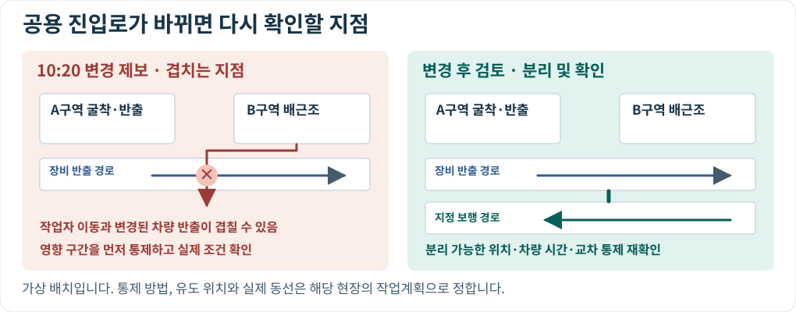

*그림 20. 공용 진입로 변경 전후 · 자체 제작. 왼쪽의 교차 구간을 통제한 뒤 오른쪽처럼 해당 현장에 맞는 경로·시간·교차점 대책의 이행을 확인합니다.*

| 시각 예시 | 누가 무엇을 하는가 | 왜 이 순서로 하는가 | 어떻게 확인하고 기록하는가 |
| --- | --- | --- | --- |
| 10:20 변경 신고·초기 통제 | A구역 운전원이 자기 관리감독자에게 알립니다. A·B구역 관리감독자가 각각 담당 작업의 영향 범위를 통제하고 공사 담당이 양쪽에 변경을 전파합니다. | 대책을 정하는 동안에도 차량과 작업자가 동시에 들어올 수 있습니다. | 기존 출구와 변경 예정 구간을 알립니다. 예시에서는 반출차를 지정 대기 위치에 대기시키고 B구역 자재 운반조의 해당 통로 진입을 보류합니다. 최초 신고자·시각·통제 구간을 남깁니다. |
| 10:35 대책 재검토·시행 | 공사 담당이 양쪽 업체 책임자를 불러 시간·통로를 조정합니다. 운전원과 작업자가 사각지대와 실제 이동 경로를 알리고, 안전관리자가 조치의 적정성을 검토합니다. 각 업체가 담당 조치를 시행합니다. | 시간표와 도면에서 분리해도 현장에서 진입이 겹치거나 경로가 이어지지 않으면 위험이 남습니다. | 교차점을 함께 확인하고 보행 통로, 반출 시간, 출입 통제 위치를 다시 정합니다. 변경 내용을 위험성평가 개정본(RA-A-014)에 남기고 해당 작업계획과 허가 조건도 확인·반영한 뒤 양쪽 작업조에 전달합니다. |
| 10:50 재확인·재개 판단 | 각 관리감독자가 자기 작업의 현장 상태와 작업조 이해를 재확인합니다. 현장 절차상 판단권자가 확인 결과를 받아 재개 범위·조건을 정합니다. | 설치된 조치가 실제로 작동하고 양쪽 작업조가 새 경로를 알아야 정한 조건으로 재개할 수 있습니다. | 관리감독자가 현장에서 차량·보행 경로의 분리 상태와 출입 통제 상태를 대조합니다. 운전원과 B구역 작업자에게 새 시간·통로를 확인합니다. 조건이 충족되면 판단권자가 시각·범위·조건을 남기고, 양쪽 관리감독자가 각 작업조에 알립니다. |
| 종료 전 인계 | 조치 담당자가 이행 근거를 제출하고 각 관리감독자가 다음 작업조에 남은 통제와 확인 사항을 넘깁니다. | 같은 진입로를 쓰는 다음 작업조도 새 조건을 알아야 이전 경로 사용을 막을 수 있습니다. | 원기록에 확인자·시각, 유지할 통제와 다음 확인 시점을 남깁니다. 관리감독자는 다음 근무조가 맡을 구간과 확인 담당을 지정합니다. |

*그림 21. 변경 후 통제와 재개 판단 · 자체 제작. 조치하는 사람, 현장에서 확인하는 사람, 재개 범위와 조건을 결정하는 사람의 역할을 표시했습니다.*

**재확인에서 막히는 예.** B구역 자재 운반조 일부가 새 경로를 듣지 못했습니다. 관리감독자는 해당 통로의 통제를 유지하고, 전달할 작업조·담당자·재확인 시점을 남깁니다. 작업조가 새 경로를 확인하면 관리감독자가 결과를 기록하고 판단권자에게 다시 올립니다.

**급박한 위험·작업중지 명령이 있는 경우.** 급박한 위험에서는 즉시 작업중지·대피 등 법령에 따른 조치를 하고, 근로자의 중지·대피와 보고도 법령에 따릅니다. 행정기관의 작업중지 명령이 적용되면 법정 해제 절차를 따릅니다. [산업안전보건법 제51·52·55조](https://www.law.go.kr/LSW/lsInfoP.do?lsId=001766) · [03장 법령과 공식 자료](./03_건설안전_관련_법령.md#법령과-공식-자료)

### 18.4 일일 기록이 주간보고와 월말까지 이어지는 순서

확인한 현장 주간보고 빈양식에는 공정률·재해건수·주요 진행 공종·계상 안전관리비·교육·안전활동과, 작업별 **업체명·공종·작업 예정일·투입인원·작업 내용·안전 관리계획** 항목이 있습니다. 본사 자료에는 주간업무보고와 분기 안전점검 실적 보고 항목이 있습니다.

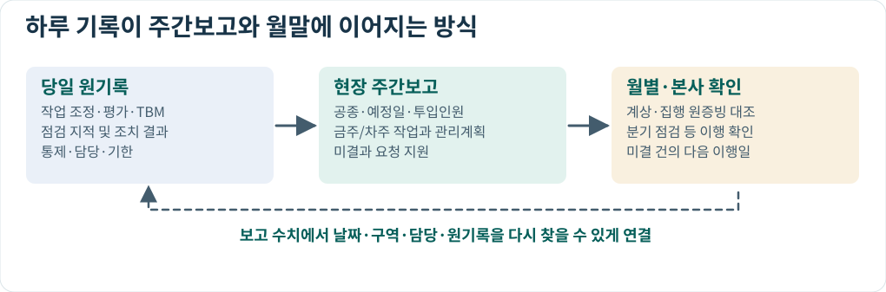

*그림 22. 일일·주간·월간 인계 · 자체 제작. 보고에서 발견한 미결·지원 필요 사항을 다음 작업 확인으로 돌려보냅니다.*

[17절의 일간·주간·월간 인계](#17-하루에서-월말까지의-업무-인계)를 이번 변경 건의 원기록에 적용합니다.

| 단계 | 누가 맡는가 | 왜 하는가 | 어떻게 확인하고 보고하는가 |
| --- | --- | --- | --- |
| 당일 기록 정리 | 각 관리감독자가 자기 작업의 변경·통제·재확인 결과를 확인합니다. 점검 담당이 원기록을 정리합니다. | 교대 뒤에도 현재 유효한 작업 조건과 미결 사항을 확인할 수 있어야 합니다. | 최초 신고, 통제, 대책 시행, 현장 재확인, 재개 판단을 실제 시각과 담당자별로 남깁니다. 통제 중인 항목에는 다음 확인 시각을 적습니다. |
| 주간 현장 보고 | 현장 보고 담당이 점검 기록을 모읍니다. 공사 담당은 차주 일정, 관리감독자는 조치가 실제로 끝났는지, 지정 검토자는 지원·이월 사항을 확인합니다. | 같은 진입로를 쓰는 작업이 반복되면 이번 주에 확인한 대책을 차주 일정에 반영해야 합니다. | A구역 반출 날짜·업체·인원과 B구역 자재 운반 일정을 대조합니다. 차주 보고서에 공용 진입로의 통제 계획과 확인 담당을 적고, 미결은 원기록 번호로 연결합니다. |
| 월별 정리 및 본사 확인 | 현장 담당이 기간별 실적과 증빙을 모으고 본사 담당이 해당 업무 기준으로 확인합니다. | 여러 현장의 수치가 같은 기준으로 집계됐는지, 이월 조치를 어느 현장과 담당자가 이어서 할지 확인합니다. | 보고 집계에서 일일·주간의 원기록과 미결 이력을 찾아 대조합니다. 비용이 발생한 건은 적용 산업안전보건관리비의 항목과 거래·사용 증빙을 연결합니다. |

이 사례에서는 기존 차단시설을 재배치해 새 비용이 발생하지 않았다고 가정합니다. 주간보고에는 경로 변경과 조치 이력을 연결하고, 월별 비용 확인에서는 해당 건의 추가 집행 여부를 실제 지출 기록으로 확인합니다.

### 18.5 담당자와 기록을 바꿔 가며 한 건을 추적하기

| 기록 예시 | 확인할 사실 | 연결할 다음 기록 |
| --- | --- | --- |
| 당일 작업 예정·조정표 | A구역의 반출 장비와 B구역 작업조가 사용하는 구역·시간 | 최초 및 변경 위험성평가 |
| 위험성평가 RA-A-014 | 교차 지점의 위험, 의견, 대책·담당·기한과 적용한 버전 | 작업계획·해당 허가, 작업 전 전달 |
| TBM·작업 전 전달 | 누구에게 어느 버전의 대책을 언제 알렸는지 | 현장 점검과 조건 변경 통보 |
| 점검·시정·재확인 | 변경을 확인한 시각과 장소, 통제·대책, 지정 확인자의 결과 | 주간보고의 실적·미결과 차주 확인 |
| 주간 업무 및 월별 정리 | 차주 공종·예정일·투입인원과 안전관리계획, 미결 또는 비용 증빙 | 다음 주 공사 일정과 위험 검토 |

**ERP에서 담당자와 판단 근거를 확인하는 순서** — 현장과 작업일·구역·업체로 당일 작업을 찾습니다. 이어서 적용 작업과 위험성평가 개정본, TBM 기록, 점검·시정·재확인을 각각 찾습니다. 변경 신고자, 조치 담당자, 현장 확인자, 재개 판단자를 찾고 각각의 시각과 근거를 대조합니다. 예를 들어 RA-A-014가 개정된 시각과 양쪽 작업조에 새 경로를 알린 시각, 현장 재확인 및 재개 판단 시각을 각각 확인합니다. 요약 보고에서 해당 원기록을 찾을 수 있게 연결합니다. 메뉴·상태 이름은 적용 화면과 역할에 따라 확인합니다. [05장 ERP 모듈 및 기능](./05_건설안전_ERP_모듈_및_기능.md)

## 19. 담당자별로 하는 일과 처리 순서

현장 업무분장표의 건축·토목·기계·전기 등 공종별 관리감독자, 협력업체 소장, 안전·보건 인력을 기준으로 업무를 풀었습니다. 아래 순서는 별내 생활문화센터 사례에 적용한 예입니다. 현장에 적용할 때는 각 역할의 **소속, 담당 작업, 법정 선임·지정 여부, 내부 권한**을 확인합니다. 한 사람이 현장소장과 안전보건관리책임자 등 여러 역할을 맡으면 기록에 어느 권한으로 판단했는지 표시합니다. [현업 자료와 공식 근거](#현업-자료와-공식-근거)

### 19.1 현장소장, 안전보건관리책임자, 안전보건총괄책임자

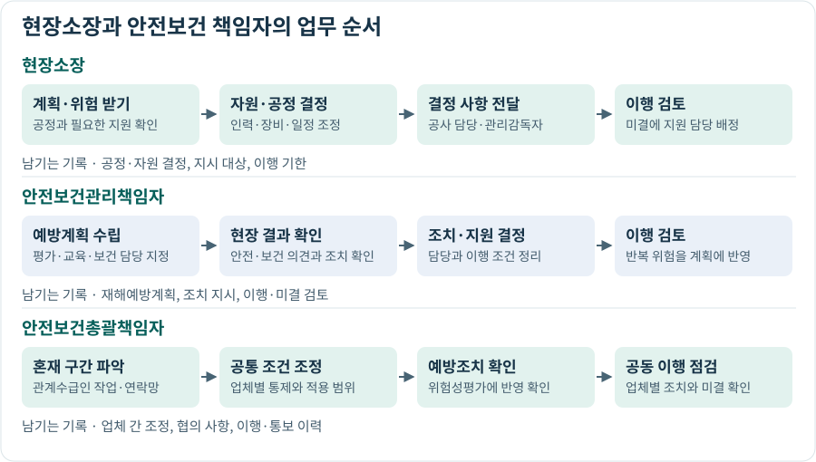

*그림 23. 현장 자원 결정, 재해예방 관리, 도급 작업 조정 · 자체 제작.*

**현장소장**은 현장 전체 공정과 인원·장비·예산을 움직여 결정된 대책을 실행할 수 있게 합니다. 업무분장표 예시에는 현장소장이 안전보건총괄책임자로 표시되어 있습니다. 실제 현장에서는 선임·지정 근거와 직무를 확인합니다.

1. 공사 담당에게서 다음 공정과 공용 공간 사용 계획을, 안전·보건관리자에게서 주요 위험과 필요한 지원을 받습니다.
2. 현장 부서가 조정할 수 있는 범위를 정합니다. 반출 시간 변경처럼 여러 공정과 자원이 걸린 건은 현장소장이 공사·장비·통제 인력 배치를 결정하고, 큰 추가 비용이나 공기 영향은 본사와 협의합니다.
3. 공사 담당에게 변경 일정을, 각 관리감독자에게 적용 범위와 현장 확인 담당을 전달합니다. 현장소장이 재개 판단권자로 정해져 있으면 확인 결과를 받은 뒤 재개 범위·조건을 기록합니다.
4. 주간회의에서 반복 지적과 기한을 넘긴 조치를 보고받아 지원 담당과 처리 시점을 정합니다. **남기는 기록**은 공정·자원 결정, 지시 대상, 이행 기한과 확인 결과입니다.

**안전보건관리책임자**는 적용 사업장에서 재해예방계획과 현장의 안전보건관리 업무를 총괄하고 안전관리자·보건관리자를 지휘·감독합니다.

1. 공정 계획을 받아 위험성평가, 교육, 점검, 작업환경·건강관리에 관한 계획과 담당을 정리합니다.
2. 안전·보건관리자의 기술 의견과 관리감독자의 현장 결과를 받아 필요한 조치와 지원을 정합니다.
3. 조치 담당에게 결과를 받고 미결 사유를 확인합니다. 반복 위험은 다음 예방계획·교육에 반영합니다. **남기는 기록**은 담당별 계획, 조치 지시, 이행·미결 검토 결과입니다.

**안전보건총괄책임자**는 도급인이 지정해야 하는 현장에서 도급인과 관계수급인 근로자의 재해예방 업무를 함께 관리합니다.

1. 공용 진입로와 같은 혼재 구간, 관계수급인별 작업 범위, 보고·연락 담당을 파악합니다.
2. 양쪽 업체가 함께 지켜야 할 통제 조건을 정리하고, 위험성평가와 도급인 예방조치가 조정된 범위에 반영됐는지 확인합니다. 법령상 작업중지 직무 및 관계수급인 간 산업안전보건관리비 사용 협의·집행 감독도 해당 범위에서 수행합니다.
3. 각 업체의 조치와 미결을 받고 공통 조건이 현장에 적용됐는지 확인합니다. **남기는 기록**은 업체 간 조정, 협의 사항, 이행·통보 이력입니다. [산업안전보건법 제15·51·62·64조](https://www.law.go.kr/LSW/lsInfoP.do?lsId=001766) · [산업안전보건법 시행령 제14·52·53조](https://www.law.go.kr/LSW/lsInfoP.do?lsiSeq=288347&efYd=20260801)

### 19.2 안전관리자

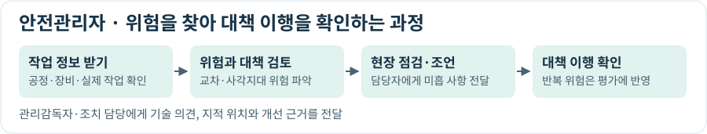

*그림 24. 공정 정보 확인부터 기술 검토와 후속 확인까지 · 자체 제작.*

안전에 관한 기술 사항을 사업주 또는 안전보건관리책임자에게 보좌하고 관리감독자에게 지도·조언합니다. 작업 현장과 평가 내용을 대조해 **어떤 위험이 남아 있고 대책이 어떻게 작동해야 하는지** 설명합니다.

1. 공사 담당에게서 공정·장비·작업구역 정보를 받고, 관리감독자와 업체 책임자에게 실제 작업방법과 변경 정보를 확인합니다.
2. 위험성평가를 지원합니다. 반출 경로·교차 지점·사각지대를 보고 필요한 출입 통제, 동선 분리, 작업계획 관련 보완을 제안합니다.
3. 순회점검으로 조치 적용 상태를 확인합니다. 언제 어디에서 어떤 위험이 남았는지 기록해 관리감독자와 조치 담당에게 전달하고, 현장 지원이 필요하면 책임자에게 보고합니다.
4. 변경 뒤에는 관리감독자와 현장을 확인하고 남은 위험을 알려 줍니다. 비슷한 지적이 반복되면 평가표·교육 자료·다음 점검 항목에 반영하도록 지원합니다. **남기는 기록**은 기술 검토 의견, 지적·개선 건의, 이행 확인 근거입니다. [산업안전보건법 제17·20조](https://www.law.go.kr/LSW/lsInfoP.do?lsId=001766) · [산업안전보건법 시행령 제18조](https://www.law.go.kr/lsLinkCommonInfo.do?lsJoLnkSeq=1034168707)

### 19.3 관리감독자

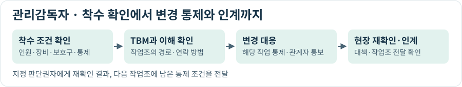

*그림 25. 작업조 지휘, 변경 구간 통제, 재확인 결과 인계 · 자체 제작.*

맡은 작업과 소속 근로자를 직접 지휘·감독합니다. 예시에서는 A구역과 B구역의 관리감독자가 각자의 작업을 확인하고 공용 진입로 문제를 공사 담당에게 함께 알립니다.

1. **작업 전** 실제 인원·장비·기구, 보호구, 작업구역과 통제 상태를 확인합니다. 위험성평가에서 해당 작업의 위험요인 파악과 개선대책 시행에 참여합니다.
2. **착수 직전** 작업조에게 작업 범위, 이동 경로, 변경 때의 연락 방법을 전달합니다. 작업자가 자기 이동 경로와 대기 위치를 설명할 수 있는지 확인합니다.
3. **작업 중** 설비 이상, 동선 변경, 위험 신고를 받으면 담당 작업을 확인합니다. 상황에 따라 통제하거나 대피·보고 절차를 진행하고, 공용 구역에 영향이 있으면 공사 담당과 상대 구역 관리감독자에게 알립니다.
4. **변경·종료 후** 시설 배치와 작업조 전달 상태를 현장에서 다시 확인합니다. 지정 판단권자에게 결과를 넘기고 시정 미결과 통제 상태를 다음 작업조에 인계합니다. **남기는 기록**은 작업 전 확인, TBM, 변경·통제 시각 및 현장 재확인 결과입니다. [산업안전보건법 제16·51·52조](https://www.law.go.kr/LSW/lsInfoP.do?lsId=001766) · [산업안전보건법 시행령 제15조](https://www.law.go.kr/LSW/lsSideInfoP.do?docCls=jo&joBrNo=00&joNo=0015&lsiSeq=288347&urlMode=lsScJoRltInfoR)

### 19.4 보건관리자

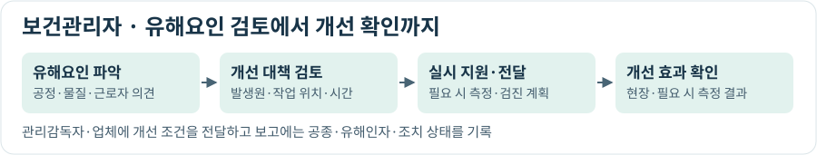

*그림 26. 노출 파악, 작업환경 개선 검토, 후속 확인 · 자체 제작.*

소음·분진·화학물질·온열 등 건강 유해요인을 파악하고 관리감독자에게 작업환경 개선을 지도·조언합니다. 반출로 변경으로 분진이 배근조 휴게·이동 구간에 닿을 우려가 생겼다면 차량 접촉 위험과 함께 검토합니다.

1. 공정표, 취급 물질과 물질안전보건자료(MSDS), 작업자 의견, 과거 작업환경측정 결과를 모아 노출이 달라지는 작업과 인원을 찾습니다.
2. 현장 확인 결과를 토대로 발생원 관리, 작업 위치·시간 조정 등 대책을 검토합니다. 작업환경측정이나 건강진단은 해당 요건을 확인해 사업주의 실시 계획을 지원하고, 필요한 자격을 갖춘 수행자나 지정 기관과 일정을 조정합니다.
3. 관리감독자와 업체 책임자에게 개선할 위치·작업 조건과 전달 내용을 알립니다. 예를 들어 분진이 늘어난 보행 구간의 작업 위치 조정이나 발생원 관리를 제안하고 현장 개선 여부를 확인합니다.
4. 관리 조치 뒤 작업환경과 필요 시 측정 결과를 확인하고 후속 조치를 추적합니다. 회의·주간보고에는 공종·유해인자·개선 상태를 올리고, 개인 건강진단 결과에는 법령상 공개·사용 제한을 적용합니다. **남기는 기록**은 유해인자 목록, 측정 실시 현황, 개선·후속 확인 결과입니다. [산업안전보건법 제18·125·132·135조](https://www.law.go.kr/LSW/lsInfoP.do?lsId=001766) · [산업안전보건법 시행령 제22조](https://www.law.go.kr/lsLawLinkInfo.do?chrClsCd=010202&lsJoLnkSeq=900384121)

### 19.5 근로자대표

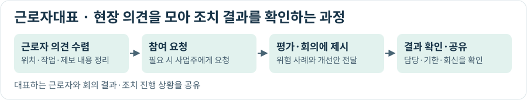

*그림 27. 의견 수렴, 평가·회의 참여, 후속 결과 공유 · 자체 제작.*

산업안전보건법상 근로자대표는 과반수 노동조합이 있으면 그 노동조합, 없으면 근로자 과반수를 대표하는 자입니다. 예시의 작업조 책임자와는 별개의 역할로, 대표하는 근로자의 의견을 평가와 회의에 전달하고 처리 결과를 확인합니다.

1. 작업자에게서 반복되는 통행 문제, 실제 보호조치의 불편, 보건 유해요인과 같은 의견을 모읍니다. 장소·작업·발생 시점과 영향을 정리합니다.
2. 위험성평가에 참여하려는 경우 사업주에게 요청합니다. 사업주는 요청이 있으면 근로자대표를 참여시키고, 작업을 수행하는 근로자의 평가 참여도 적용 법령에 따라 진행합니다.
3. 평가나 해당 회의에서 현장 사례와 개선안을 제시합니다. 예를 들어 우회 통로가 자재 운반 동선과 다시 겹친다는 제보를 전달하고 처리 결과와 확인 기한을 확인합니다.
4. 해당 위원회·협의체 회의 결과와 조치 진행 상황을 대표하는 근로자와 공유합니다. 작업환경측정·건강진단에서 법령에 따른 참석이나 설명을 요청할 수 있습니다. **남기는 기록**은 의견, 참여 요청, 회의 조치, 회신·후속 확인입니다. [산업안전보건법 제2·24·36·75·125·132조](https://www.law.go.kr/LSW/lsInfoP.do?lsId=001766) · [사업장 위험성평가에 관한 지침](https://www.law.go.kr/LSW/admRulLsInfoP.do?admRulSeq=2100000288038)

공통 문제가 반복되면 적용되는 회의체의 안건으로 올립니다. 산업안전보건위원회는 대상 사업장의 중요 안전보건 사항을 근로자위원과 사용자위원이 심의·의결합니다. 도급인의 안전 및 보건에 관한 협의체는 도급인과 수급인 사이의 예방조치와 작업 조정을 다룹니다. 해당 건설공사가 법 제75조의 노사협의체를 구성·운영하면 두 회의체를 각각 구성·운영하는 것으로 봅니다. 회의록에는 의견, 결정, 시행 담당과 후속 확인을 연결합니다. [산업안전보건법 제24·64·75조](https://www.law.go.kr/LSW/lsInfoP.do?lsId=001766)

### 19.6 공사 담당과 협력업체 작업책임자

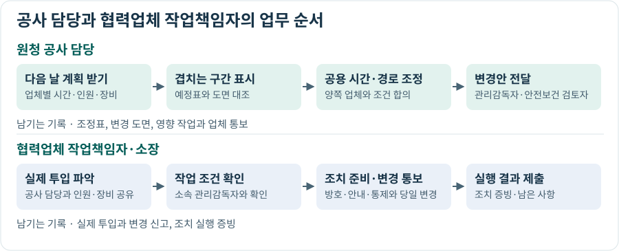

*그림 28. 원청의 공용 구역 조정과 협력업체의 조치 실행 · 자체 제작.*

| 담당 | 실제 업무 순서 | 전달·기록 |
| --- | --- | --- |
| 원청 공사 담당 | ① 각 업체의 다음 날 시간·인력·장비·구역을 받습니다. ② 도면과 작업 예정표에 겹치는 구간을 표시합니다. ③ 충돌하면 양쪽 책임자와 시간·경로를 조정합니다. ④ 변경안을 관리감독자와 안전·보건 검토자에게 전달합니다. ⑤ 위험이나 공기·자원 문제가 팀 범위를 넘으면 현장소장에게 올립니다. | 조정표, 변경 도면, 영향 작업 목록, 양쪽 업체 통보 이력 |
| 협력업체 작업책임자·협력업체 소장 | ① 자기 업체의 실제 작업 범위, 장비, 운전원과 작업조를 확인해 원청 공사 담당에게 보냅니다. ② 업체 내부 관리감독자와 적용 조건을 확인합니다. ③ 자기 업체가 맡은 방호·안내·통제 실행을 준비합니다. ④ 당일 투입이나 경로가 달라지면 관련 담당에게 즉시 알립니다. ⑤ 조치 결과와 남은 사항을 제출합니다. | 장비·인원 예정과 실제, 변경 신고, 조치 실행 증빙과 미결 |

### 19.7 작업지휘자·유도자와 근로자·운전원

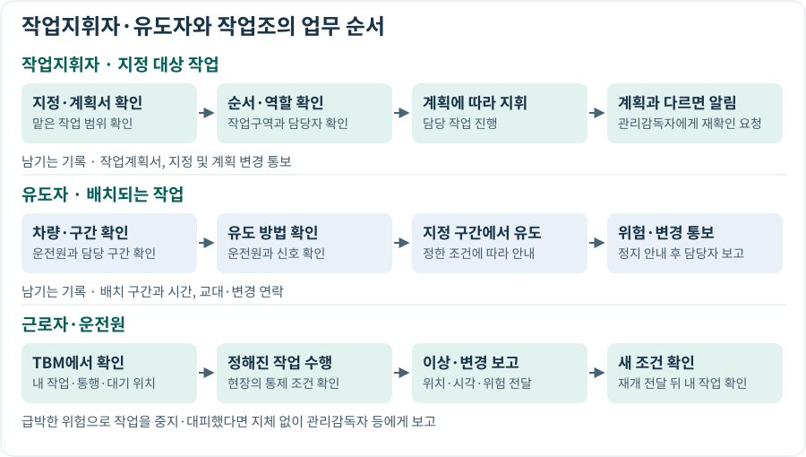

*그림 29. 지정 작업의 지휘·유도와 근로자·운전원의 변경 보고 · 자체 제작.*

| 담당 | 실제 업무 순서 | 전달·기록 |
| --- | --- | --- |
| 작업지휘자 | ① 해당 작업의 지정 여부와 적용 작업계획서를 확인합니다. ② 작업구역·순서·관계자 역할을 확인합니다. ③ 계획에 따라 지정받은 작업을 지휘합니다. ④ 계획과 현장이 달라지면 관리감독자에게 알려 필요한 재확인을 받습니다. | 적용 작업계획서, 지정 기록, 계획 변경 통보 |
| 유도자 | ① 해당 작업에 배치되는 경우 담당 차량·구간과 유도 방법을 운전원과 확인합니다. ② 작업 중 지정된 구간에서 유도합니다. ③ 통제 조건이 바뀌거나 위험이 생기면 작업을 안전하게 멈추도록 알리고 관리감독자에게 보고합니다. | 배치 구간과 시간, 교대·변경 연락 |
| 근로자·운전원 | ① TBM에서 자기 작업과 통행·대기 위치를 확인합니다. ② 합의한 작업 조건을 따릅니다. ③ 이상이나 변경을 발견하면 작업 위치·시각·위험을 관리감독자에게 알립니다. ④ 급박한 위험에서 작업을 중지하고 대피했다면 지체 없이 관리감독자 등에게 보고합니다. ⑤ 재개 전달을 받은 뒤 자기 작업에 적용할 조건을 확인합니다. | 현장 제보, 작업조 전달·확인, 미해결 사항 |

작업지휘자와 유도자 배치 여부는 장비·작업 유형과 적용 조항에 따라 확인합니다. 법정 작업계획서가 적용되는지와 현장의 작업허가 절차도 각각 확인합니다. [산업안전보건기준에 관한 규칙 제38·39조](https://www.law.go.kr/LSW/lsInfoP.do?lsId=007363) · [산업안전보건법 제52조](https://www.law.go.kr/LSW/lsInfoP.do?lsId=001766)

### 19.8 현장 공무·자재·보고 담당과 본사 안전보건 담당

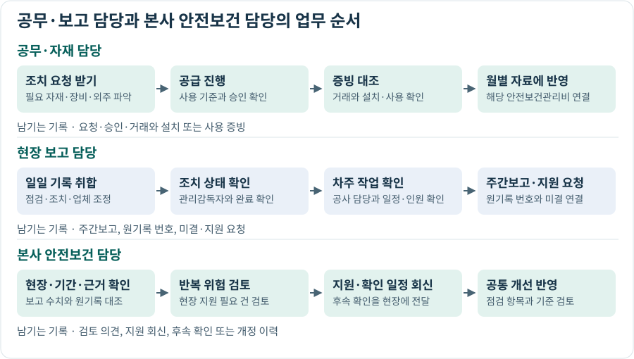

*그림 30. 조치 지원, 현장 보고, 본사 검토와 후속 확인 · 자체 제작.*

| 담당 | 실제 업무 순서 | 전달·기록 |
| --- | --- | --- |
| 공무·자재 담당 | ① 현장 조치에 필요한 자재·장비·외주 요청을 받습니다. ② 구매·사용 기준과 내부 승인 절차에 맞춰 공급을 진행합니다. ③ 설치·사용 후 거래·사용 증빙을 대조합니다. ④ 적용되는 산업안전보건관리비 항목이면 현장 월별 자료에 연결합니다. | 요청·승인·거래·설치 또는 사용 증빙 |
| 현장 보고 담당 | ① 일일 점검, 시정·재확인, 업체 조정 이력을 모읍니다. ② 공사 담당에게 차주 작업일과 인원을, 관리감독자에게 조치 상태를 확인합니다. ③ 주간보고에 차주 관리계획과 원기록 번호를 넣고 미결·지원 건을 올립니다. | 주간보고, 원기록 연결, 미결과 지원 요청 |
| 본사 안전보건 담당 | ① 보고의 현장·대상 기간과 원기록을 확인합니다. ② 반복 위험과 현장에서 해결하기 어려운 지원 요청을 검토합니다. ③ 현장별 지원 결과와 후속 확인 일정을 공유합니다. ④ 다른 현장에도 적용할 조치가 있으면 점검 항목이나 업무 기준에 반영합니다. | 검토 의견, 지원 회신, 후속 확인 또는 개정 이력 |

### 19.9 발주자 측 안전보건조정자

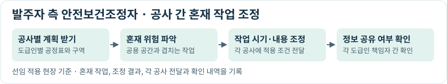

*그림 31. 별도 도급된 공사의 혼재 작업 파악과 정보 공유 확인 · 자체 제작.*

건설공사발주자가 같은 장소에서 진행하는 둘 이상의 건설공사를 도급하고 법령의 적용 요건을 충족할 때 선임되는 역할입니다. 한 원청 아래 두 협력업체의 작업을 조정하는 이 장의 기본 사례는 원청 측 조정으로 다뤘습니다.

1. 각 공사의 도급인에게 공정표, 공용 공간 계획과 작업 내용을 받습니다.
2. 두 공사 사이의 혼재 작업과 위험을 파악하고 작업 시기·내용을 조정합니다.
3. 각 도급인의 안전보건관리책임자 사이에 작업 정보가 공유됐는지 확인합니다. **남기는 기록**은 혼재 작업, 조정 결과와 전달·확인 내역입니다. [산업안전보건법 제68조](https://www.law.go.kr/LSW/lsLinkCommonInfo.do?chrClsCd=010202&lsJoLnkSeq=1032637273) · [산업안전보건법 시행령 제56·57조](https://www.law.go.kr/LSW/lsInfoP.do?lsiSeq=288347&efYd=20260801)

### 19.10 반출 경로 변경 때 담당자들이 서로 넘기는 것

*그림 32. 반출로 변경 시 담당자별 인계 · 자체 제작. 근로자대표의 참여와 보건 검토는 해당 상황에서 연결되고, 통제가 필요한 경우 초기 조치를 먼저 합니다.*

별내 사례에서 운전원은 A구역 관리감독자에게 바뀐 경로를 알립니다. 공사 담당이 B구역에도 알리고, 양쪽 관리감독자가 영향 작업을 통제합니다. 공사 담당은 업체와 변경안을 만들고 안전관리자에게 충돌·출입 위험의 기술 검토를 받습니다. 보행 쪽 분진 제보가 함께 들어오면 보건관리자가 노출과 개선안을 확인합니다. 근로자대표가 위험성평가 참여를 요청하면 참여 절차를 진행하고, 해당 작업을 맡은 근로자에게도 실제 이동 조건을 확인합니다.

각 업체가 대책을 시행하면 관리감독자가 실제 경로·출입 통제와 양쪽 작업조에 전달됐는지 확인합니다. 작업조 일부에 전달되지 않았다면 통제를 유지하고 다시 전달·확인합니다. 확인 결과는 현장 절차상 판단권자에게 올라가며, 판단권자는 재개 범위·시각·조건을 남깁니다. 관리감독자는 각 작업조에 결정을 전달합니다. 반복 지적이나 지원 요청은 원기록 번호와 다음 확인 담당을 붙여 주간보고와 해당 회의 안건에 연결합니다.

## 핵심 요약

- 계획·투입 단계에서 누가 어디서 어떤 작업을 수행할지와 이행 조건을 확인합니다.
- 평가·교육·TBM·허가는 각각의 목적과 기록이 있습니다. 변경 시 영향받는 조건과 담당자를 확인합니다.
- 점검 지적을 조치 완료로 닫기 전에 재확인 결과를 남깁니다. 사건과 후속 조치는 같은 위험 작업의 평가로 다시 연결합니다.
- 주간·월간 자료에는 집계의 기준일과 원기록, 미완료 이월 건이 필요합니다.
- 작업 조건이 바뀌면 최초 신고자, 조치 담당자, 현장 재확인자와 재개 판단자를 확인하고 각 판단의 기록을 연결합니다.

## 학습 확인 문제

1. 새 작업조를 투입할 때 협력업체 작업책임자와 현장 담당이 각각 준비할 정보를 적어 보세요.
2. 운반차가 다른 시간에 들어오기로 바뀌었습니다. 어느 자료를 고치고 작업조에 어떤 내용을 전달합니까?
3. 화기작업 승인 뒤 주변에 가연성 물질이 반입됐습니다. 다음 상태와 남길 기록은 무엇입니까?
4. 조치 담당자가 덮개 정비 전후 사진을 올렸습니다. 종결 전에 누가 무엇을 확인해야 합니까?
5. 사고가 났을 때 내부 보고와 법정 제출을 구별해야 하는 이유는 무엇입니까?
6. 월간 지출과 점검 실적을 검토할 때 이전 기록에서 무엇을 대조합니까?

## 정답 및 해설

1. 업체는 소속·배치·업무와 자격·교육 자료를 제출합니다. 현장 담당은 적용 요건과 현장 조건을 확인하고 배치·교육·보호구·변경 기록을 남깁니다.
2. 일정과 동선 변경이 영향을 미치는 작업을 찾아 평가·작업계획을 대조하고 필요한 재평가를 합니다. 양쪽 작업조에 새 반입 시간과 교차지점·통제 방법을 작업 전에 알리고 결과를 기록합니다.
3. 회사 절차와 작업 조건에 따라 보류·중지하고 위험을 재검토합니다. 변경 상황, 통제, 재허가 또는 보완 판단, 지정 승인자와 시각을 남깁니다.
4. 지정 확인자가 적용 기준과 고정·표시·접근 상태를 검토합니다. 확인자가 남긴 결과가 종결의 근거이며, 미충족이면 보완 후 다시 확인합니다.
5. 내부 보고의 수신자·기준과 법령별 제출 대상·수신자·기한이 다릅니다. 실제 제출이 필요한 경우 접수·수신 근거가 필요합니다.
6. 비용은 계상·사용 목적·거래·사용명세와 월별 실적을 대조합니다. 점검은 일일 지적·시정·재확인 기록을 대조하고 미종결을 이월합니다.

## 참고자료

- 법령명·시행일·공식 보고 서식과 적용 조건은 [03장 법령과 공식 자료](./03_건설안전_관련_법령.md#법령과-공식-자료)에 있습니다. 위험성평가 사전 공지와 공동평가 등은 2026년 개정 고시 기준입니다. [고용노동부 위험성평가 제도 개편 안내](https://www.moel.go.kr/news/enews/report/enewsView.do?news_seq=20194)
- 회사 사례의 참고 양식은 저장소와 같은 상위 폴더의 로컬 `ref/`에 있습니다. 현장 목표 추진 계획서, 보호구 지급대장, 순회점검일지, 화기작업 신청 허가서, 아차사고 접수등록부, 노사협의체 회의록, 주간업무보고 빈양식과 안전보건관리비 집행 자료의 종류와 구성을 참고했습니다. 가상 예시를 실제 회사 규정 및 최신 법정 서식의 적용 여부와 구별합니다.

### 현업 자료와 공식 근거

| 자료 | 이 절에서 확인한 부분 |
| --- | --- |
| `ref/현업자료/본사 운영 부문/vPLUS(ERP) 안전관리 현장 운영 부문(수정본).xlsx` | ‘본사 서류 전산화 목록(취합)’ 시트 10~17행의 일일점검·위험성평가·주간업무보고·관리비 및 33~38행의 작업계획서·작업지휘자 지정·작업허가서. 작성 주체·결재 관련 열을 확인 |
| `ref/현업자료/본사 운영 부문/vPLUS(ERP) 안전관리 본사 운영 부문.xlsx` | ‘본사 서류 전산화 목록’ 시트 3·7행의 주간업무보고와 분기안전점검 실적 보고 항목 |
| `ref/현업자료/현장주간보고/주간업무보고(빈양식).xlsx` | ‘주간업무보고’ 시트 5·16행의 공정·안전활동 및 작업별 예정·투입·관리계획 작성 항목 |
| `ref/2.현장 안전보건경영매뉴얼/5.안전보건 조직도 및 개인별 업무분장표.hwp` | ‘안전보건 조직도’의 현장소장·안전보건총괄책임자 표기, 안전·보건관리자, 공종별 관리감독자, 협력업체 소장의 배치 |
| `ref/10차개정 문서표준안/2.안전교육,회의/2.회의/4.노사협의체 회의록/노사협의체 회의록.hwp` | 근로자위원·사용자위원 구성란, 안건 중 위험성평가와 연락 방법·작업공정 조정 |
| `ref/10차개정 문서표준안/6.보건/3.작업환경/1.작업환경측정 실시 현황/작업환경 측정 실시 현황 목록표.hwp` | 측정 회차·실시일, 관계협력사·참여 인원, 유해인자와 공정별 결과의 구성 |

위 자료는 저장소와 같은 상위 폴더의 `ref/`에 있습니다. 회사의 서류 목록과 보고 양식을 참고해 **업무가 이어지는 순서**를 가상 현장에 맞춰 재구성했습니다. 법령과 공식 안내는 근거 확인일 2026-11-27 기준으로 확인했습니다. [현행 위험성평가 지침](https://www.law.go.kr/LSW/admRulLsInfoP.do?admRulSeq=2100000288038) · [고용노동부 개정 안내](https://www.moel.go.kr/news/enews/report/enewsView.do?news_seq=20194) · [건설현장 TBM 실천 가이드](https://moel.go.kr/local/busanbukbu/news/notice/noticeView.do?bbs_seq=20230302066)

### 사진 출처와 이용조건

사진 1은 Ronald Gutridge가 2005-12-27 미 해군 직무로 촬영한 실제 오키나와 건설 작업 전 안전 브리핑입니다. 사진 제공처는 미국에서 퍼블릭 도메인으로 표시합니다. 원본 이미지를 교재 파일명으로 저장했습니다. [원본·이용조건](https://commons.wikimedia.org/wiki/File:US_Navy_051227-N-3560G-009_U.S._Navy_Seabees_assigned_to_Naval_Mobile_Construction_Battalion_Four_(NMCB-4)_conduct_the_daily_safety_brief.jpg)
