# 04 안전관리 업무 프로세스

[교재 안내](./README.md) · [03장 건설안전 관련 법령](./03_건설안전_관련_법령.md) · [학습 로드맵](./ROADMAP.md#04-안전관리-업무-프로세스)

## 학습 목표

- 현장의 계획, 작업 전 준비, 작업 중 확인, 조치·경영 검토를 한 흐름으로 설명합니다.
- 업무별 수행자·검토자·승인자, 시점, 입력, 결과 및 예외를 찾습니다.
- 같은 현장·구역·작업의 평가, 교육, 허가, 점검 기록을 연결해 봅니다.

**사례의 기준** — 가상 별내 생활문화센터에서 A구역은 굴착, B구역은 골조 작업을 합니다. 회사별 조직, 양식, 결재·허가 권한과 주기는 실제 업무에 따라 정해집니다. 아래 표와 번호는 학습용입니다. 적용 법령과 법정 서식은 [03장](./03_건설안전_관련_법령.md) 및 말미의 공식 자료에 연결했습니다.

## 1. 안전보건 목표와 계획

목표는 예방 활동에 필요한 인력과 예산을 준비하고 이행 여부를 확인할 기준을 마련합니다. 본사는 방침과 적용 기준을 제시하고, 현장소장과 안전보건 담당은 착공 준비나 운영 계획 수립 시 공정·위험·자원을 검토합니다. 해당 승인권자가 계획을 검토하고, 실행 담당자가 결과와 미흡 사유를 기록합니다. 목표 추진계획서와 측정표는 회사 문서의 예입니다.

*그림 1. 본사 방침을 현장 목표와 실적으로 연결 · 자체 제작. 목표와 실행 담당, 실적을 측정할 근거를 한 줄에서 이어 봅니다.*

| 목표 추진계획 예시 | 내용 |
| --- | --- |
| 목표와 기준 | B구역의 개구부 방호 변경 건마다 작업 재개 판단 전에 상태 재확인 |
| 입력·담당 | 변경 건 목록과 작업 일정 · 공사 담당과 지정 확인자 |
| 측정·검토 | 완료 확인 건과 대상 건을 월말 대조 · 현장소장 검토 |
| 증빙 | 점검 번호, 조치 사진, 재확인 결과와 미이행 사유 |

**ERP 연결** — 현장·기간·차수별 계획과 실적을 연결합니다. 목표율의 분모와 미완료 건을 함께 확인해 집계가 누락을 가리지 않도록 합니다.

## 2. 현장과 협력업체 관리

현장이 개설되면 현장 담당은 공사 기간, 작업 구역, 담당 조직과 관계 업체를 정리합니다. 협력업체 선정·계약 단계에서는 작업 수행 범위와 필요한 안전보건 역량·역할을 확인합니다. 업체는 현장 투입 전 해당 담당자와 작업·인원·장비 자료를 제출하고, 시공 측은 업무 범위와 공용 동선·보고 경로를 안내합니다. 공정·계약 변경이나 현장 종료 시 업체의 활동 범위·권한·미해결 과제와 인수인계를 확인합니다.

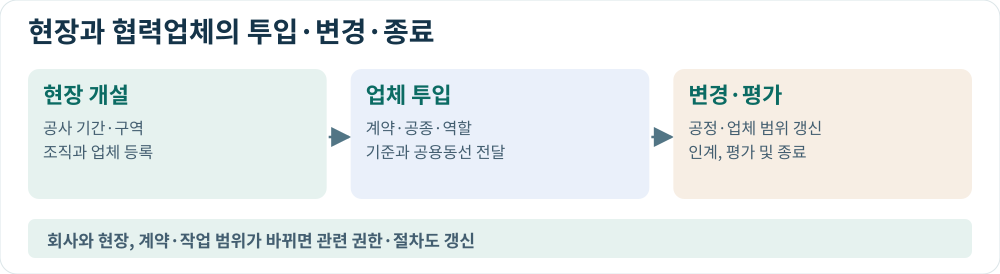

*그림 2. 현장과 협력업체의 투입·변경·종료 · 자체 제작. 계약 기간과 실제 투입 기간을 구별하고, 범위를 바꾸면 관련 기록을 재확인합니다.*

**투입 확인 예시** — B사, 토공, A구역, 11월 4~28일, 책임자 B-01, 장비·근로자 확인 목록, 반입 경로 안내, 계약에 따른 검토자. 작업 후 업체 평가에는 점검·시정 결과와 후속 관리 내역을 근거로 남깁니다. ERP에서는 업체 전체 정보와 현장별 배치·계약을 연결해 조회합니다.

## 3. 근로자 투입·변경·종료

협력업체 작업책임자가 작업 전에 소속·작업·예정 기간과 필요한 자격·교육 자료를 제출합니다. 현장 담당이 작업과 자격·교육의 해당 여부를 보고, 관리감독자와 보호구·역할·변경 내용을 확인합니다. 혼합 작업조의 경우 소속과 실제 담당 업무를 구분합니다. 누락이 있으면 영향받는 작업의 투입 조건을 다시 확인합니다.

*그림 3. 신규 작업조 투입 확인 · 자체 제작. 작업조 편성 전에 확인한 자료와 실제 작업 배정을 연결합니다.*

| 가상 투입 확인표 | 예시 값 |
| --- | --- |
| 근로자·소속·배치 | 근로자 B-07 · B사 · A구역 토공조 |
| 예정 작업 | 굴착 구간 작업 보조 · 지정된 작업과 이동 경로 확인 |
| 확인 | 해당 교육·자격 여부 확인, 보호구 지급, 작업 변경 시 재확인 |
| 결과·증빙 | 투입 여부, 확인자·일자, 교육 이수와 지급 기록 |

**ERP 연결** — 소속·투입 기간·당일 역할과 종료를 기록합니다. 다음 현장에 배치할 때는 새 작업 조건에 필요한 교육·자격을 다시 확인합니다.

## 4. 위험성평가의 실시와 변경

사업주는 해당 작업의 위험을 실제 근로자와 함께 확인하고 감소대책을 수립·이행합니다. 평가시점과 참여·결과 공유는 산업안전보건법 제36조 및 현행 고시를 따릅니다. 현장에서는 공정·장비·작업 위주로 대상 범위를 정하고, 작업자 의견을 반영한 뒤 담당·기한과 재확인 조건을 남깁니다. 작업 조건이 달라지면 고시의 수시 등 해당 평가 절차를 확인합니다. [산업안전보건법 제36조](https://law.go.kr/LSW/lsLinkCommonInfo.do?chrClsCd=010202&lsJoLnkSeq=1032635443) · [현행 평가 고시](https://www.law.go.kr/LSW/admRulLsInfoP.do?admRulSeq=2100000288038)

*그림 4. 굴착 동선 변경을 평가에 반영 · 자체 제작. A구역 굴착 장비와 B구역 작업조의 동선이 겹친다는 제보를 평가·조치·전달과 연결합니다.*

*보충 그림. 공용 진입로 평면의 위험과 개선 방향 · 02장 자체 도해를 재사용했습니다.*

| 평가표 항목 | 조치 전 | 조치 후 확인 예시 |
| --- | --- | --- |
| RA-A-014 | 공용 진입로에서 장비 진입과 B구역 작업자 통행이 겹침. 작업자가 교차 위치를 제보 | 동선 분리와 교차 구간 통제 확인. 남은 차량 진출입 조건을 작업 전 알림 |
| 이행 | 굴착·골조 작업 책임자와 조치 담당 지정 | 담당과 일자, 설치·확인 기록 및 작업자 공유 |
| 재평가 조건 | 차량 경로나 반입 시간이 바뀔 수 있음 | 조건 변경 시 영향받는 작업을 다시 검토 |

## 5. 작업 전 안전점검회의

작업 전 안전점검회의(Tool Box Meeting, TBM)는 작업 직전 관계 작업자와 위험요인·대책을 공유하고 질문과 변화를 확인하는 활동입니다. 진행자는 오늘의 작업에 필요한 평가 결과를 먼저 정리하고, 작업자는 작업·장비·환경 변화를 알려 줍니다. 즉시 해결할 수 없는 사항은 담당자를 정하고 작업을 보류하거나 해당 조건을 재검토합니다. 산업안전보건법 제36조와 고시는 평가 결과 공유를 규정하고, 중대재해로 이어질 수 있는 요인의 상시 주지에 관한 법의 노력 규정을 확인합니다. [고용노동부 건설현장 TBM 실천 가이드](https://moel.go.kr/local/busanbukbu/news/notice/noticeView.do?bbs_seq=20230302066) · [산업안전보건법 제36조](https://law.go.kr/LSW/lsLinkCommonInfo.do?chrClsCd=010202&lsJoLnkSeq=1032635443)

*그림 5. 작업 전 안전점검회의에서 확인할 사항 · 자체 제작. 당일 조건과 작업자 의견을 확인해 안전조치를 작업 시작 전에 반영합니다.*

*사진 1. 건설 작업 전 현장 브리핑 · 실제 사진. 일본 오키나와에서 정자를 시공하는 작업조가 사진 오른쪽 위의 작업발판에 모여 착수 전 브리핑을 하고 있습니다. 한국의 법정 교육 이수 요건을 보여 주는 사진과 구별합니다. [사진 출처와 이용조건](#사진-출처와-이용조건)*

**회의 기록 예시** — A/B구역 관계 작업조, 당일 반입 일정, 평가 RA-A-014, 교차지점 통제 위치, 근로자 질의 ‘차량 진입 시간이 달라지면 누구에게 알리는가’, 작업 책임자의 답과 담당·보완 결과. ERP에는 회의 기록을 해당 평가 개정본과 그 날짜 작업에 연결합니다.

## 6. 안전보건교육

교육 담당자는 근로자 소속·업무·숙련·작업 변경과 유해·위험작업을 확인해 대상과 유형을 정합니다. 사업주는 적용되는 교육을 실시하거나 법이 정한 기초교육 이수를 확인합니다. 시행규칙의 교육시간·내용, 면제·특례, 강사 기준을 확인한 뒤 이수 자료를 작업조 배치와 연결합니다. [산업안전보건법 제29·31조 및 시행규칙 제26~28조·별표 4·5](./03_건설안전_관련_법령.md#법령과-공식-자료)

*그림 6. 안전보건교육의 대상과 이수 증빙 · 자체 제작. 교육의 목적과 대상·실시 시점을 먼저 결정합니다.*

| 교육 유형 | 대상과 시점 확인 예시 | 증빙 |
| --- | --- | --- |
| 정기교육 | 대상 근로자와 관리감독자 등 해당 기간·직무 기준 확인 | 기간, 과정, 참석과 이수 기록 |
| 채용 시·작업내용 변경 시 | 신규 배치나 작업내용 변경의 조건과 교육 필요 여부 확인 | 대상, 배치 전 교육 또는 근거, 변경 이력 |
| 특별교육 | 해당 유해·위험작업인지 별표의 대상·시간·내용 확인 | 대상 작업, 실시 시간·내용과 이수 |
| 건설업 기초안전보건교육 | 건설 일용근로자 채용 시 해당 이수 의무·이미 이수한 경우 등 확인 | 교육기관과 이수 확인, 작업 배치 |

**교육일지 예시** — ED-B-011, B사 B-07, 작업 변경 교육, 굴착 경로·접근통제·비상연락, 교육자·실시 일시·대상 기준, 이수 확인, 적용 작업. ERP는 교육 계획, 교육 실적과 실제 투입 조건을 연결합니다. 당일 TBM 참석도 별도 기록으로 확인합니다.

## 7. 작업허가서

작업허가(Permit to Work, PTW)는 회사나 현장이 지정한 작업에서 범위와 선행 안전 조건을 확인하는 절차입니다. 예시 화기작업의 신청자는 위치·작업·시간과 위험·대책을 제출합니다. 현장 검토자는 적합한 방호·감시·초기 대응 수단과 관계 작업을 살피고, 지정 승인자는 허가 조건과 유효기간을 확인합니다. 실제 위험작업별 법정 조치·계획은 별도로 확인합니다.

*그림 7. 작업허가의 신청·검토·재허가·종결 · 자체 제작. 승인 후에도 현장 조건이 바뀌거나 시간이 지나면 재검토와 해당 재허가가 필요할 수 있습니다.*

| 화기작업 허가 양식 예시 | 예시 값 |
| --- | --- |
| 신청 | PW-B-003 · B구역 지정 작업 위치 · 신청 업체·책임자·예정 시간 |
| 검토 및 승인 | 적용한 작업계획, 가연물·불티 통제, 감시·임시소방시설 확인 · 승인자와 허가 범위 |
| 작업 및 변경 | 작업 시작 시 조건 확인. 위치·시간·주변 작업이 바뀌면 중지 또는 보류하고 재검토 |
| 종료 | 현장 상태와 해당 작업 후 확인 사항 기록 · 종료 확인자 및 일시 |

**ERP 연결** — 신청, 검토, 승인, 보류·반려, 작업 종료와 재확인의 시점·담당자를 구별합니다. 회사 화기작업 양식은 내부 사례이며, 적용 법령과 관련 소방시설 기준은 해당 현장의 요건으로 확인합니다. [소방시설 설치 및 관리에 관한 법률 제15조](https://www.law.go.kr/법령/소방시설설치및관리에관한법률/제15조)

## 8. 안전점검

일상 안전점검(Inspection)은 작업 일정과 위험에 따라 대상·구역·시간을 잡고 현장 상태를 확인하는 활동입니다. 지정 점검자가 위치·적용 기준·적합 여부·확인 방법을 기록하고, 미흡 사항과 즉시 통제 여부를 해당 책임자에게 알립니다. 일상 순회와 건설기술 진흥법상 대상 공사의 자체·정기·정밀안전점검은 근거·시점·수행자가 다를 수 있습니다. [건설기술 진흥법 시행령 제100조](https://www.law.go.kr/LSW/lsLinkCommonInfo.do?lsJoLnkSeq=1033553135)

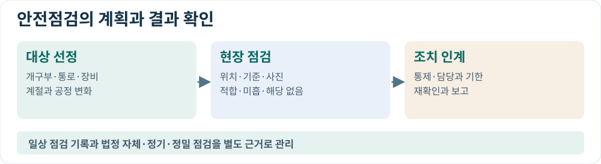

*그림 8. 안전점검의 계획과 결과 확인 · 자체 제작. 점검 항목 번호만으로는 부족하므로 위치와 기준, 결과와 이어지는 조치를 기록합니다.*

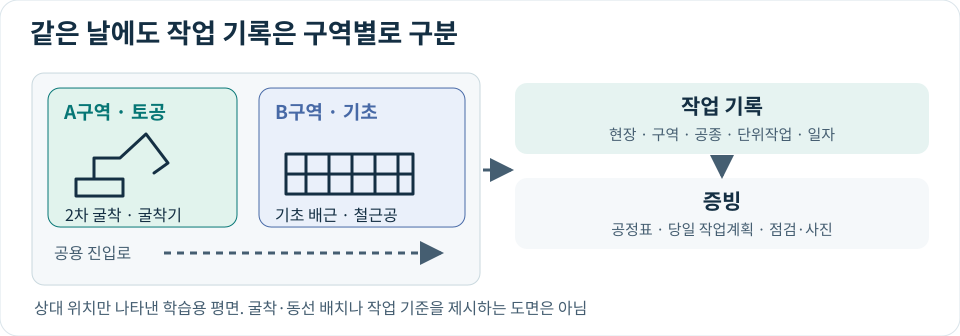

*보충 그림. 순회점검의 위치 기록 예 · 01장 자체 도해를 재사용했습니다.*

**점검표 예시** — CK-B-022, B구역 골조층 개구부, 고정·식별 확인, 결과 ‘고정 상태 재확인 필요’, 발견일·점검자, 접근 통제, 조치 CA-B-009 연결. 다음 점검자는 변경된 공정과 앞선 미완료 항목을 같이 확인합니다.

## 9. 지적사항과 시정조치

시정조치(Corrective Action)는 지적 등록, 필요한 통제, 담당·기한, 조치 등록, 재확인을 거쳐 종결합니다. 점검에서 발견한 위험에 즉시 통제가 필요하면 담당 배정이나 전자결재를 기다리기 전에 해당 절차에 따라 대응합니다. 담당자가 작업을 마쳤다고 알리면 지정 확인자가 기준·현장 상태를 보고 기록을 남깁니다.

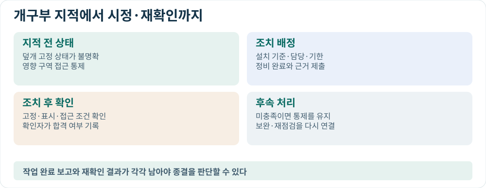

*그림 9. 개구부 지적에서 시정·재확인까지 · 자체 제작. 같은 지적을 여러 작업조가 조회할 수 있게 하고, 보완과 재확인 이력을 연결합니다.*

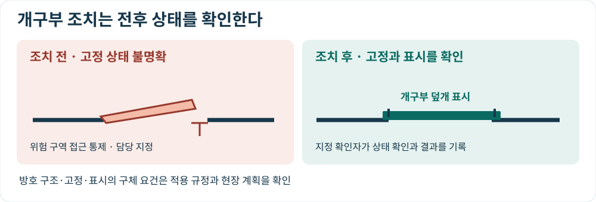

*보충 그림. 개구부 시정 전·후 · 자체 제작. 위험 구역의 통제와 개선 상태 재확인을 보여 주는 개념도입니다.*

| 지적·시정 기록 예시 | 예시 값 |
| --- | --- |
| 지적 | CA-B-009 · CK-B-022 · 덮개 고정 상태 불명확 |
| 초기 통제·담당 | 접근 통제 · 공사 담당, 방호 작업조 · 재확인 전 재개 보류 |
| 조치 | 기준에 맞는 방호 구성·고정·표시 적용 · 조치 완료 사진과 기록 |
| 재확인 | 지정 확인자의 확인 내용과 결과 · 기준 미충족이면 보완 진행 |

**ERP 연결** — 완료 보고일, 확인일·확인자, 종결일을 별도로 확인합니다. 같은 위험이 재발하면 이전 기록과 작업조건 변경 여부를 찾아봅니다.

## 10. 건설기계·장비 안전관리

장비 담당자는 반입 전에 해당 장비의 식별 정보·제원·적용 등록·검사 상태와 운전원 자격, 작업계획 적용을 확인합니다. 작업일에는 운전원·관리감독자가 장비 상태와 당일 위치·반경·통제 조건을 확인합니다. 결함이 발견되면 사용 제한과 수리·교체를 기록하고, 적합 확인 후 허용 범위에서 사용합니다. 반출 때는 현장 배치 상태를 종료합니다. [건설기계관리법 시행령과 별표 1](https://www.law.go.kr/법령/건설기계관리법시행령) · [산업안전보건기준에 관한 규칙](./03_건설안전_관련_법령.md#법령과-공식-자료)

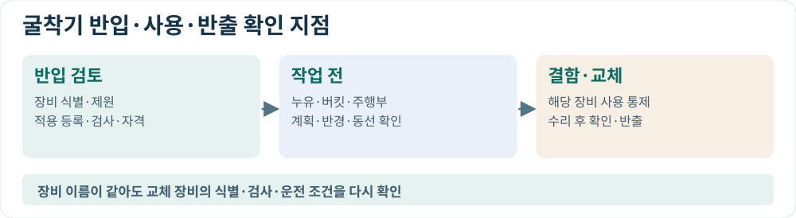

*그림 10. 굴착기 반입·사용·반출 확인 지점 · 자체 제작. 굴착기와 실제 운전원, 장비가 들어가는 현장의 확인 자료를 연결합니다.*

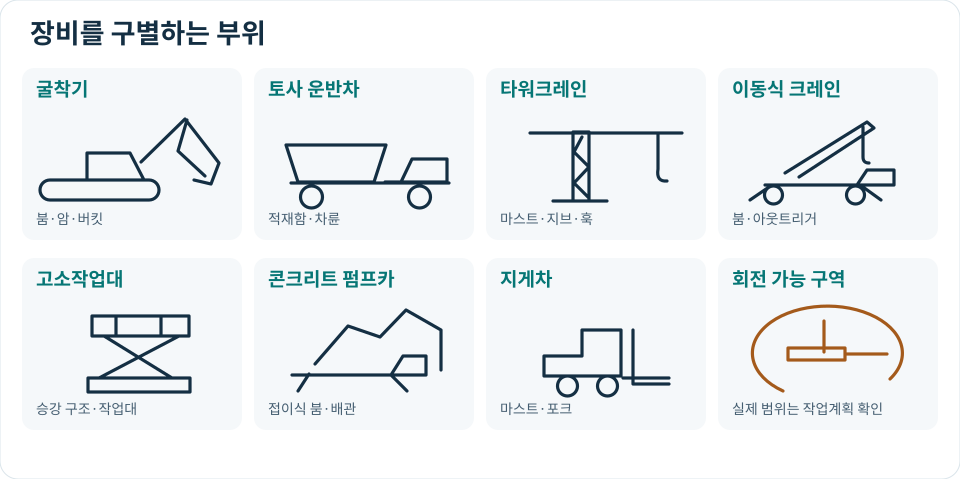

*보충 그림. 장비 종류 및 주요 부위 · 01장 자체 도해를 재사용했습니다. 굴착기의 붐·암·버킷과 작업 영역을 확인합니다.*

**반입·점검표 예시** — EQ-EX-02, A구역, 장비 모델·식별정보, 운전원과 자격 확인, 적용 장비 검사 자료, 버킷·주행부 및 작업계획 확인, 반입 확인자·일시, 결함과 조치 기록. 같은 구역에 대체 장비가 들어오면 배치와 당일 점검을 갱신합니다.

## 11. 보건 및 건강관리

보건 담당자는 절단 분진·소음, 화학물질 등 작업별 유해인자와 노출 상황을 확인합니다. 사업주는 적용 요건에 따라 작업환경측정(Work Environment Measurement) 및 일반·특수·배치전·수시 건강진단 등 해당 건강진단을 실시·관리합니다. 후속조치는 노출 저감과 작업환경 개선에 연결합니다. 건강진단 결과는 산업안전보건법상 다른 목적으로 사용하지 않으며, 건강 관련 개인정보의 처리 근거와 접근·공유 범위를 검토합니다. [산업안전보건법 제125·129~132조](https://www.law.go.kr/LSW/lsInfoP.do?ancYnChk=0&chrClsCd=010202&efYd=20261027&lsiSeq=291447&urlMode=lsInfoP) · [개인정보 보호법 제23조](https://www.law.go.kr/법령/개인정보보호법/제23조)

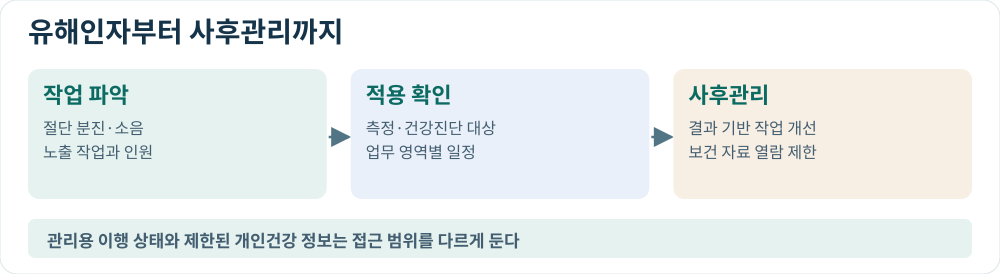

*그림 11. 유해인자부터 사후관리까지 · 자체 제작. 작업의 노출 확인과 개인별 건강정보 열람 범위를 각각 검토합니다.*

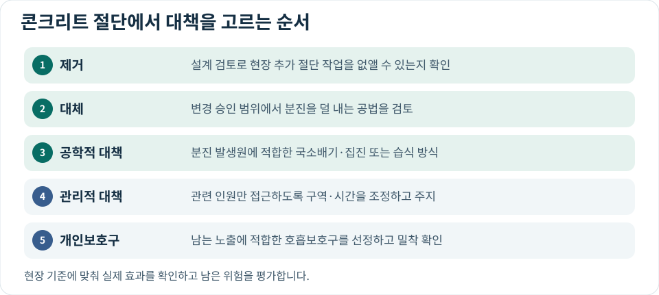

*보충 그림. 작업 유해인자 저감 예 · 02장 자체 도해를 재사용했습니다. 절단 분진과 소음은 각각 노출과 대책을 확인합니다.*

**학습용 보건 기록** — H-B-004, B구역 절단작업, 유해인자 분진·소음, 측정·건강진단 적용 확인 담당, 집진 및 구역 통제 적용, 작업환경 재확인 일정. 일반 현장 조회에는 작업 개선 상태만 표시하고 개인의 진단 자료는 업무상 필요한 담당이 처리하는 예입니다.

## 12. 산업안전보건관리비 관리

공사비 담당자는 계상 근거를 인계받고 사용 목적·편성액과 현행 고시의 허용·제한을 미리 대조합니다. 사용 담당은 품목과 사용 현장·대상 및 원증빙을 남기며, 검토자는 같은 지출이 여러 곳에 중복 반영됐는지, 항목과 시기에 맞는지 확인합니다. 월말에는 당사·협력업체 실적을 대조해 정정·정산 자료와 사용명세를 보관합니다. [산업안전보건관리비 고시와 해설](./03_건설안전_관련_법령.md#법령과-공식-자료)

*그림 12. 산업안전보건관리비의 계상·집행·정산 · 자체 제작. 계상액, 사용 목적, 거래·사용 증빙과 확인 결과를 월별로 추적합니다.*

| 가상 사용명세 | 내용 |
| --- | --- |
| 지출 요청 | SC-11-021 · B구역 추락 예방 시설 · 80만 원(가상 금액) |
| 사전 검토 | 해당 공사, 사용 목적, 적용 고시 항목과 인정 요건 검토 |
| 첨부 | 납품·거래 증빙, 실제 사용 위치 및 확인 기록 |
| 월말 결과 | 검토 상태, 수정 사항, 승인·제외 근거 및 월별 사용명세 |

**ERP 연결** — 현장·월·업체·항목으로 조회하되, 계약변경으로 계상액을 바꾼 날짜와 지출 발생일은 구별합니다. 결재나 사진 한 장에만 의존하지 않고 원증빙과 이력을 연결합니다.

## 13. 재해와 아차사고

사고를 발견하면 구조·대피, 2차 재해 예방과 보고를 우선합니다. 현장 담당은 작업·시간·위치, 피해와 확인된 사실을 기록하고, 해당 법령의 보고·통보 의무를 사업주·관계 주체가 판단할 수 있게 전달합니다. 조사 담당은 원인, 재발방지대책, 담당·기한을 정리하고 결과를 해당 작업에 다시 반영합니다. 아차사고도 위험요인 개선을 위한 입력으로 관리합니다. [산업안전보건법 제54·57조 및 시행규칙 제73조](./03_건설안전_관련_법령.md#법령과-공식-자료) · [CSI 건설사고 안내](https://www.csi.go.kr/por/about_acd_002.do)

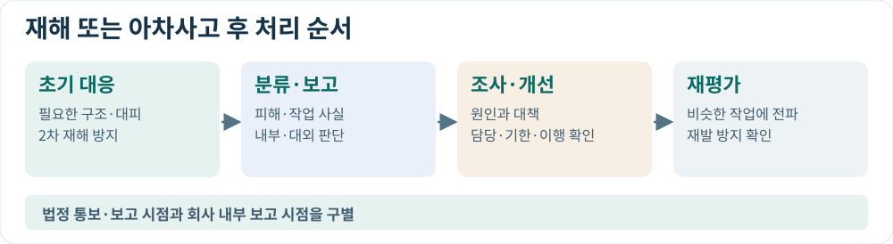

*그림 13. 재해 또는 아차사고 후 처리 순서 · 자체 제작. 초기 대응과 법령별 보고, 조사와 후속 조치 기간을 서로 구별합니다.*

**가상 아차사고 기록** — NM-A-002, 공용 진입로에서 굴착 운반차와 보행자가 예상보다 가까워졌으나 피해 없음, 해당 구역 통제와 작업조 확인, 원인 ‘반입 시간이 바뀌었으나 보행 담당에게 미전달’, 대책 ‘교차점 통제·변경 전달·재확인 담당 지정’, 관련 평가 RA-A-014. 재해인 경우 조사보고서에는 피해, 보고 판단, 제출·수신과 예방조치를 각각 기록합니다. 법정 기준에 해당하는 경우 공식 서식·기한을 적용합니다. [산업재해조사표 공식 서식](https://www.law.go.kr/flDownload.do?flSeq=152447827)

## 14. 안전보건 관련 회의체

회의체마다 목적과 구성·주기가 다릅니다. 현장 담당은 법 제24·64·75조와 해당 시행령·시행규칙에 따라 적용 요건을 확인합니다. 예를 들어 시행령 제63조의 노사협의체 기준은 공사금액 120억 원 이상이며 해당 토목공사업은 150억 원 이상입니다. 법 제75조 요건을 충족해 노사협의체를 구성·운영하면 적용되는 위원회·도급 협의체 관련 간주 규정을 확인합니다. [산업안전보건법](./03_건설안전_관련_법령.md#법령과-공식-자료) · [시행령 제63~65조 및 별표](https://www.law.go.kr/LSW/lsInfoP.do?ancYnChk=0&efYd=20260801&lsiSeq=288347)

*그림 14. 회의체별 안건과 후속 과제 · 자체 제작. 회의 계획에 참여자, 적용 근거, 후속 조치 확인 담당을 함께 둡니다.*

| 회의록 항목 | 가상 예 |
| --- | --- |
| 회의·참석 | 적용 회의체와 일자 · 시공사·협력업체 등 해당 참여자 및 역할 |
| 안건 | 11월 B구역 물류와 A구역 반출 시간 겹침 |
| 결정 | 담당자가 일일 작업계획을 조정하고 현장 통제 위치 확인 |
| 후속 | 기한, 작업 전 반영·전달 기록, 다음 회의에서 이행 확인 |

**ERP 연결** — 회의록에서 결정된 과제에 담당자와 기한을 부여하고 평가·중점 점검·조치 기록에 연결합니다. 회의록 승인과 과제 이행을 구별합니다.

## 15. 중대재해 예방과 의무이행 점검

본사 담당은 적용 의무와 점검 주기, 책임 및 현장이 제출할 근거를 정리합니다. 현장은 작업계획, 평가·교육·비상훈련 등 해당 자료를 연결합니다. 이행 점검자는 누락·미흡과 실제 조치 여부를 확인하고, 필요한 인력·예산 지원과 완료 기한을 정해 재확인합니다. 중대재해처벌법 시행령 제4·5조에 따른 반기 점검 등은 적용 조문과 대상에 맞춰 관리합니다. [중대재해처벌법 시행령 제4·5조](https://www.law.go.kr/LSW/lsInfoP.do?lsId=014159)

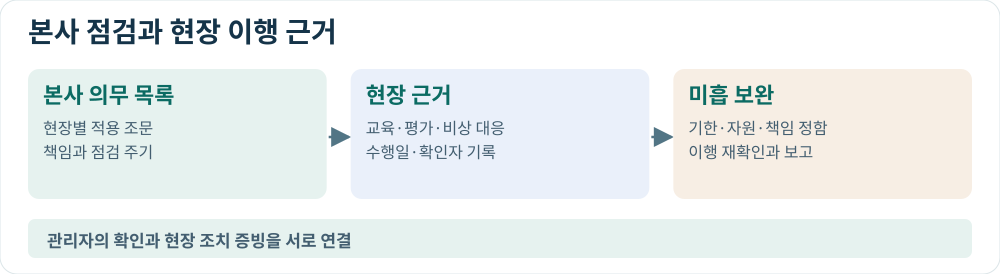

*그림 15. 본사 점검과 현장 이행 근거 · 자체 제작. 본사의 확인 결과를 현장의 보완과 다시 연결합니다.*

**의무 이행 점검 예시** — 하반기 의무 이행 검토, 별내 센터, 근거 위험성평가와 근로자 참여·개선 기록, 미흡 ‘변경 후 재확인 증빙 누락’, 담당·기한·본사 지원 여부, 개선 후 확인일. ERP에서는 여러 현장을 집계하면서 각 결과의 근거 번호로 내려갈 수 있게 합니다.

## 16. 비상대응·작업중지·재개

급박한 위험이 발견되면 현장 역할에 따라 작업중지·대피와 접근 제한, 보고와 필요한 비상 대응을 합니다. 산업안전보건법 제51조는 사업주의 작업중지를, 제52조는 근로자의 작업중지·대피·보고를 규정합니다. 보고받은 담당자는 위험이 제거됐는지 확인하고 작업계획, 평가와 필요한 재검토·재개 권한을 확인합니다. 행정기관이 작업을 중지시킨 경우에는 해당 법정 해제 절차를 적용합니다. [산업안전보건법 제51·52·54·55조](./03_건설안전_관련_법령.md#법령과-공식-자료)

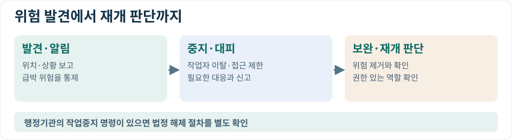

*그림 16. 위험 발견에서 재개 판단까지 · 자체 제작. 위험 발견·통제, 보완 완료, 재개 판단은 각기 다른 기록을 남깁니다.*

**비상 훈련·조치 기록 예시** — EM-B-001, B구역, 방호 훼손·위험 발견 시각, 통제 범위와 대피·연락 대상, 현장 확인과 보완, 재개 검토 담당·근거, 작업조에 다시 알린 내용. 훈련과 실제 사건을 해당 유형으로 표시하고, 훈련에서 확인된 누락 연락망을 보완합니다.

## 17. 하루에서 월말까지의 업무 인계

현장마다 작업·회의 주기는 다릅니다. 다음은 별내 센터에서 작업 전 준비가 주간 조정과 월간 관리로 이어지는 예입니다. 해당 법정 점검·회의·보고에 정해진 기한이 있으면 이를 일정에 반영합니다.

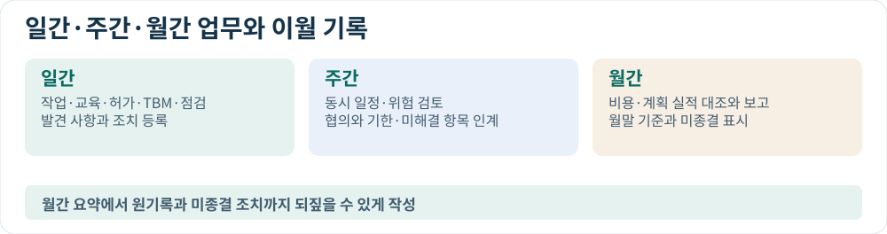

*그림 17. 일간·주간·월간 업무와 이월 기록 · 자체 제작. 일간 기록을 주간 작업 일정과 월간 증빙에서 다시 확인합니다.*

| 시점 | 주된 업무와 참여자 | 다음에 넘길 정보 |
| --- | --- | --- |
| 일간 작업 전 | 작업책임자·관리감독자·관계 작업조가 인원·교육·장비·계획·허가 조건과 위험성평가 및 TBM 결과를 확인 | 당일 작업 범위, 시행할 조치, 확인·보류 |
| 일간 작업 중·후 | 현장 담당자가 순회점검, 변경 통제, 지적·시정 등록과 작업·허가 종료 확인 | 조치 담당·기한, 완료·재확인, 보고 대상 사건 |
| 주간 | 공사·안전보건 담당과 관계 업체가 다음 공정과 동시 작업을 조정하고 회의·점검 현황을 검토 | 다음 주 위험, 예정 조치와 미해결 건, 주간보고 |
| 월간 | 현장소장과 본사 담당이 계획·실적, 교육·재해·비용·보건 및 개선 현황을 대조 | 월말 기준, 원증빙, 이월 조치와 후속 일정 |

예를 들어 A구역 진입로 변경은 **RA-A-014 위험성평가 → 당일 TBM → 실제 동선 점검 → A구역 동선의 후속 조치 → 주간 인계**로 추적합니다. B구역의 개구부 조치와 A구역 동선 조치는 서로 다른 위험 건으로 유지하되, 같은 작업일의 공용 구역 영향은 작업계획에서 함께 확인할 수 있습니다. 월 마감을 넘긴 항목은 미종결 사유와 새 기한까지 인계합니다.

## 핵심 요약

- 계획·투입 단계에서 누가 어디서 어떤 작업을 수행할지와 이행 조건을 확인합니다.
- 평가·교육·TBM·허가는 각각의 목적과 기록이 있습니다. 변경 시 영향받는 조건과 담당자를 확인합니다.
- 점검 지적을 조치 완료로 닫기 전에 재확인 결과를 남깁니다. 사건과 후속 조치는 같은 위험 작업의 평가로 다시 연결합니다.
- 주간·월간 자료에는 집계의 기준일과 원기록, 미완료 이월 건이 필요합니다.

## 학습 확인 문제

1. 새 작업조를 투입할 때 협력업체 작업책임자와 현장 담당이 각각 준비할 정보를 적어 보세요.
2. 운반차가 다른 시간에 들어오기로 바뀌었습니다. 어느 자료를 고치고 작업조에 어떤 내용을 전달합니까?
3. 화기작업 승인 뒤 주변에 가연성 물질이 반입됐습니다. 다음 상태와 남길 기록은 무엇입니까?
4. 조치 담당자가 덮개 정비 전후 사진을 올렸습니다. 종결 전에 누가 무엇을 확인해야 합니까?
5. 사고가 났을 때 내부 보고와 법정 제출을 구별해야 하는 이유는 무엇입니까?
6. 월간 지출과 점검 실적을 검토할 때 이전 기록에서 무엇을 대조합니까?

## 정답 및 해설

1. 업체는 소속·배치·업무와 자격·교육 자료를 제출합니다. 현장 담당은 적용 요건과 현장 조건을 확인하고 배치·교육·보호구·변경 기록을 남깁니다.
2. 일정과 동선 변경이 영향을 미치는 작업을 찾아 평가·작업계획을 대조하고 필요한 재평가를 합니다. 양쪽 작업조에 새 반입 시간과 교차지점·통제 방법을 작업 전에 알리고 결과를 기록합니다.
3. 회사 절차와 작업 조건에 따라 보류·중지하고 위험을 재검토합니다. 변경 상황, 통제, 재허가 또는 보완 판단, 지정 승인자와 시각을 남깁니다.
4. 지정 확인자가 적용 기준과 고정·표시·접근 상태를 검토합니다. 확인자가 남긴 결과가 종결의 근거이며, 미충족이면 보완 후 다시 확인합니다.
5. 내부 보고의 수신자·기준과 법령별 제출 대상·수신자·기한이 다릅니다. 실제 제출이 필요한 경우 접수·수신 근거가 필요합니다.
6. 비용은 계상·사용 목적·거래·사용명세와 월별 실적을 대조합니다. 점검은 일일 지적·시정·재확인 기록을 대조하고 미종결을 이월합니다.

## 참고자료

- 법령명·시행일·공식 보고 서식과 적용 조건은 [03장 법령과 공식 자료](./03_건설안전_관련_법령.md#법령과-공식-자료)에 있습니다. 위험성평가 사전 공지와 공동평가 등은 2026년 개정 고시 기준입니다. [고용노동부 위험성평가 제도 개편 안내](https://www.moel.go.kr/news/enews/report/enewsView.do?news_seq=20194)
- 회사 사례의 참고 양식은 저장소와 같은 상위 폴더의 로컬 `ref/`에 있습니다. 현장 목표 추진 계획서, 보호구 지급대장, 순회점검일지, 화기작업 신청 허가서, 아차사고 접수등록부, 노사협의체 회의록, 주간업무보고 빈양식과 안전보건관리비 집행 자료의 종류와 구성을 참고했습니다. 가상 예시를 실제 회사 규정 및 최신 법정 서식의 적용 여부와 구별합니다.

### 사진 출처와 이용조건

사진 1은 Ronald Gutridge가 2005-12-27 미 해군 직무로 촬영한 실제 오키나와 건설 작업 전 안전 브리핑입니다. 사진 제공처는 미국에서 퍼블릭 도메인으로 표시합니다. 원본 이미지를 교재 파일명으로 저장했습니다. [원본·이용조건](https://commons.wikimedia.org/wiki/File:US_Navy_051227-N-3560G-009_U.S._Navy_Seabees_assigned_to_Naval_Mobile_Construction_Battalion_Four_(NMCB-4)_conduct_the_daily_safety_brief.jpg)
