# 05 건설안전 ERP 모듈 및 기능

[교재 안내](./README.md) · [04장 안전관리 업무 프로세스](./04_안전관리_업무_프로세스.md) · [학습 로드맵](./ROADMAP.md#05-건설안전-erp-모듈-및-기능)

## 학습 목표

- 현장 업무를 모듈별 사용자, 수행 시점, 입력·결과, 권한과 증빙으로 설명합니다.
- 같은 작업에서 평가·작업 전 안전점검회의·허가·점검·시정·집계를 연결합니다.
- 기능정의서의 기록, 운영 메뉴 확인, 교육용 화면의 범위를 구별합니다.

## 1. 건설안전 ERP의 목적과 메뉴

건설안전 ERP는 현장과 업체가 수행한 예방 업무를 기록하고, 본사에서 상태·의무이행·증빙을 확인하도록 돕는 업무 영역입니다. 기록은 역할과 함께 읽습니다. 현장 담당은 구역별 작업을 관리하고, 협력업체는 자신이 맡은 범위에서 작성·보완하며, 지정 검토자와 본사는 확인·집계·필요한 제출을 관리합니다. 같은 작업의 단계별 증빙을 따라가면 어떤 조치가 진행 중인지 판단할 수 있습니다.

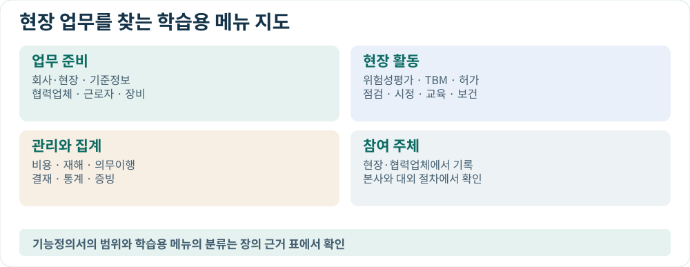

*그림 1. 현장 업무를 찾는 학습용 메뉴 지도 · 자체 제작. 교재의 모듈 구성이며 회사별 운영 메뉴는 기능 근거와 접근 범위를 확인합니다.*

**확인 범위** — 로컬 `ref/현업자료/`의 2026-01-12 안전환경 기능정의서와 두 vPLUS 안전관리 기능정의서의 메뉴 후보·업무 범위를 비교했습니다. 팀의 검토 문서에서 안전관리비 월별실적 관련 결재와 보고서의 검토 범위도 확인했습니다. 운영 메뉴 조회는 호출자 인증이 확인되지 않아 실행되지 않았습니다. 따라서 ‘기능정의서’로 표시된 항목은 문서의 기능 범위이고, 자체 제작 화면은 별내 센터의 가상 데이터와 역할을 넣은 학습 예시입니다. [기능정의서 확인 근거](#기능정의서-확인-근거)

## 2. 기준정보 관리

기준정보(Master Data)는 작업과 기록에 반복해서 쓰는 분류입니다. 안전 담당과 기준정보 관리자는 공종·단위작업·유해위험요인·감소대책·점검 항목·교육 유형의 쓰임, 적용 시작과 중지 시점을 확인합니다. 기준 개정 뒤에도 그 이전 평가에 실제 적용한 항목과 내용은 다시 확인할 수 있어야 합니다.

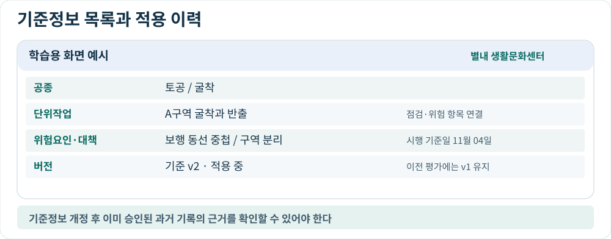

*그림 2. 기준정보 목록과 적용 이력 · 자체 제작. 입력과 적용 버전이 후속 평가·점검·교육에 이어지는 학습용 화면입니다.*

- **입력·결과** — 기준명, 적용 범위, 시행 여부, 변경 사유. 결과는 점검표와 평가에 적용할 기준 목록, 변경 이력입니다.
- **사용자와 판정** — 기준 담당은 작성·개정을 맡고 현장 작업자는 사용할 기준을 조회합니다. 승인 또는 배포는 조직의 지정 권한을 확인합니다.
- **기능정의서 근거** — ‘작업공종관리’, ‘위험요인관리’, ‘교육코드관리’, ‘점검체크리스트지표’가 정의돼 있습니다. 단위작업 기준버전 추적은 학습용 연결 예입니다. [기능정의서 확인 근거](#기능정의서-확인-근거)

## 3. 회사 및 현장 관리

회사는 계약과 책임이 놓인 법인·조직 단위입니다. 현장은 그 회사가 작업과 인력을 배치하는 사업 장소·기간 단위입니다. 현장 개설 정보에는 회사·현장, 공사 유형, 착공·준공 예정, 구역·조직과 담당을 연결할 수 있습니다. 확대·축소·종료 때 미해결 조치와 인수인계를 확인합니다.

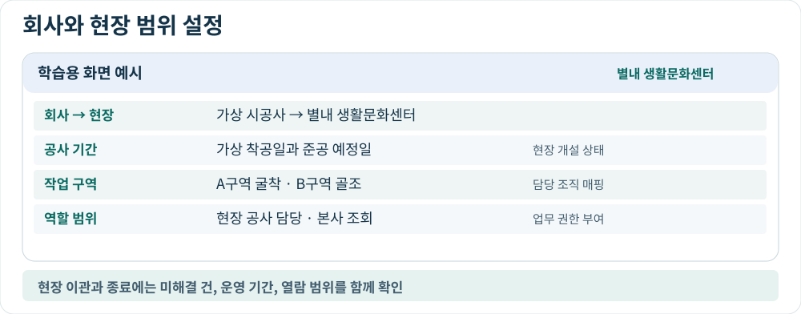

*그림 3. 회사와 현장 범위 설정 · 자체 제작. 같은 시공사에 여러 현장이 있고, 작업 기록은 현장과 기간으로 구분됩니다.*

- **입력·결과** — 현장 식별, 발주·공사기간·조직, 담당자·구역. 결과는 회사·현장 목록과 작업·점검에서 사용할 범위입니다.
- **사용자와 판정** — 현장·본사 담당이 개설·변경을 검토하고 해당 현장 역할은 배정 범위를 조회합니다.
- **기능정의서 근거** — 2026-01-12 정의서의 ‘현장기준정보’와 모바일 시공사용 ‘현장정보 조회’가 사례 근거입니다. 일부 vPLUS 개정안에는 유사 항목에 삭제 요청 표시가 있으므로 운영 범위는 버전을 구분해 확인합니다. [기능정의서 확인 근거](#기능정의서-확인-근거)

## 4. 협력업체 관리

한 업체가 여러 현장에 참여할 때 기업의 기본 정보와 개별 공사 계약은 의미가 다릅니다. 계약을 확인한 뒤 현장·공종·기간과 업체 작업책임자를 연결합니다. 현장 담당자는 투입 범위와 예외를 검토하고, 협력업체는 자기 계약·작업과 관련된 평가·허가·조치 자료를 제출할 수 있도록 권한을 정합니다.

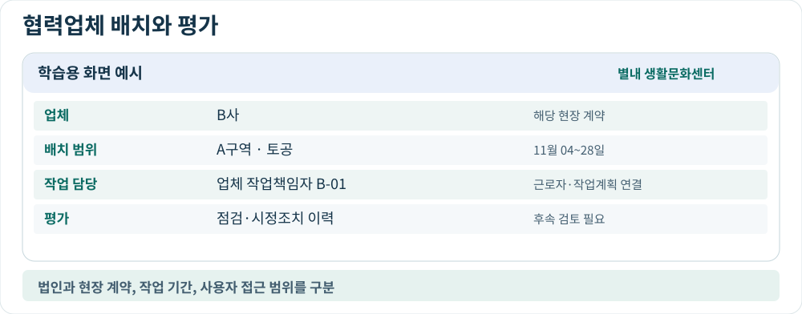

*그림 4. 협력업체 배치와 평가 · 자체 제작. 업체 등록 정보와 현장 계약, 작업 배치 및 후기 평가의 관계를 보여 줍니다.*

**입력·결과** — B사 계약·공종·기간·구역, 업체 담당, 작업조, 평가·조치 이력. 결과는 현장 업체 목록, 평가 참여 범위와 개선 결과입니다. 계약 종료로 작성 범위가 끝난 뒤에도 필요한 증빙의 보관·조회 여부를 확인합니다. 정의서의 ‘협력업체 관리’와 업체의 작성·제출 업무가 근거이며, 업체 평가 화면의 세부는 학습 예시입니다. [기능정의서 확인 근거](#기능정의서-확인-근거)

## 5. 근로자 관리

근로자 관리는 업체와 작업자를 현장·기간·역할에 연결합니다. 현장에 투입하기 전에 해당 교육 이수 및 자격·보호구 등의 조건을 확인하고 작업이 변하면 다시 검토합니다. 교육·출입·배치·보건 자료의 열람 범위는 업무 목적을 따릅니다.

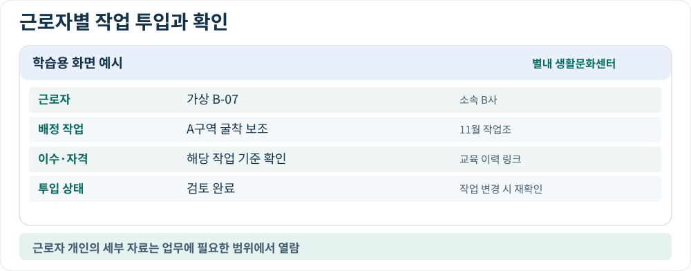

*그림 5. 근로자별 작업 투입과 확인 · 자체 제작. 가상 근로자 B-07의 소속과 실제 작업, 확인한 자료를 보여 줍니다.*

**입력·결과** — 업체의 소속·배치 요청, 날짜·작업과 적용 자격·이수 확인. 현장 담당은 작업 전 확인 자료로 적합 여부를 검토하고 배치·변경·종료 기록을 남깁니다. ‘신규 투입 확인’은 학습용 화면입니다. 문서의 일부 근로자 관련 항목은 특정 관리 목적을 가진 기능 요구로 읽습니다. [기능정의서 확인 근거](#기능정의서-확인-근거)

## 6. 안전관리

안전관리는 위험성평가에서 발견한 위험이 작업 전에 전달되고, 현장 점검·시정과 실제 확인으로 이어지게 관리합니다. 업체의 제출, 현장 실무 검토, 지정 승인 및 후속 조치를 같은 업무로 묶어 보는 대신 각 기록의 의미를 구별합니다.

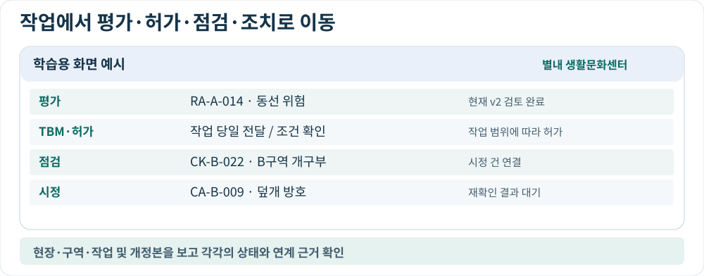

*그림 6. 작업에서 평가·허가·점검·조치로 이동 · 자체 제작. 평가 상세, 당일 TBM·허가, 점검과 조치를 현장·구역·작업으로 연결한 학습용 화면입니다.*

| 업무 | 주 사용자와 처리 시점 | 입력과 결과 |
| --- | --- | --- |
| 위험성평가 | 업체 작성, 현장 검토와 지정 승인. 평가 시기·변경에 따라 처리 | 공종·작업·위험과 의견·대책 → 평가본·대책 기한·이행 근거 |
| TBM | 작업팀이 작업 전에 내용을 공유하고 현장 담당이 확인 | 당일 작업, 최신 평가, 근로자 질의 → 회의 기록·추가 보완 |
| 작업허가 | 신청자와 검토·승인자가 작업 전에 범위를 확인 | 위치·시간·선행 조건 → 허가 상태·범위·종료·재허가 |
| 안전점검 | 점검자가 계획에 맞춰 확인하고 발견 건을 인계 | 위치·판정·사진 → 점검 건·필요 조치 |
| 시정조치 | 지정 담당자가 이행하고 다른 역할로 확인할 수 있게 설정 | 지적·담당·기한·증빙 → 재확인·종결 또는 보완 |

**기능정의서 근거** — 위험성 평가 계획·수시평가·검토, 일일안전점검, 추가위험 발굴, 부적합보고서와 안전작업 허가가 정의돼 있습니다. vPLUS 개정안에는 ‘일일안전점검 및 TBM’ 항목이 있습니다. 예시에서 위험성평가·허가·점검을 한 화면에서 링크하는 방식은 업무 연결을 학습하기 위한 것입니다. [기능정의서 확인 근거](#기능정의서-확인-근거)

## 7. 보건관리

보건관리(Occupational Health Management)는 작업환경 유해인자, 측정, 해당 건강진단과 사후조치를 다룹니다. 보건 담당은 작업·노출 기준과 일정, 결과에 따른 대책을 확인합니다. 현장 공사 담당에게는 작업환경 개선·조치 상태가 필요할 수 있지만, 개인별 건강진단 정보는 처리 근거와 접근 범위를 따로 확인합니다. [산업안전보건법 제125·129~132조](https://www.law.go.kr/LSW/lsInfoP.do?ancYnChk=0&chrClsCd=010202&efYd=20261027&lsiSeq=291447&urlMode=lsInfoP) · [개인정보 보호법 제23조](https://www.law.go.kr/법령/개인정보보호법/제23조)

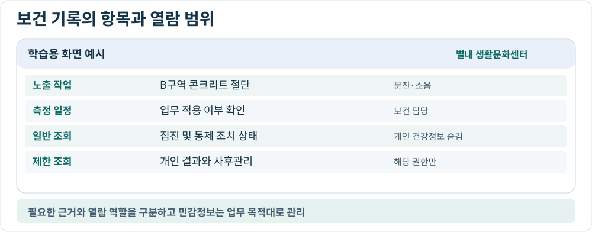

*그림 7. 보건 기록의 항목과 열람 범위 · 자체 제작. 동일한 업무의 일반 조회 정보와 업무 목적에 따른 제한 정보를 구별하는 예시입니다.*

**입력·결과** — 작업 구역·유해인자·대상 여부·일정, 조치와 후속 확인을 연결합니다. B구역 절단 작업이 수정되면 작업·노출 및 측정 관련 적용을 재검토합니다. vPLUS 안전부 정의서의 ‘작업환경측정’, ‘건강진단’, ‘보건업무현황표’가 문서 근거입니다. 가상 개인 데이터 입력은 이 장에서 생략하고 권한 범위만 나타냈습니다. [기능정의서 확인 근거](#기능정의서-확인-근거)

## 8. 교육관리

교육 담당은 작업·배치 조건을 확인해 과정, 대상, 기한을 정합니다. 실시 담당은 교육 내용·시간·참여를 남기고, 현장 검토자는 근로자별 이수 근거와 적용 작업을 확인합니다. 같은 근로자가 작업 변경으로 추가 교육 대상이 될 수 있으므로 ‘교육 완료’에 해당 과정·조건을 함께 둡니다.

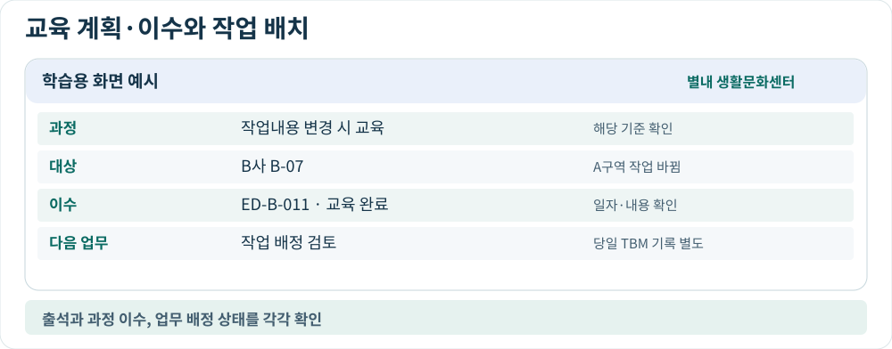

*그림 8. 교육 계획·이수와 작업 배치 · 자체 제작. 교육이 필요한 작업과 이수 증빙을 작업 배치와 연결하는 예입니다.*

**입력·결과** — 교육유형, 교육 대상·신청, 과정·실시 일시·교육자·내용, 이수와 증빙. 대상자·이수·미이수 또는 사유, 후속 교육 목록을 봅니다. 기능정의서의 ‘안전보건 교육관리’, ‘교육코드관리’ 및 모바일 ‘안전교육 사진등록’이 근거입니다. 이수 상태와 실제 투입 판단 연결은 학습 예시입니다. [기능정의서 확인 근거](#기능정의서-확인-근거)

## 9. 장비관리

장비관리(Equipment Management)는 실제 장비와 운전원, 작업계획 및 사용 상태를 연결합니다. 반입 검토자는 등록·검사·자격 등의 해당 요건을 보고, 작업 담당은 현장 배치와 일일 점검·결함을 확인합니다.

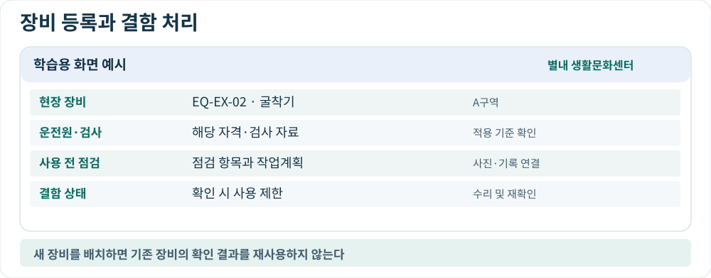

*그림 9. 장비 등록과 결함 처리 · 자체 제작. 대장에 있는 장비가 실제 작업 구역에 배치됐는지 확인합니다.*

**입력·결과** — 장비 모델과 식별, 장비 소유·사용 업체, 검사 근거와 기간, 실제 운전원, 반입·점검·조치 및 반출. 장비 대장, 결함 및 사용 가능 확인, 교체 이력을 남깁니다. 기능정의서의 ‘건설기계관리대장’은 장비 대장 기능의 근거입니다. 현장별 만료 경고나 자동 통제 동작은 운영 요건을 개별 확인합니다. [기능정의서 확인 근거](#기능정의서-확인-근거)

## 10. 산업안전보건관리비 관리

비용 모듈은 현장별 계상과 실제 사용, 업체별 실적·원증빙 및 정산을 연결합니다. 현장 담당은 지출 목적과 인정 근거·명세를 확인하고, 지정 검토·승인자는 월·업체·항목별로 중복이나 누락을 점검합니다. 본사는 현장별 집계와 상세 증빙을 대조합니다.

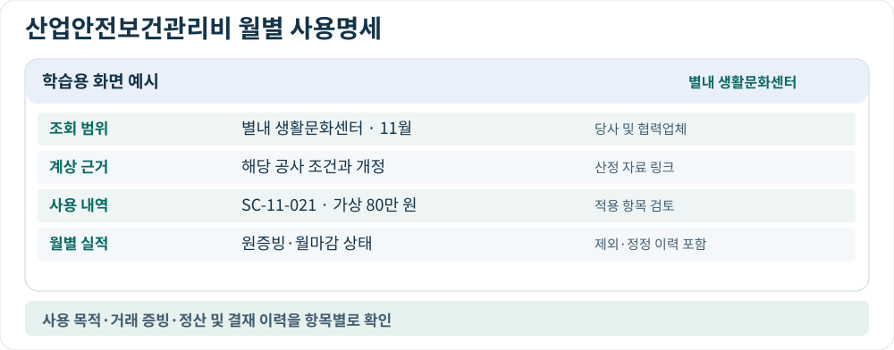

*그림 10. 산업안전보건관리비 월별 사용명세 · 자체 제작. 지출 한 건에서 계상·사용·월 보고 및 원증빙까지 찾아가는 학습 화면입니다.*

**기능정의서 근거** — 2026-01-12 정의서의 ‘산업안전보건관리비’, ‘월별실적관리’, ‘당사 월별 실적 입력’, ‘협력업체 월별 실적 조회’, ‘정산결과 분석’을 확인했습니다. 전환 검토 문서에도 월별실적관리 결재와 해당 보고 문서 범위가 기록돼 있으나 검토 상태가 반려였으므로 운영 결과를 보증하는 근거로 사용하지 않았습니다. 가상 금액과 조회 필터의 표현은 업무 학습 예시입니다. [기능정의서 확인 근거](#기능정의서-확인-근거)

## 11. 재해 및 아차사고 관리

현장 담당은 확인된 사건과 초기 대응을 등록합니다. 조사·검토 담당은 원인·피해와 법령별 적용, 내부·대외 보고 및 조치를 확인합니다. 재발방지 담당과 이행 확인자는 개선 후 평가와 작업계획의 반영 여부를 확인합니다.

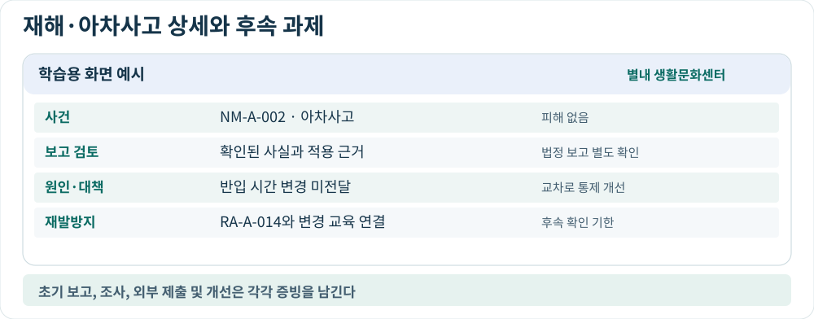

*그림 11. 재해·아차사고 상세와 후속 과제 · 자체 제작. 가상 아차사고에서 최초 사실, 원인 분석과 시정·재평가를 조회합니다.*

**입력·결과** — 사건 발생 시간·위치·작업·분류, 피해, 관련 보고와 접수, 조사·조치 담당과 기한. 결과는 최초 기록, 조사 결과·제출 여부, 개선 이력입니다. 정의서의 ‘산업재해관리(현장)’, ‘산업재해관리(본사)’, ‘재발방지대책 이행 관리’를 확인했습니다. ‘아차사고 접수 상세’ 화면은 회사 양식의 내용을 참고한 학습 예시입니다. [기능정의서 확인 근거](#기능정의서-확인-근거)

## 12. 중대재해 예방과 의무이행

경영책임자등의 이행을 확인하려면 해당 사업·현장, 적용 의무, 책임과 점검 주기, 실제 수행 근거가 필요합니다. 본사 담당은 점검 목록을 정하고 현장은 해당 자료를 제출·보완합니다. 미흡 건은 예산·인력·기한 등 보완과 재확인을 이어서 관리합니다. [중대재해처벌법과 시행령의 확인 범위](./03_건설안전_관련_법령.md#법령과-공식-자료)

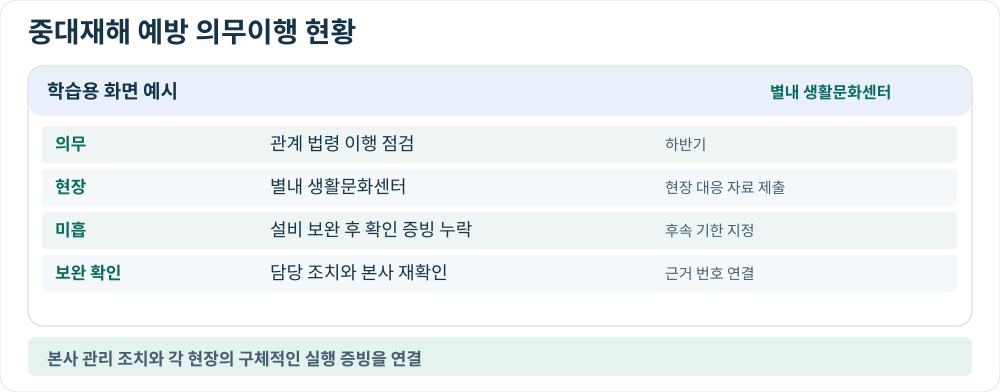

*그림 12. 중대재해 예방 의무이행 현황 · 자체 제작. 본사 이행 확인과 현장의 증빙, 미흡 구분을 연결한 학습용 화면입니다.*

**입력·결과** — 적용 근거·주기·책임, 현장 이행자료, 미흡 사유와 개선 일정. 결과는 현장별 의무이행 현황, 추가 지원과 재확인 자료입니다. vPLUS 정의서에는 ‘공사안전보건대장’, ‘비상대피훈련’, ‘본사점검’과 ‘본사점검 조치결과 등록’ 등이 있습니다. 의무별 통합 화면은 학습 예시입니다. [기능정의서 확인 근거](#기능정의서-확인-근거)

## 13. 전자결재

전자결재(Electronic Approval)는 담당자가 제출한 문서와 지정된 검토·승인 역할을 연결합니다. 작성자는 상신 범위와 첨부를 정하고, 검토자는 사실과 누락을 확인합니다. 승인자는 승인·반려와 필요한 조건을 남깁니다. 반려 후 재상신할 때는 보완 전후 내용과 문서 이력을 확인합니다.

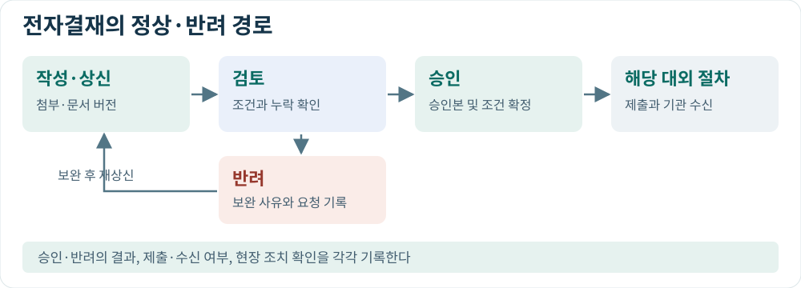

*그림 13. 전자결재의 정상·반려 경로 · 자체 제작. 결재 상태와 현장의 안전조치, 대외 제출의 결과를 같은 상태값으로 처리하지 않는 예입니다.*

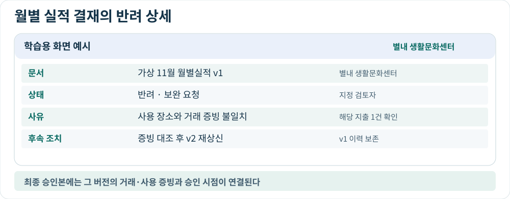

*보충 그림. 반려 상세 · 자체 제작. 검토 의견과 보완 요청, 해당 문서 버전을 연결합니다.*

**입력·결과** — 작성자·검토자·승인자, 승인 범위와 문서 버전, 근거 자료. 결과는 결재 이력, 승인·반려 사유와 승인본입니다. ‘전자결재 현황’과 개별 업무의 결재 표시는 기능정의서에 있습니다. 결재선과 대행·권한, 반려 사유 입력 방식은 해당 운영 기준을 확인합니다. [기능정의서 확인 근거](#기능정의서-확인-근거)

## 14. 통계 및 대시보드

대시보드(Dashboard)는 같은 기준으로 여러 기록을 조회하여 후속 확인이 필요한 업무를 드러냅니다. 본사·현장 관리자는 기준일, 조회 구간·업체, 포함할 상태, 미종결 정의를 먼저 확인합니다. 예시 지표는 신규 지적 8건 중 월말까지 재확인 완료 6건, 미종결 2건입니다. 실제 집계는 이전 달 이월과 취소·재개 여부를 어떤 기준으로 처리했는지 화면 또는 설명에서 확인합니다.

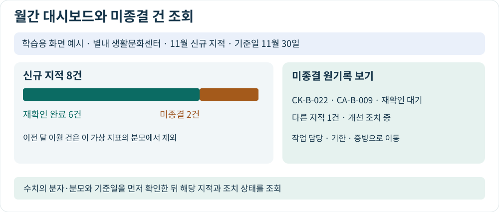

*그림 14. 월간 대시보드와 미종결 건 조회 · 자체 제작. 가상 집계 수치에서 미종결 두 건의 담당과 기한을 조회하도록 구성한 예입니다.*

**입력·결과** — 기간·현장·업체·공종·상태·기준일과 합계 기준. 결과는 건수·추이와 원기록 목록입니다. 정의서의 ‘현장별 위험평가 현황’, ‘정산결과 분석’과 협력업체 ‘HOME(대쉬보드)’를 확인했습니다. 점검·조치 통합 집계 지표는 교재의 예시입니다. [기능정의서 확인 근거](#기능정의서-확인-근거)

## 15. 모듈 연결과 사용자 권한

모듈 간 연결은 업무에서 같은 대상을 찾는 데 쓰입니다. 공사계약에 연결된 업체가 작업을 제출하고, 작업에 배치된 인원·장비의 교육·자격을 확인합니다. 작업·구역·일자를 기준으로 평가·허가·TBM·점검·시정조치를 찾습니다. 기록의 날짜와 적용 버전을 남기면 변경 전후에 어떤 근거로 작업했는지 구분할 수 있습니다.

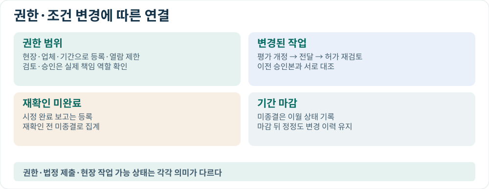

*그림 15. 권한·조건 변경에 따른 연결 · 자체 제작. 권한 범위와 평가 개정, 재확인·월마감의 처리 결과를 함께 살펴봅니다.*

| 역할 예시 | 입력·보완 | 검토·승인 | 조회 범위 |
| --- | --- | --- | --- |
| 협력업체 작업책임자 | 자기 업체 배치 범위의 평가·허가 신청·조치·사용 실적 | 제출 전 자체 검토와 요청받은 보완 | 해당 계약·현장·기간의 자기 업체 기록 |
| 시공 현장 담당 | 작업·점검·회의 및 초기 보고 기록 | 해당 현장의 계획·증빙 검토 | 맡은 현장과 업무 범위 |
| 지정 승인·확인자 | 승인·반려·재확인 결과와 사유 | 권한 위임·대행 적용 범위 내 판단 | 담당 단계의 필요한 정보 |
| 보건 담당 | 적용 검토·보건 업무의 제한 기록 | 결과 후속조치와 접근 근거 확인 | 업무상 필요한 범위 |
| 본사 관리·검토자 | 현장 의무 목록·지원·기준 개정 | 증빙 및 이행 상태 확인 | 담당 현장 묶음·지표·근거 |
| 외부 제출 담당 | 최종 승인 자료의 제출·수신 기록 | 기한과 대외 경로 확인 | 제출용으로 승인된 자료 |

위 표는 교육용 권한 모델입니다. 실제 처리 권한은 업무분장·사용자 역할·현장·업체·기간·정보 민감도를 함께 확인합니다. 예를 들어 승인된 평가 뒤에 작업 조건이 바뀌면 이전 승인본은 그 당시의 근거로 남고, 새 조건은 재평가·작업 전 공유·필요한 재허가 대상으로 연결됩니다.

| 상태가 달라지는 예 | 연결할 업무 | 기준 확인 |
| --- | --- | --- |
| 장비 도착 시간이 변경됨 | 작업계획, 해당 평가, 교차지점 통제와 TBM | 이전 평가 개정본의 범위, 새 조건 전달 |
| 조치 담당이 완료 사진을 올림 | 점검 지적과 시정 상태 | 지정 확인자의 판정 전에는 재확인 대기로 표시 |
| 교육 자료가 누락됨 | 근로자 배정과 과정 확인 | 필요한 과정·이수 근거와 업무 재확인 |
| 월 마감을 넘김 | 미종결 목록과 시정·비용 이월 | 마감 당시 상태와 이후 정정 내역 |
| 승인된 문서를 제출함 | 대외 보고와 업무 기록 | 접수·보완과 수신 결과 별도 확인 |

## 16. 현장–ERP 통합 실습

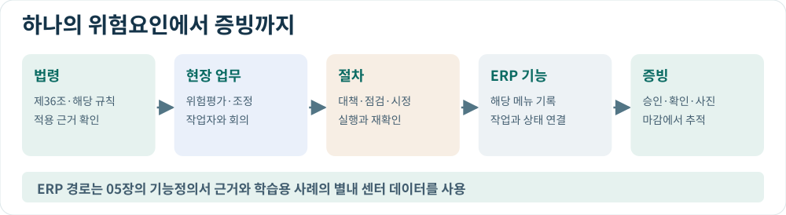

*그림 16. 하나의 위험요인에서 증빙까지 · 자체 제작. 업무와 기록을 연결해 실제 수행이 확인된 시점까지 찾아갑니다.*

### 같은 날의 평가와 지적을 추적하기

별내 센터의 작업계획을 열어 A구역 굴착 장비와 B구역 인력의 공용 진입로 사용을 확인합니다. A구역의 평가 RA-A-014에서 작업 전 공유로 이동하고, B구역의 개구부 점검 CK-B-022는 별도의 위험 건으로 다룹니다. 구역 간 연결점은 같은 날의 공용 동선과 업무 계획입니다.

| 근거 또는 업무 | 절차와 역할 | ERP 입력·조회 예 | 결과와 증빙 |
| --- | --- | --- | --- |
| 산업안전보건법 제36조 및 평가 고시 | 회사와 해당 근로자가 동선 변경을 검토하고 담당자가 대책을 확인 | 위험성평가 RA-A-014 개정, 작업조 의견·이행 담당 | 평가본, 조치·재확인, 적용 시점 |
| 결과 공유·현장 작업 전 준비 | 작업책임자가 최신 평가를 당일 TBM에서 공유. 지정 허가 대상이면 조건 확인 | TBM 기록과 작업·허가의 범위 확인 | 공지·참여·조건, 허가 기간과 필요 시 재검토 |
| 안전보건규칙 제43조 개구부 방호 | 점검자가 위치·방호 상태를 확인하고 미흡을 통제 | B구역 점검 CK-B-022, 조치 CA-B-009 연결 | 지적, 담당·기한, 조치 자료와 확인 결과 |
| 회사 주간·월간 관리 | 현장과 본사가 미종결 목록과 변경 사항을 확인 | 기준일·현장 필터에서 결과 건과 원기록 조회 | 집계 근거, 이월·재확인과 지원 |

**대외 제출 대응 예** — 같은 현장에서 법정 계획서나 사고 신고를 제출할 때는 회사 ERP에서 작성·결재한 승인본, 제출자·제출 시각, 기관 접수·보완·수신 기록을 연결합니다. 건설공사 안전관리 종합정보망(CSI)은 관련 제출 경로가 되는 외부 서비스의 예입니다. [CSI 안전관리계획서 근거](https://www.csi.go.kr/por/about_smp_002.do)

## 핵심 요약

- 현장·구역·업체·작업·시점이 모듈 간 증빙을 연결합니다.
- 현장 이행, 전자결재, 대외 제출과 재확인은 각각 어떤 사실을 입증하는지 확인합니다.
- 기능정의서에서 확인한 범위와 학습용 화면의 상태·입력을 구별해서 해석합니다.

## 학습 확인 문제

1. 협력업체 작업책임자가 여러 현장의 모든 업체 기록을 조회해야 한다는 요청을 받았습니다. 어떤 업무 정보로 범위를 결정합니까?
2. 승인된 평가의 작업 조건이 바뀌면 어떤 기록과 준비 업무가 영향을 받습니까?
3. 11월 말 미종결 두 건의 통계는 어느 원기록에서 어떻게 확인합니까?
4. 외부 제출 대상 문서가 ERP에서 승인됐습니다. 무엇으로 제출과 보완 종료를 확인합니까?
5. 보건관리 상세 결과와 현장 공사 담당에게 필요한 보건조치 상태는 왜 구별합니까?
6. vPLUS 기능정의서에 있는 항목을 근거로 현재 운영 중이라고 설명할 수 있습니까?

## 정답 및 해설

1. 해당 업체와 현장, 계약·활동 기간, 맡은 업무와 목적을 확인합니다. 입력·검토·승인·조회 권한도 각각 확인합니다.
2. 기존 평가의 승인본과 적용 기간을 확인한 뒤 변경된 조건을 재평가합니다. 영향을 받는 작업계획, TBM·교육, 해당 허가와 후속 점검을 연결합니다.
3. 집계 기준일·현장·필터, 미종결 정의와 취소·이월 조건을 확인합니다. 원기록의 지적·시정·재확인을 찾아 담당과 기한 및 상태를 대조합니다.
4. 외부 제출 기록, 기관의 접수·수신과 보완 처리 결과를 확인합니다. 적용 경로와 제출한 승인본을 함께 찾습니다.
5. 공사 담당에게는 작업환경 개선과 이행 상태가 필요합니다. 개인의 건강자료는 법적 근거와 목적, 필요한 상세 범위 및 접근 역할을 확인해야 합니다.
6. 정의서는 요구·설계 범위를 알려 줍니다. 운영 중인 기능을 확인하려면 적용 버전의 공식 메뉴와 권한, 해당 화면과 상태에서 조회·처리를 확인해야 합니다.

## 기능정의서 확인 근거

로컬 `ref/현업자료/`의 원본과 팀 검토 문서를 2026-11-27 확인했습니다. 아래는 실제 기능정의서에서 직접 확인한 메뉴 후보와 조사 범위입니다. 시트와 행 번호는 원본을 다시 대조할 때 사용합니다.

| 확인 자료 | 시트 / 행 | 근거로 사용한 내용 |
| --- | --- | --- |
| `중흥건설_ERP시스템 기능정의서(2차)_20260112_v1.0_안전환경.xlsx` | 안전, 6~16행 | 현장기준정보, 협력업체, 전자결재 현황, 목표·실적 및 위험성 평가 계획·검토·현황 |
| 같은 정의서 | 안전, 17~30행 | 평가 회의, 일일안전 점검, 추가위험, 부적합, 교육, 노사합동점검, 작업허가, 재해, 건설기계관리대장 |
| 같은 정의서 | 안전, 31~51행 | 산업안전보건관리비, 월별실적·정산, 본사점검과 조치, 작업공종·위험요인·교육·점검 기준 |
| 같은 정의서 | 안전, 53~79행 | 협력업체 업무의 작성·제출 및 시공사용·협력업체용 모바일 범위. B2B는 Business-to-Business로 여기서는 업체 업무 영역을 뜻함 |
| `vPLUS 안전관리(기능정의서)_안전부.xlsx` | 안전관리 업무 구현 범위 엑셀 변환, 3~10·25~35·43~46행 | 현장기초정보 삭제 요청 표시, 주간보고, 비상대피훈련·공사안전보건대장·보건·재발방지대책·장비·본사점검의 정의 범위 |
| `vPLUS 안전관리(기능정의서).xlsx` | 안전관리 업무 구현 범위 엑셀 변환, 11·18·26~42·59~71행 | 작업계획서, 일일안전점검 및 TBM, 작업중지 관련 항목, 건강진단, 재해예방활동, 기준정보와 협력업체용 기능 |
| 팀 검토 문서 `hmplus/products-erp` | `docs/full-conversion/plan/module-prep/QS/qs-verify/review-89444-safeCostRegAprv-ef95227c99-20261103.md` · `docs/full-conversion/plan/module-prep/QS/qs-verify/review-89748-safeCostRpt1-617d002540-20261103.md` | 월별실적관리 결재 및 사진대지 보고서의 검토 범위와 당시 상태. 운영 배포 상태와 사용자 권한은 확인 범위에 포함되지 않음 |

정의서 사이에서 이름이나 계층이 달라지는 항목이 있습니다. 사례 문서명을 함께 보아야 같은 업무 의도인지, 영역·사용자가 다른 메뉴인지 판단할 수 있습니다. 운영 화면을 확인할 수 있는 환경에서는 시스템·버전·메뉴 이름·역할·현장 범위, 확인 날짜와 동작을 기록합니다.

## 참고자료

- 평가, 점검, 법적 이행 및 안전관리비의 근거는 [03장 법령과 공식 자료](./03_건설안전_관련_법령.md#법령과-공식-자료)에 있습니다.
- 현장 업무, 양식과 증빙의 예는 [04장 안전관리 업무 프로세스](./04_안전관리_업무_프로세스.md)에 있습니다.
- 05장 예시 화면과 흐름도는 자체 제작이며 별내 센터의 회사·근로자·장비·상태·금액은 가상의 값입니다.
